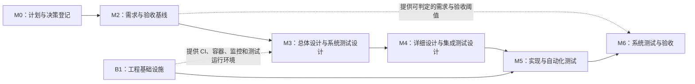

# 全局开发计划

| 字段     | 值                                                   |
| -------- | ---------------------------------------------------- |
| 文档编号 | `MLS-DOC-GOV-0006`                                   |
| 文档状态 | `Draft`                                              |
| 文档版本 | `v0.9`                                               |
| 编制日期 | `2026-09-05`                                         |
| 最近更新 | `2026-09-12`                                         |
| 适用阶段 | 全生命周期；当前处于 M3/M4 受影响复审前              |
| 验证对应 | 里程碑出口核对与门禁评审（M0–M6）                    |
| 权威性质 | 规范性；全局开发计划、里程碑出口与滚动状态的唯一来源 |

> 引用文档：
>
> - [后续实证审计与人工清单](../../HANDOFF-AUDIT-20260912.md)
> - 治理与决策：[MLS-DOC-GOV-0005](MLS-DOC-GOV-0005.md)
> - 需求工件：[MLS-DOC-RA-0003](../01-requirements/requirements/MLS-DOC-RA-0003.md)、[MLS-DOC-RA-0011](../01-requirements/requirements/MLS-DOC-RA-0011.md)、[MLS-DOC-RA-0013](../01-requirements/requirements/MLS-DOC-RA-0013.md)、[MLS-DOC-RA-0014](../01-requirements/requirements/MLS-DOC-RA-0014.md)、[MLS-DOC-RA-0015](../01-requirements/requirements/MLS-DOC-RA-0015.md)
> - 验收工件：[MLS-DOC-AT-0001](../01-requirements/acceptance/MLS-DOC-AT-0001.md)、[MLS-DOC-AT-0002](../01-requirements/acceptance/MLS-DOC-AT-0002.md)、[MLS-DOC-AT-0003](../01-requirements/acceptance/MLS-DOC-AT-0003.md)
> - 评审与证据：[MLS-DOC-REV-0001](../01-requirements/reviews/MLS-DOC-REV-0001.md)、[MLS-DOC-REV-0002](../01-requirements/reviews/MLS-DOC-REV-0002.md)、[MLS-DOC-EVD-0002](../01-requirements/evidence/MLS-DOC-EVD-0002.md)

## 1. 引言

> 要点：
>
> - 该计划围绕以下三个方面展开：目标解决问题、系统解决方案、候选版本发布依据。
> - 该计划的阅读群体为评审人和开发者，LLM Agent可参考执行的结构化约定。
> - 全文遵循单一主线：先确认需求，再决定设计，再实现与测试，最后按冻结口径验收。

### 1.1 关于文档

这是 MyLibrarySystem 的**全局开发计划**，描述全量重写的范围、顺序、阶段出口和验收判据。重点关注“做什么、如何做、如何验收”，不包含具体的类、SQL 或页面实现细节，那些内容落在 M3–M5 的设计与代码阶段。本文由仓库根目录未跟踪草案 `PLAN-DRAFT.md` r5（2026-08-30，经 r3/r4/r5 三轮评审修订）按 M0 正式化入库；里程碑出口对后续阶段具有约束力，修改本文须走变更控制并留下变更记录。需求基线批准（M2/G5）前不得开始业务功能实现。

### 1.2 读者与阅读路径

计划同时服务两类人，各自按需阅读，不必通读全文：

- **评审人**（负责批准范围与验收结果）：读 §1、§3、§5、§11 即可掌握要批准什么、何时签署。
- **开发者**（负责设计、实现和测试）：还需读 §4、§6、§7、§8、§9，了解技术边界、阶段出口与测试约定。
- **LLM Agent**（用于自动执行计划、生成阶段产物或核对出口）：依赖 §1.3 的编号与引用约定、§5 的出口定义、§13.1 的编号索引，这些部分刻意写成了可机械核对的形式。

### 1.3 使用约定

为避免歧义与冲突，全文遵守以下约定：

- **编号工件首现定义**：GOV、DEC、EVD、REV、AT、RA、BR、FR、OD、DD 等编号类别在 §2 统一解释，正文首次出现时用一句话回指，此后只写编号。
- **出口只定义一次**：每个里程碑的出口在 §5 定义；§6 与 §10 只引用，不重述，防止两处表述出现差异。
- **交叉引用写章节号**：不使用“如上所述”“前述”“它”等代词式指代，一律写 `§x.y`。
- **状态词固定含义**：“冻结”表示此后修改需走变更流程；“签署”表示由指定角色正式确认；“退役”表示仍可查阅但不再作为验收证据。

### 1.4 主流程与依赖图

整份计划沿一条主线展开：**先确认要解决问题的需求基线，再决定系统解决的设计方案，然后编写实现和自动化测试，最后用冻结的验收口径判断候选版本能否发布。**

实线表示必须完成的前置任务，虚线表示一个阶段向另一个阶段提供支撑条件。其中最关键的是：M2 不仅约束 M3/M4 的设计范围，还提前规定 M6 用什么标准判定“通过”，因此 M6 不能临时发明验收口径。B1 是一条并行支线，它提前准备构建、运行和观测系统所需的工程设施，但不允许借此提前实现尚未批准的业务功能——这样既缩短后续等待时间，也不会让技术实现反过来绑架需求决策。

## 2. 术语速查

下表集中解释正文反复出现的编号类别与术语；正文首次出现时只回指本节，不再重复展开。

| 术语                                     | 含义                                                                                          | 价值                                                                         |
| ---------------------------------------- | --------------------------------------------------------------------------------------------- | ---------------------------------------------------------------------------- |
| 需求基线                                 | 经评审并签署的一组需求、规则和验收标准；建立后修改需走变更流程                                | 防止开发期间目标不断移动，导致设计、代码和测试互相不一致                     |
| 治理入库                                 | 把决策登记到正式文档并建立编号、版本、评审和追溯关系                                          | 让后续人员能回答“谁在何时基于什么理由批准了这件事”                           |
| G3/G4/G5                                 | 需求治理流程中的复审与最终批准门禁，沿用现有治理文档定义                                      | 它们是是否允许进入设计阶段的正式控制点，而非普通会议名称                     |
| FR / BR / RA                             | 功能需求 / 业务规则 / 需求分析与质量属性记录                                                  | 分别说明“系统提供什么能力”“业务如何判定”“系统需达到什么质量”                 |
| AT / ADR                                 | 验收测试 / 架构决策记录                                                                       | 分别回答“如何验收”和“为何采用这种技术方案”                                   |
| GOV / DEC / EVD / REV                    | 治理、决策、证据、评审工件的编号类别                                                          | 用于追踪计划条目最终落入哪份正式文档，定义以文档登记表为准                   |
| OD / DD                                  | 总体设计评审 / 详细设计评审                                                                   | OD 确认系统结构合理，DD 确认细节已具体到可实现、可测试                       |
| CI                                       | 持续集成，每次提交自动执行构建、静态检查和测试                                                | 尽早发现破坏性改动，避免问题堆积到 M6 才暴露                                 |
| Docker Compose                           | 用一份配置启动数据库、前后端和监控组件                                                        | 让不同人员和 CI 使用尽量一致的运行环境                                       |
| Flyway                                   | 按版本执行数据库结构迁移的工具                                                                | 保证新环境和升级环境得到一致、可追踪的数据库结构                             |
| DDL                                      | 创建或修改表、索引、约束等数据库结构的语句                                                    | M4 的 DDL 是 Flyway 正式迁移和数据库集成测试的直接输入                       |
| NFR                                      | 非功能需求，例如性能、可靠性、安全性和可观测性                                                | 功能“能用”不等于系统在真实负载下“可接受”                                     |
| SLI                                      | 服务水平指标，例如请求延迟、错误率和恢复时间的明确测量方法                                    | 没有统一测量方法，p95、可用性等数字就无法比较或签署                          |
| p95 / p99                                | 95% / 99% 请求不超过的延迟值，不是平均值                                                      | 用于发现平均值掩盖的慢请求，但必须同时说明环境、负载和统计窗口               |
| 可观测性                                 | 通过指标、日志和调用链追踪理解系统内部状态的能力                                              | 测试失败或线上异常时，帮助定位是应用、数据库还是依赖组件导致                 |
| Micrometer / Prometheus / Grafana / OTel | 应用指标接入 / 指标采集 / 展示告警 / 调用链追踪                                               | 四者组合后才能从现象进入定位；单独安装任一组件都不等于完成可观测性           |
| k6 / soak                                | k6 是负载测试工具；soak 是持续较长时间的稳定性测试                                            | 前者生成可重复请求，后者发现短测试看不到的泄漏和持续退化                     |
| REST / API                               | 前后端通过 HTTP 交换请求和响应的接口约定                                                      | 统一字段、枚举和错误码可减少前后端各自解释造成的不一致                       |
| RBAC / JWT / CORS                        | 基于角色的权限控制 / 登录身份令牌 / 浏览器跨域访问策略                                        | 三者共同决定“谁以什么身份从哪个来源访问哪些能力”                             |
| Tool Calling（工具调用）                 | AI 以结构化参数调用系统登记工具，获取业务事实或生成操作预填内容                               | 它是 AI 验收的主要判定对象；自然语言回复仅作参考，使概率性输出获得可判定载体 |
| 幂等                                     | 同一个业务请求重复执行，最终效果与执行一次相同                                                | 网络重试、重复点击和重复消息都可能发生，缺少幂等会造成重复借阅、扣款或审计   |
| 乐观锁 / CAS                             | 更新时检查数据版本或旧状态是否仍符合预期，不符合则拒绝或重试                                  | 防止两个并发操作基于同一旧状态同时成功                                       |
| `FOR UPDATE`                             | 在事务中锁住将要修改的数据库记录，其他事务需等待                                              | 适合需要严格顺序的预约分配，但必须规定统一锁序以降低死锁风险                 |
| `SKIP LOCKED`                            | 批量任务跳过正被其他事务锁定的记录，继续处理后续记录                                          | 适合相互独立的到期任务；用于预约队列会跳过队首                               |
| Outbox                                   | 在业务事务中同时写入一条待发布事件，再由分发器异步投递                                        | 避免业务数据已提交但审计或通知事件丢失的“双写不一致”                         |
| 至少一次投递                             | 一条已提交事件可能重复送达，但不能无声丢失                                                    | 消费者必须按事件 ID 去重，不能假设消息只出现一次                             |
| Inbox / Delivery / 死信                  | 消费者已处理事件 / 各消费者投递状态 / 超过重试上限的失败事件                                  | 用于多消费者去重、局部成功追踪和失败事件的人工处置                           |
| Testcontainers                           | 测试时启动真实 PostgreSQL 容器的工具                                                          | H2 等替代数据库无法准确复现 PostgreSQL 的锁、索引和全文检索行为              |
| pg_trgm                                  | PostgreSQL 内置扩展，将文本切为三元字符组（trigram）并建立 GIN 索引，加速片段匹配与相似度排序 | 中文没有天然空格分词，普通按词切分或简单`LIKE` 难以兼顾相关性和规模          |
| Caffeine                                 | 运行在单个后端进程内的高速内存缓存                                                            | 能降低热点检索延迟，但多实例失效与旧数据返回必须另行设计和测试               |
| E2E                                      | 端到端测试，从浏览器页面经后端到数据库验证完整用户流程                                        | 单元测试和 API 测试无法发现页面、接口与权限配置之间的连接问题                |
| UT / IT / ST / CON / OBX / SEC           | 单元、集成、系统、并发、Outbox 和安全测试用例前缀                                             | 帮助读者快速识别测试层级与关注风险，不代表优先级                             |
| JaCoCo / Vitest / Playwright             | Java 覆盖率 / 前端单元测试 / 浏览器 E2E 测试                                                  | 三者覆盖的层级不同，不能用某一个工具的绿灯替代其余验证                       |
| JVM / GC                                 | JVM 是 Java 运行环境；GC 是自动回收不再使用内存的机制                                         | 性能测试需观察 JVM 内存和 GC 暂停，避免接口暂时达标但资源已接近失控          |
| Trace ID                                 | 一次请求或异步处理链路的关联标识                                                              | 可用它在指标、日志和调用链中定位同一次业务活动                               |
| 不可变候选镜像                           | 一旦进入验收便不再修改、由摘要唯一标识的容器镜像                                              | 保证最终签署的版本就是测试过的版本                                           |
| P0/P1 与 Sev-1/2                         | 前者是测试场景的业务优先级，后者是实际缺陷的严重程度                                          | 一个描述“必须先测什么”，另一个描述“发现的问题有多严重”                       |

## 3. 总体策略

> 要点：
>
> - 五项策略共同回答“做什么、达到什么质量、在哪里验证、以何种方式交付、如何保证可追溯”。
> - 治理优先确定“做什么”，技术增强入库补齐“还必须满足哪些质量目标”，基建前置提供“在哪里持续验证”，全量重写决定“以何种实施方式交付”，计划正式化保证这些决定都有可追溯的授权。

| 策略             | 实际做法                                                                        | 安排理由                                                                    | 绕过后果                                                                 | 与其他任务的关系                                               |
| ---------------- | ------------------------------------------------------------------------------- | --------------------------------------------------------------------------- | ------------------------------------------------------------------------ | -------------------------------------------------------------- |
| 治理优先         | 软件设计与业务实现排在需求基线 v1.0 之后，先完成 G3/G4 复审和 G5 签署           | 全量重写成本较高，必须先确认需求、业务规则和验收标准稳定                    | 开发可能基于尚未批准的规则返工，测试也会缺少可信判据                     | M2 是 M3–M6 的共同前置，既给设计输入，也给最终验收提供标准     |
| 基建前置         | B1 与 M2 并行建设 CI、容器、配置和观测设施，只用现有代码验证管道                | 这些设施不依赖最终业务规则，却会被所有后续开发和测试使用                    | 若等到 M5 才建设，开发完成后仍需等待环境，且环境问题会与业务缺陷混在一起 | B1 不解禁业务开发，只为 M3–M6 提供可重复的构建、运行和取证环境 |
| 全量重写         | 前后端业务层按新基线重新实现；旧实现只作为行为线索，不作为正确性的最终依据      | 旧实现与新基线可能存在结构性冲突，局部修补容易保留隐含旧规则                | 新旧逻辑长期混杂，难以证明哪些行为来自新基线，测试也可能错误复制旧缺陷   | 决策登记为 MLS-DEC-0007；M3/M4 重新设计，M5 执行实现           |
| 计划正式化       | 本文件即治理入库后的全局开发计划 `MLS-DOC-GOV-0006`，后续修订一律走文档变更控制 | 草案只能充当讨论载体，不能长期充当正式授权依据                              | 任务范围、状态和签署记录可能散落在聊天或临时文件中                       | M0 已完成正式化，随后所有阶段按本计划追踪                      |
| T1–T5 随基线入库 | 在 M2 同时冻结五项增强的外部需求和验收口径，设计细节留给 M3/M4                  | 五项增强会影响数据模型、接口、测试环境和验收成本，必须尽早确定是否属于 v1.0 | 若实现中途才加入，将触发跨模块返工和正式变更门禁                         | M2 冻结“需要达到什么”，M3/M4 决定“如何做到”，M5/M6 实现并验证  |

## 4. T1–T5 技术增强及其边界

> 要点：
>
> - 五项增强是一组共同影响数据库、接口、测试和验收的质量目标。
> - 它们必须在 M2 一次性确认范围，在 M3/M4 协同设计，防止中途加入引发返工。
> - 验收口径与实现机制分离：外部行为进验收，锁、缓存和模型服务形态的选型留作设计阶段决策。

T1 保护并发写入时的业务正确性；T3 保护业务提交后事件和审计不丢失；T2 为 T1/T3 的冲突、重试、积压和性能提供可见证据；T4 引入新的检索能力，同时带来索引、缓存与数据新鲜度风险；T5 以对话式 AI 助手接入模型服务端点，带来权限过滤、受确认执行和概率性输出验收口径的新风险。

| 增强                 | 内容                                                                                                             | M2 治理入库方式                                                                                                                                                 | 落点        |
| -------------------- | ---------------------------------------------------------------------------------------------------------------- | --------------------------------------------------------------------------------------------------------------------------------------------------------------- | ----------- |
| T1 并发硬化          | 预约/保留队列冲突处理：约束兜底、乐观锁、CAS 状态迁移、幂等键、到期批处理                                        | 正确性不变量增补 RA-0011 / RA-0013(NFR-REL)；并发验收用例进 AT-0002；技术策略登记 MLS-DEC-0008                                                                  | M3/M5/M6    |
| T2 可观测性+NFR实证  | Micrometer/Prometheus/Grafana/OTel 进 compose；k6 压测                                                           | AT-0001/AT-0002 修订：性能与可用性以测量协议证据为准（§9）                                                                                                      | B1/M6       |
| T3 Outbox 事件驱动   | 领域事件 + 事务性 Outbox + 本地分发器；审计日志为首个消费者                                                      | 事务原子性/重复投递/崩溃恢复/乱序/毒消息/人工重放纳入 AT-0002 与 M6 出口；架构决策 MLS-DEC-0009                                                                 | M3/M5/M6    |
| T4 中文全文检索+缓存 | PostgreSQL pg_trgm 检索索引、相关性排序、输入联想、Caffeine 热点缓存                                             | 检索语义与陈旧上界冻结进 RA-0013/AT-0002；检索延迟并入 p95 口径                                                                                                 | M3/M4/M5/M6 |
| T5 AI 助手           | 以当前用户身份与权限运行的对话式 AI 助手：业务问答、经确认的模态预填辅助操作、角色权限过滤、会话与操作双日志留存 | 角色配置矩阵、工具集边界、日志留存与 Tool Calling 验收口径冻结进 RA/AT（`MLS-OQ-0016`~`0020` 关闭）；端点形态（本地部署或云端 API）属 M3 设计决策并登记决策编号 | M2/M3/M5/M6 |

### 4.1 T1：并发硬化

预约、借阅和到期处理都会修改数量有限的副本。即使每个请求单独执行时完全正确，两个请求同时读到“还有一个可用副本”后也可能都成功，造成超发、重复保留或队列跳号。这类错误通常难以人工复现，一旦发生会污染核心业务数据。

T1 因此采用多层防护：应用层用乐观锁、CAS 和统一锁序协调并发，数据库唯一约束作为最后防线，幂等键吸收客户端或网络造成的重复请求。各机制职责不同，不能简单理解为“锁越多越安全”——锁和重试设计不当会导致死锁、长时间等待或重复副作用。所以 M3 必须先定义不变量和事务边界，M5 再用真实 PostgreSQL 的确定性交错测试验证。不实施 T1 时，低负载演示可能正常，但两名用户同时操作或后台任务与用户请求重叠时，系统就无法证明“不超发、不跳号”。

### 4.2 T2：可观测性与 NFR 实证

Micrometer 负责从应用暴露指标，Prometheus 按时间采集，Grafana 展示和告警，OpenTelemetry（OTel）串联一次请求经过的服务、数据库和异步事件，k6 产生可重复负载。这些工具分工不同：仪表盘展示现象，压测制造条件，Trace 和日志帮助定位原因。

引入它们的目的不是“拥有一个漂亮看板”，而是回答可验收的问题：在约定数据量和请求速率下，哪些接口满足 p95/p99；冲突和重试是否异常增加；Outbox 是否积压；系统达到峰值后能否恢复。只有压测结果而没有资源和调用链证据，失败时无法判断瓶颈；只有监控而没有固定负载，性能数字又无法重复比较。

### 4.3 T3：事务性 Outbox

借阅、归还和支付等操作完成后，还需要产生审计事件。若业务表更新和“发送事件”是两个互不关联的步骤，进程可能在第一步成功后崩溃，导致业务已发生但审计永久缺失；也可能事件已处理却因确认失败而再次投递。

Outbox 把业务变更和待发送事件写入同一个数据库事务，再由分发器异步处理，从而把“业务成功但事件完全丢失”转化为“事件可能重复，但可以恢复”。代价是消费者必须幂等，并需处理重试、乱序、毒消息和积压。单纯看到 Outbox 表和分发器代码不能证明方案可靠。

### 4.4 T4：中文全文检索与缓存

简单的 SQL `LIKE '%关键词%'` 容易实现，但数据量增长后通常难以稳定利用索引，也无法提供可信的相关性排序。PostgreSQL pg_trgm 扩展以 trigram 索引支持中文片段检索与相似度排序，字段权重和稳定的次级排序改善结果质量；Caffeine 缓存热点查询，减少重复检索对数据库的压力。

缓存会引入“读到旧结果”的可能，多实例部署还会让每个进程拥有不同缓存。因此 T4 的验收必须定义哪些输入受支持、Top-K 结果应达到何种质量，以及新增、修改、软删除后最多允许多久仍返回旧结果。以区分可接受的最终一致性与真正的数据错误。

### 4.5 已确认的关键技术边界

- **验收口径与实现机制分离**：RA/AT 只冻结外部行为——不超发、不跳号、最终可恢复、延迟上限、缓存陈旧上界。`@Version`、`FOR UPDATE`、`SKIP LOCKED`、Caffeine 属于设计选择，记录于设计阶段 ADR，不作为系统验收判定条件。例外：幂等键是外部可观察行为（重复同一请求观察结果），可进验收。
- **PostgreSQL 原生部分唯一索引**。“一个副本至多一个有效借阅/保留”等唯一性不变量用**部分唯一索引**直接表达，例如：`CREATE UNIQUE INDEX uk_copy_active ON loan (copy_id) WHERE status = 'ACTIVE'`；该方案替代早期针对 MySQL 8 的「生成列 + UNIQUE 二级索引 + NULL 多值语义」设计。需在真实 PostgreSQL（Testcontainers）中验证；部分唯一索引官方支持见 [PostgreSQL Documentation: Partial Indexes](https://www.postgresql.org/docs/current/indexes-partial.html)。H2 结果不可替代此类断言。
- **T3 语义冻结**：至少一次投递 + 消费者幂等；不承诺端到端 exactly-once。若未来出现多消费者，单一 `published` 字段不足，M3 设计须预留 Inbox/Delivery 记录演进。
- **SKIP LOCKED 适用边界**：仅用于彼此独立的到期任务批扫描；预约分配路径必须以普通 `FOR UPDATE` 等待队首，不得 SKIP，否则可能绕过被锁定的队首。

这些边界把“验收时必须看到的业务结果”和“设计阶段可以比较替换的技术方案”分开。这样即使 M3 发现更合适的锁或缓存实现，只要外部行为和证据仍满足基线，就不需要把技术替换误当成需求变化。

### 4.6 T5：AI 助手

T5 将项目形态（`MLS-DEC-0010`）落实为可验收的 AI 能力：AI 助手与业务系统共用同一套数据、业务规则和权限体系，以当前用户身份运行，只提供业务问答与经用户确认、完整通过前后端校验的辅助操作，不直接改变业务事实。自然语言回复是概率性的，因此 T5 沿用 §4.5 的口径分离原则：验收判定对象是确定性的 Tool Calling 行为——工具选择、参数、确认流与日志关联；回复内容仅作参考记录（`MLS-DEC-0011`）。AI 能力经由系统管理的模型服务端点接口提供，端点兼容本地模型部署与云端 API，形态选择属设计决策，在 M3 登记并留出验收批次内版本固定的口径。

需求落点：`MLS-FR-0029`~`0034`、`MLS-BR-0026`~`0029`、`MLS-IR-0013`/`0014`、`MLS-NFR-AI-0001`~`0005`（按 ERP 对照五维组织）、`MLS-AT-0019`/`0020`；相关未决细节已登记为 `MLS-OQ-0016`~`0019` 并于 2026-09-06 随 `MLS-DEC-0012` 全部关闭，M2 出口的该子项已满足。

## 5. 里程碑总览

> 要点：
>
> - “里程碑出口”是进入下一阶段前必须已经存在且经过检查的成果，不是阶段内希望完成的松散愿望。
> - 出口不满足时应继续停留在当前阶段或走正式豁免，不能用“后面再补”默认放行。
> - 系统验证用于帮助开发团队发现实现问题，用户验收用于判断交付物是否可接受，二者目的和签署责任不同，因此不共用一份登记册。

| 里程碑                                                           | 依赖   | 出口                                                                                                                 | 滚动状态                                            |
| ---------------------------------------------------------------- | ------ | -------------------------------------------------------------------------------------------------------------------- | --------------------------------------------------- |
| M0 计划落盘与决策登记                                            | 无     | GOV-0006 入库、DEC-0007 可追溯                                                                                       | 已完成（2026-09-05）                                |
| B1 工程基建前置（与 M2 并行）                                    | 无     | CI 绿灯、compose 一键起全栈（含监控栈）；Flyway**仅框架与迁移验证能力**，无正式 V1                                   | 已完成（B1-A/B1-B、C1～C4；业务实现仍禁止提前计入） |
| M2 需求基线 v1.0 + T1–T5 入库 + 验收测量基线（需需求批准人签字） | M0     | REV-0002 激活基线；SLI 字典/阈值/检索语义/陈旧上界/业务不变量清单签署；AI 角色配置矩阵与 Tool Calling 工具集边界关闭 | 已完成（2026-09-11 授权签署；产品验收仍未执行）     |
| M3 总体设计 + 系统测试设计                                       | M2     | OD 评审通过；风险矩阵、状态机、并发模型、需求—测试追踪矩阵、环境与数据规范                                           | 原评审已签；逻辑 T/图修订包待受影响复审             |
| M4 详细设计 + 核心模块设计                                       | M3     | DD 评审通过；核心状态机/事务边界/测试接口的模块设计在此完成；可执行用例规格、迁移测试、故障注入点、看板查询定义      | 原评审已签；V4/逻辑 T 修订包待受影响复审            |
| M5 模块设计收尾 + 全量重写实现                                   | M4, B1 | UT/IT/并发/Outbox 套件通过；关键前端 E2E 通过                                                                        | 未开始                                              |
| M6 系统测试与验收（需验收负责人签字）                            | M5     | 对不可变候选镜像黑盒执行系统/NFR/安全/恢复测试并归档证据                                                             | 未开始                                              |

各阶段传递的主要成果如下：M0 提供正式计划和决策编号；M2 提供已签署的需求、质量阈值和验收判据；M3 把这些要求转化为系统结构、接口和系统测试场景；M4 进一步确定事务、数据库、模块接口和可执行测试规格；M5 交付经过自动化测试的候选实现；M6 只验证并签署该候选版本，不再临时改变设计或验收标准。

## 6. 阶段实施细则

每个阶段按同一模板描述：先给要点，再说明目的、前后关系（输入与输出）和行动清单，最后指出明确“不做”的事，防止该阶段越界。

### 6.1 M0 计划落盘与决策登记

> 要点：把讨论结果转化为正式、可追溯的授权；本阶段不产生业务功能。

M0 的目的，是让后续所有工作都依据一个确定的计划版本、重写决策和证据处置状态。它没有技术前置条件，其产物是 M2 复审和签署的文档入口；跳过 M0 会让后续人员依据不同版本的草案工作，范围变化也无法追踪。

1. 本文件即 M0 的落盘产物：`docs/00-governance/MLS-DOC-GOV-0006.md`《全局开发计划》。入库顺序为：先登记 `docs/README.md` 维护基线表，再 `git add -f`，最后以 `docs:` 提交；内容为草案 `PLAN-DRAFT.md` r5 的正式化（v0.1 入库时含 T1–T4 登记表，v0.2 增补 T5 AI 助手），含里程碑出口和滚动状态列。
2. GOV-0005 追加 MLS-DEC-0007（全量重写策略）；EVD-0002 升版 v0.2 同步处置状态。这样决策、证据和计划对“旧实现如何处置”保持同一结论，避免只在计划中声明重写、其他文档仍假定增量修改。
3. 以 `chore:` 提交修复 `mvnw` 的可执行位，否则 Unix CI 会在执行测试前就因权限位错误而失败，形成与业务代码无关的阻塞。

### 6.2 B1 工程基建前置

> 要点：提前打通“提交代码—自动构建—启动完整环境—采集证据”的工程链路；只能验证管道，不得借机实现或固化尚未批准的业务规则。

B1 与 M2 并行，因为这些能力对任何业务方案都需要，但必须用现有代码验证，不能提前实现业务功能。它为 M3/M4 的设计验证和 M5/M6 的自动化执行提供环境；没有 B1，后续测试只能依赖个人机器手工运行，环境差异和部署问题会延迟到验收阶段才暴露。

1. **自动流水线**：GitHub Actions 执行后端 `mvnw test`（Testcontainers 需要 Docker，Ubuntu runner 自带）和前端 lint/build，每次提交用同一命令验证。
2. **容器化运行环境**：后端使用多阶段 Dockerfile，docker-compose 编排 PostgreSQL、后端和前端（数据库选型见 `MLS-DEC-0017`）；多阶段构建把编译工具与运行镜像分开，compose 固定组件连接方式。
3. **T2 观测与负载脚手架**：compose 增加 Prometheus、Grafana 和 OTel Collector，后端接入 Micrometer，并提供可运行的 k6 最小脚本。
4. **配置与数据库迁移能力**：JWT 密钥、数据库口令和 CORS 白名单改由环境变量提供；Flyway 此时仅引入框架和迁移占位校验，正式 V1 DDL 在 M4 数据模型冻结后生成。
5. **质量脚手架**：接入 JaCoCo、前端 Vitest 和 Playwright E2E，使 M5 编写的不同层级测试都能在统一入口执行和报告。

这里的“脚手架”只表示工具已经接入、能运行最小示例并在 CI 产出报告，不代表业务测试已完成；正式测试场景依赖 M2 的需求和 M3/M4 的测试设计。

### 6.3 M2 需求基线 v1.0 + 技术增强入库 + 验收测量基线

> 要点：同时冻结功能范围和“怎样算通过”；需求基线说明必须做什么，验收测量基线说明如何观察和判定，二者缺一不可。

M2 使用 M0 建立的正式文档和决策记录，其输出直接约束 M3/M4 的设计，并在 M6 原样用于验收。若阈值、检索语义或队列不变量尚未签署，设计阶段不得解禁，否则 M6 会围绕“到底怎样才算正确”重新争论。

1. **消除预约规则冲突**：修复 RA-0003 与 OQ-0001 对“是否排队”的不同结论；预约队列是 T1 并发模型和后续数据设计的输入，冲突未关闭就无法定义何为跳号。2026-09-07 起，RA-0003 侧的正式修订登记为 `MLS-OQ-0025`（预约到馆工作流正式需求传导），按变更控制处置。
2. **完成政策传导**：把 RA-0015 的 P1 结论同步到 RA-0013、AT-0001、AT-0002 和 RA-0014，保证需求、验收和关联分析不会各自保留不同版本的规则。
3. **T1–T5 治理入库**：按 §4 表格把外部行为、质量目标和验收范围纳入 v1.0；具体锁、表、缓存实现和模型服务端点形态仍留给 M3/M4。
4. **建立验收测量基线**：签署 SLI 字典、p95/p99/错误率阈值、检索语义、缓存陈旧上界、T1 业务不变量清单，以及 AI 角色配置矩阵与 Tool Calling 工具集边界；全部签署后方可进入 G5。
5. **准备复审证据**：按 REV-0001 整理 G3/G4 所需材料，由验收评审人确认此前问题确已关闭，而不是只看文档状态字段。
6. **发布基线**：在 G5 使用 REV-0002 登记完整工件清单并完成最终批准；此后 v1.0 成为 M3–M6 的共同输入，修改它需要显式变更记录。

### 6.4 M3 总体设计 + 系统测试设计

> 要点：把已批准的需求翻译成系统级结构；系统测试设计与总体设计同步进行，从外部场景反向检查设计是否可验证。

总体设计回答“系统整体怎样工作”——系统分成哪些模块、模块通过什么接口协作、核心数据如何组织、权限在哪里检查、跨模块流程如何闭环，暂不深入每个类和 SQL 的实现细节。系统测试设计与它同步，是为了反向检查设计是否可验证：若要求证明一次请求经过数据库和 Outbox 后仍可追踪，设计就必须提供关联 ID、指标和可控制的故障点。若测试设计推迟到编码后，常会发现系统缺少可观察性或无法稳定构造边界条件。

输入是 M2 的需求与验收基线，输出是 M4 能继续细化的模块边界、数据关系、接口契约和测试模型；M3 未解决的系统级冲突不能留给 M5 的开发人员自行决定。本阶段完成以下相互关联的工作：

1. **确定系统边界和技术基线**：划分认证、读者、图书、副本、借阅、支付、审批和审计等模块，明确职责及依赖方向，避免多个模块同时修改同一业务状态。
2. **统一外部契约**：定义 REST API、英文枚举、错误码和版本策略，使前端、后端和系统测试以同一契约为依据。
3. **建立数据与安全框架**：设计核心实体关系、软删除和审计字段，并确定 RBAC、密钥与 CORS 边界，避免各模块产生不一致实现。
4. **闭合跨模块业务流程**：说明支付模拟、预约队列、两级审核和账户生命周期如何跨模块推进状态，使 M4 能进一步确定事务边界和异常补偿。
5. **完成 T1–T5 总体设计**：规定状态机 CAS 迁移和统一锁序、幂等键处理流程、领域事件分类与 Outbox 架构（预留 Inbox/Delivery 演进）、pg_trgm 检索和缓存总体策略、AI 模型服务端点形态决策（按 §4.6 登记决策编号）与 AI 需求—测试追踪关系，以及需要采集的指标和看板。
6. **并行完成系统测试设计**：把 AT-0002 和 §8 的风险转化为系统场景，产出风险矩阵、需求—测试追踪矩阵、并发模型、测试环境与数据规范。

### 6.5 M4 详细设计 + 核心模块设计

> 要点：把 M3 的系统结构细化为可直接实现和测试的技术规格；核心模块设计前移到这里，因为并发、支付和 Outbox 的正确性取决于跨模块事务，不能边写代码边临时决定。

M4 的产出包括数据库 DDL、事务边界、接口字段、错误处理、缓存失效、事件顺序和故障注入位置。集成测试设计关注真实组件接合处——Java 事务与 PostgreSQL 锁、Flyway 迁移与既有数据、业务提交与 Outbox 写入；只做单元测试时，这些组件各自可能正确，组合后仍可能出现约束失效、事务提交顺序错误或环境配置不一致。

M4 接收 M3 的总体契约，产出 M5 可直接实现的模块规格和可执行测试说明。正式 Flyway V1 在此生成，因为数据库模型至此才完成冻结；过早发布 V1 会迫使团队修改已发布迁移，破坏环境可重复性。具体产出包括：

1. **模块接口契约**：把 M3 的 API 和模块关系细化到字段、校验、错误映射、调用顺序和超时行为。
2. **数据库迁移与验证**：形成全量 Flyway DDL，包括 Outbox 表、幂等键表、pg_trgm 检索索引和部分唯一索引，并生成新建环境和升级路径的迁移测试。
3. **跨事务时序设计**：明确支付回调、预约分配和 Outbox 分发在成功、重复、超时与崩溃时的步骤和提交边界，这些时序直接决定 M5 的幂等和恢复实现。
4. **缓存与观测规格**：定义缓存键、TTL、失效触发和允许陈旧时间，并把 M2 的 SLI 转为 Grafana 查询与告警条件，使 M6 使用的图表与阈值不是事后挑选。
5. **故障注入和测试接口**：列出需要稳定暂停或失败的位置（事务提交前后、事件消费前后、缓存失效时）；测试接口只在受控测试环境开放。
6. **核心模块设计定稿**：副本状态机、预约队列、支付和 Outbox 分发器的事务边界与测试接口在此完成；其余不影响全局正确性的局部模块设计可在 M5 随实现收尾。

### 6.6 M5 模块设计收尾 + 全量重写实现

> 要点：依据 M2–M4 已批准的规格完成业务实现，并用分层自动化测试持续证明实现没有偏离设计；不得重新决定核心业务规则、事务边界或验收阈值。

M5 同时依赖 M4 的可实现规格和 B1 的构建测试环境，输出一个功能完整、自动化测试通过、可以冻结为候选镜像的版本。若实现与测试不同步，问题会集中到 M6，届时每次修复都会使候选版本失效并要求重新验收。

- **后端实现**：重写认证与账户生命周期、读者、图书与分类、副本状态机、借阅/归还/续借、罚款、支付、预约队列、两级审核、Outbox 审计、软删除、检索缓存，以及 AI 助手与模型服务端点接入。实施顺序服从模块依赖，先稳定账户、图书和副本基础模型，再接入借阅、预约、支付和审计流程。
- **前端实现**：全部页面改接新 REST 契约，完成预约、支付、审计、副本和读者等页面，并清除旧拼音 API 与脚手架遗留，避免新旧契约同时存在。
- **自动化测试**：按 M4 规格新写单元和集成测试，集成层使用 Testcontainers PostgreSQL；完成 §8.2 并发套件、Outbox 恢复套件和 Playwright 关键 E2E。测试与对应功能在同一实现任务内完成，不集中留到阶段末尾。
- **旧测试处置**：现有 22 个 H2 服务层测试退役为行为参考，不进入新基线的正式通过统计。

“行为参考”表示旧测试可以帮助识别曾经考虑过的场景，但其预期结果必须重新对照 v1.0 基线，不能因为旧测试通过就认定新需求已经满足；涉及 PostgreSQL 专有行为的断言必须迁移到真实 PostgreSQL 集成测试。

### 6.7 M6 系统测试与验收

> 要点：对已冻结的候选版本作独立、黑盒、可审计的最终判断；证据不是“代码看起来正确”，而是按 M2 已签署判据执行的场景与保存的材料。

M6 接收 M5 产生的不可变镜像以及 M2–M4 产生的验收口径和测试规格。发现缺陷后可以退回修复，但修复会生成新的镜像摘要，受影响测试必须重跑；若直接在验收环境修改代码或配置，最终签署将无法对应到唯一版本。

1. **冻结候选版本**：构建不可变候选镜像，把 Git 提交、镜像摘要和 Flyway 版本写入证据包。
2. **执行黑盒验证**：通过公开 API 和页面执行 AT-0002 全部用例，覆盖并发、Outbox、检索、缓存、安全、恢复和 AI（Tool Calling）；M5 的内部测试钩子不能成为业务正确的唯一证据。
3. **执行 NFR 协议**：由 k6 按 §9 的固定环境、数据和负载参数运行，保存原始数据以及指标、日志和 Trace 诊断材料。
4. **闭环缺陷**：按 Sev-1..4 登记、修复和重测，修复后产生新的候选摘要，并根据影响分析重跑相关测试。
5. **登记并签署**：将结果写入 AT-0003；只有满足 §11 的退出条件后，验收评审人才签署通过。

## 7. 测试设计基线

> 要点：本节规定所有测试共同遵循的设计方法，不等同于某一批具体用例；它解决三个经常导致测试结论失真的问题——使用与生产不同的数据库、依赖真实时间或随机数据、只检查 HTTP 状态码而不确认数据库和异步事件是否一致。

测试按风险逐层收窄问题范围：单元测试快速验证纯业务规则；集成测试验证应用与真实 PostgreSQL 等组件的协作；系统测试验证完整部署后的跨模块流程；验收测试站在批准人的角度判断候选版本是否满足已签署基线。上一层通过不能替代下一层，但较低层测试可以更快、更准确地定位缺陷。

### 7.1 测试环境层次

| 层级       | 环境                               | 判据                                                         |
| ---------- | ---------------------------------- | ------------------------------------------------------------ |
| 单元       | 无数据库或轻量替身                 | 纯逻辑、决策表、状态机迁移函数                               |
| 集成       | 真实 PostgreSQL（Testcontainers）  | 锁、隔离级别、约束、部分唯一索引、pg_trgm**必须 PostgreSQL** |
| 系统测试   | 完整 compose                       | 端到端场景、E2E、故障注入                                    |
| 验收 / NFR | 固定规格、独占或受控环境，版本冻结 | §9 协议、AT-0002 用例                                        |

分层的原因是“执行速度”和“真实性”无法由一种环境同时最优满足：单元测试应在数秒内给开发人员反馈；锁竞争、索引和迁移只有在真实 PostgreSQL 中才有意义；性能结果只有在资源稳定、无其他任务争用的环境中才可比较。混用环境会让测试要么很快但结论不真实，要么结论真实却慢到无法持续执行。

### 7.2 测试数据与时间模型

- **可注入固定时钟**：到期、罚款、续借、支付回调全部经注入 `Clock`，禁止真实等待。业务代码从统一 `Clock` 获取“当前时间”，测试可以把时间设置在到期前一秒、到期时刻和到期后一秒，而不需要等待。
- **数据集版本化**：生成器版本、随机种子、数据规模、校验和。版本化数据保证性能变化来自代码或配置，而不是每次随机生成了不同规模和分布的数据。

### 7.3 用例字段规范

每个测试用例包含：用例 ID（`UT/IT/ST/CON/OBX/NFR/SEC-模块-序号`）、追溯关系（FR/BR/RA/AT/ADR）、风险与优先级（P0/P1/P2）、前置状态（用户/图书/副本/队列/时钟/库版本）、操作步骤（含并发交错点或故障注入点）、API 断言（状态码/错误码/响应）、数据不变量（最终库态/数量/唯一性/状态机）、可观测性断言（日志/指标/Trace/重试次数）、清理方式（重复执行不互相污染）、证据（报告/原始结果/关键查询/关联 ID）。

统一字段让任何人都能回答：这个用例验证哪条要求、为什么重要、如何构造、怎样判断、失败后去哪里找证据。缺少追溯关系的测试可能一直运行却不再对应任何有效需求；缺少数据不变量的测试则可能在接口返回成功后遗漏内部数据损坏。

### 7.4 三层验证原则

每个高风险用例同时验证三层：① 接口结果；② 数据库不变量；③ 日志、指标和事件证据。覆盖率只作缺口提示；核心 BR 决策表、状态机、错误路径用风险覆盖，必要时做变异测试。

三层验证并非要求所有普通单元测试都查询数据库，而是要求涉及并发、支付、Outbox 等高风险集成场景不能只看表面响应。例如两个借阅请求得到“一成功一冲突”只是第一层，还要确认数据库只有一条有效借阅、只产生一个领域事件且重试次数符合预期。JaCoCo 覆盖率只能说明哪些代码被执行过，不能说明断言是否有效；变异测试故意修改条件判断或返回值、检查现有测试能否发现错误，因此适合用于少量核心决策表，而不作为所有代码的统一硬门槛。

## 8. 核心测试用例目录 v0（范围冻结）

> 要点：本节是“必须覆盖哪些风险”的目录，不是可直接运行的脚本；M3 用它检查系统设计是否可测，M4 补齐数据、步骤、交错点、断言和清理方法，M5 实现自动化，M6 从中选择需要黑盒重复执行的验收场景。

### 8.1 业务与安全

这组用例覆盖用户最直接感知的业务闭环和权限边界。状态迁移、审批顺序和支付结果必须以业务规则为判据；安全测试验证“已登录”不等于“可以访问任何对象”。如果只测试正常成功路径，越权、重复提交和边界日期等高风险行为会被遗漏。

| ID            | 场景                         | 主要判定                                           |
| ------------- | ---------------------------- | -------------------------------------------------- |
| ST-COPY-001   | 副本五状态合法迁移矩阵       | 合法迁移成功；非法迁移返回稳定错误码且数据不变     |
| ST-LOAN-001   | 借阅、归还、续借边界         | 到期日、最大续借次数、已有预约等与 BR 决策表一致   |
| ST-RES-001    | 预约、取消、过期、递补       | 满足资格的队首优先；合法跳过必须有原因和审计       |
| ST-PAY-001    | 支付回调重复、乱序和失败     | 一个支付只产生一次业务效果；非法回调不改账务状态   |
| ST-APP-001    | 两级审核通过、拒绝、重复提交 | 审核顺序正确；越权和重复审核无副作用               |
| SEC-AUTH-001  | RBAC 与对象级权限            | 401/403 区分正确；读者不能访问或修改他人数据       |
| ST-DELETE-001 | 软删除与恢复                 | 业务查询不可见，历史借阅和审计仍可追踪             |
| E2E-001       | 前端关键闭环                 | 登录→检索→预约/借阅→支付/审核，页面状态与 API 一致 |

### 8.2 T1 并发正确性

并发正确性不能用“多跑几次没有失败”证明，而应先声明任何交错顺序下都必须成立的不变量，再主动控制两个事务在关键位置相遇。Barrier/Latch 是测试中的同步闸门，它让两个线程都完成读取后再同时更新，从而稳定复现平时只在极短时间窗口发生的竞争。

先冻结不变量：一副本至多一个有效借阅或保留；可借数量 ≥ 0；成功分配数 ≤ 实际副本数；队首满足资格不得被越过；同一幂等键只产生一个业务结果；失败/回滚/重试不得产生重复 Outbox、审计或扣款；所有重试有上限，耗尽后不变量仍成立。

| ID      | 固定交错场景                                  | 预期                                         |
| ------- | --------------------------------------------- | -------------------------------------------- |
| CON-001 | 两事务同时借同一副本，状态更新前 Barrier 汇合 | 一方成功一方明确冲突；仅一条有效借阅一个事件 |
| CON-002 | 多人竞争最后一个副本                          | 不超发；合格队首获得保留                     |
| CON-003 | 队首取消/过期与分配同时发生                   | 仅“队首获得”或“队首退出后第二名获得”之一     |
| CON-004 | 同幂等键并发提交                              | 同请求体同结果；不同请求体明确拒绝           |
| CON-005 | 乐观锁冲突后重试                              | 重读数据；只产生一次最终业务效果             |
| CON-006 | 两个到期 worker 用 SKIP LOCKED                | 处理集合互斥且完整；非到期记录不受影响       |
| CON-007 | 构造死锁或锁超时                              | 有界重试；无挂死、无部分提交、指标可观察     |
| CON-008 | 续借与他人预约竞争                            | 结果符合冻结的优先规则，无中间状态泄漏       |

测试夹具注意：每个并发参与者使用独立数据库连接；测试控制层采用显式编程式事务，以便精确暂停在读取、更新和提交之间，而不是依赖测试方法上的 `@Transactional`；使用 Barrier/Latch 固定交错，禁止以 `sleep` 或循环碰运气作为主要复现手段。这里限制的是测试夹具，不是要求生产业务代码全面弃用声明式事务。

### 8.3 T3 Outbox（语义：至少一次投递 + 消费者幂等）

Outbox 的核心风险集中在几个崩溃窗口：业务事务提交前、提交后但事件尚未领取、消费者完成副作用后但尚未确认。正常流程测试无法覆盖这些窗口，因此需要可控制的故障注入点。所谓“毒消息”是指无论重试多少次都会失败的事件，它必须在达到上限后隔离并告警，否则会无限占用分发资源、阻塞后续事件。

| ID      | 故障窗口                          | 预期                                     |
| ------- | --------------------------------- | ---------------------------------------- |
| OBX-001 | Outbox 写入后、业务事务提交前抛错 | 业务数据和 Outbox 同时回滚               |
| OBX-002 | 业务提交后、分发前进程终止        | 重启后事件最终被发现并消费               |
| OBX-003 | 消费副作用完成后、成功标记前终止  | 允许重复投递，最终副作用只有一份         |
| OBX-004 | 多分发器同时领取                  | 同一事件不得被同时持有；租约过期后可接管 |
| OBX-005 | 同聚合 N/N+1/N+2，N 首次失败      | 按冻结的聚合顺序消费，或证明乱序安全     |
| OBX-006 | 消费者永久失败                    | 按策略退避，达上限进死信并告警           |
| OBX-007 | 人工重放死信                      | 不绕过幂等控制，不破坏事件顺序           |

### 8.4 T4 检索与缓存

检索结果存在“相关程度”而不仅是简单真/假，因此需要一组经过人工标注的查询和期望结果。Top-K 表示前 K 条结果；Recall@K 衡量相关结果被找回多少，MRR@K 关注第一个正确结果出现得是否足够靠前，nDCG@K 同时考虑多条结果的相关等级和排序位置。最终采用哪些指标及阈值由 M2 冻结，M4 负责把标注集变成可执行检查。

版本化语料 + 人工标注查询集；验收用 Top-K 硬断言 + Recall@K/MRR@K 等质量指标，不断言浮点分值。

| ID         | 场景                             | 判定                                 |
| ---------- | -------------------------------- | ------------------------------------ |
| SEARCH-001 | 完整/部分书名、作者、ISBN、分类  | 关键结果进 Top-K                     |
| SEARCH-002 | 中文短词、中英混合、数字、全半角 | 行为符合冻结的检索语义               |
| SEARCH-003 | 同名书、同分结果与分页           | 次级排序稳定，无跨页重复或漂移       |
| SEARCH-004 | 新增、改名、软删除、恢复         | 约定陈旧窗口内反映变化               |
| SEARCH-005 | 质量基准集                       | Recall@K / MRR@K / nDCG@K 达冻结阈值 |
| CACHE-001  | 有缓存与绕过缓存查询             | 返回结果完全一致                     |
| CACHE-002  | 标题、分类、可见性变化           | 缓存在承诺时间内失效                 |
| CACHE-003  | 空结果负缓存后新增匹配记录       | 新记录不得长期不可见                 |
| CACHE-004  | 多线程访问冷热点键               | 数据库请求放大在允许范围             |
| CACHE-005  | 多实例缓存一致性                 | 其他实例满足冻结的最大陈旧时间       |

## 9. NFR 测量协议（写入 RA-0013/AT-0002 的模板）

> 要点：性能数字只有在测量条件固定时才有意义；模板中的 `[E]`、`[D]`、`[W]` 不是留给 M6 临场填写的空白，而是 M2 必须签署、M3/M4 必须落实的参数。

`E` 描述机器和部署规格，`D` 描述数据规模与分布，`W` 描述每秒请求数、业务比例和并发方式。k6 从用户入口测量端到端延迟，Micrometer/Prometheus 和 OTel 用于解释延迟来自何处。

> 在环境 `[E]`、数据集 `[D]`、负载模型 `[W]` 下，预热 `[X]` 分钟后持续 `[Y]` 分钟；由 k6 入口测得接口 `[API]` 的 p95 ≤ `[A]`、p99 ≤ `[B]`，非预期失败率 ≤ `[C]`；CPU、内存、GC、线程池、连接池和数据库锁等待均未超过对应饱和阈值。

四类场景回答的问题不同，不能互相替代：稳态混合负载验证正常容量；检索专项（冷缓存/热缓存/热门/长尾分列）分离缓存和搜索算法的影响；峰值与恢复验证过载后能否回到稳定状态；长稳测试寻找短测试看不到的内存泄漏、连接泄漏和持续性能退化。同一候选版本 NFR 至少独立运行 3 次并报告全部结果；7 天可用性以长稳 soak + 合成探针 + 受控故障注入产出证据，AT-0002 明示“验收期证据边界”。一次短压测的成功率不等同于长期可用性，因此必须清楚声明验收期能够证明到什么程度，不能把有限观察夸大为生产环境的长期承诺。

可观测性自验证：k6/应用指标/日志三者请求数与错误数可核对；HTTP→服务→DB→Outbox 消费以 Trace ID 串联；预期 4xx、非预期 4xx、5xx、超时分别计数；监控组件故障不拖垮业务；指标标签禁高基数值；日志与 Span 禁泄漏 JWT/口令/支付/个人信息；告警经受控故障验证触发、定位、解除。“监控组件故障不拖垮业务”是反向要求：观测系统不应在 Prometheus 或 OTel Collector 暂时不可用时让业务请求阻塞或内存无限增长。“高基数标签”指把用户 ID、图书 ID 等大量不同值放进指标标签，这会显著增加监控系统的存储和查询开销，应改用日志或 Trace 记录这些明细。

## 10. 里程碑测试出口速查

下表从测试角度重新汇总 §5 的阶段出口，供门禁检查时快速核对。它不是一套额外任务，每一项都应由前述阶段产生，并在进入下一阶段时提供链接或证据编号。

| 阶段 | 出口                                                                            |
| ---- | ------------------------------------------------------------------------------- |
| M2   | SLI 字典、阈值、检索语义、陈旧上界、业务不变量、AI 配置矩阵与工具集边界获得签署 |
| M3   | 原评审已签；AUD-20260912 差额待复核（OQ-0027）                                  |
| M4   | 原评审已签；AUD-20260912 差额待复核（OQ-0027）                                  |
| M5   | UT/IT/并发/Outbox 套件通过；关键前端 E2E 通过                                   |
| M6   | 对不可变候选镜像黑盒执行系统、NFR、安全与恢复测试并归档证据                     |

## 11. AT-0003 证据包与退出条件

> 要点：AT-0003 是最终验收结果登记，不只记录“通过/失败”；证据包必须让未参与执行的人能够确认测试针对哪个版本、在什么条件下运行、原始结果是什么，以及失败如何处置。

Grafana 截图只能辅助说明趋势，不能替代原始数据和自动阈值结果。证据包至少包括：

- **被测版本**：Git 提交、容器镜像摘要、Flyway 版本；
- **运行环境**：机器规格以及 PostgreSQL、JVM、应用和监控配置；
- **测试数据**：生成器版本、随机种子、数据规模和校验和；
- **测试输入**：脚本版本、完整参数、负载模型和故障注入配置；
- **原始结果**：单元/集成/E2E 报告，k6 原始数据与阈值结果；
- **正确性证据**：并发事务时间线、幂等键、事件 ID、重试次数和数据库不变量查询；
- **诊断证据**：Grafana 快照、代表性 Trace ID、相关日志和告警记录；
- **专项证据**：检索标注集版本、质量指标和缓存新鲜度结果；
- **处置记录**：缺陷编号、修复与重测结果、豁免理由、期限和批准人。

只有同时满足以下条件才允许退出 M6：P0/P1 用例全部通过；每个关键不变量均有正常、竞争和回滚/恢复场景；确定性并发套件连续重复 20–50 次无波动；同一候选版本的 NFR 测试独立运行 3 次并报告全部结果而非只选择最好的一次；没有未关闭的 Sev-1/Sev-2 缺陷；所有豁免都有影响分析、有效期限和明确签署人。

若任一条件不满足，默认结论是“不具备签署条件”，而不是自动降低阈值。确有业务理由接受风险时，必须留下显式豁免，确保风险不会在文档中消失。

## 12. 横切约定

- **提交规范**：使用 Conventional Commits，使提交标题能区分功能、修复、文档和工程变更，便于生成变更记录和追溯。
- **文档登记顺序**：新正式文档先进入维护基线表，再使用 `git add -f` 加入仓库；仓库根目录默认忽略新文件，强制加入必须是有意识、可核查的动作。
- **冲突处置**：需求、设计、测试或证据之间存在矛盾时，状态保持“未解决”，直到所有受影响工件同步更新；只修一份文档会制造表面关闭、实际仍冲突的状态。
- **证据等级**：旧测试和静态检查可以帮助发现问题，但不能冒充基于新基线执行的验收证据；代码覆盖率、构建成功或仪表盘截图也不能单独证明业务正确。
- **签署职责**：计划准备者负责整理材料和执行记录，不代替验收评审人签署门禁；签署表示接受范围、判据和剩余风险，必须由指定角色亲自完成。

## 13. 附录（非规范性）

### 13.1 编号索引

下表列出正文出现的工件编号及其所属章节，供快速定位。编号的定义以 docs/README.md 文档维护基线表和相应治理文档为准。

| 编号                                                                   | 类别（见 §2） | 正文首次出现        |
| ---------------------------------------------------------------------- | ------------- | ------------------- |
| MLS-DOC-GOV-0006                                                       | GOV           | §1.1、§6.1          |
| MLS-DEC-0007 / 0008 / 0009 / 0010 / 0011 / 0017                        | DEC           | §3、§4、§6.1、§6.2  |
| MLS-DOC-GOV-0005、EVD-0002                                             | GOV / EVD     | §6.1                |
| REV-0001 / REV-0002                                                    | REV           | §6.3                |
| RA-0003 / RA-0011 / RA-0013 / RA-0014 / RA-0015、OQ-0001、OQ-0016~0019 | RA / 需求相关 | §4、§6.3            |
| AT-0001 / AT-0002 / AT-0003                                            | AT            | §4、§6.3、§6.7、§11 |

## 14. 变更记录

| 日期       | 版本 | 变更内容                                                                                                                                                                                                                                                                                                                                                                                                                                                                                                                                                                                                                                                                                                                                                                                                                                                     |
| ---------- | ---- | ------------------------------------------------------------------------------------------------------------------------------------------------------------------------------------------------------------------------------------------------------------------------------------------------------------------------------------------------------------------------------------------------------------------------------------------------------------------------------------------------------------------------------------------------------------------------------------------------------------------------------------------------------------------------------------------------------------------------------------------------------------------------------------------------------------------------------------------------------------ |
| 2026-09-12 | v0.9 | 收尾状态校正：B1-A/B1-B 与 C1～C4 标为已完成；M3/M4 改为“原评审已签、逻辑 T/V4 与图修订包待受影响复审”；同步记录 OQ-0027 复开、8 张修改图待 Windows 视觉复核及 AI 模式确认。历史评审条目保留，不将本轮修订包标为批准。                                                                                                                                                                                                                                                                                                                                                                                                                                                                                                                                                                                                                                       |
| 2026-09-12 | v0.7 | M4 出口状态更新：DD 评审通过（`MLS-DOC-REV-0004 v1.0`，lingzz 授权 Zcode 代录）——DD-0002~0006 建立（模块接口契约、数据库设计与迁移含正式 V1 DDL、事务边界/并发与恢复规则＝OQ-0027 关闭产物②、Outbox/缓存/故障注入/看板查询、可执行集成用例规格＝关闭产物④）；`MLS-DEC-0008` 登记（GOV-0005 v0.24，关闭产物③）；`MLS-OQ-0027` 关闭（RA-0007 v0.24，登记册无 Open 项）；M4 滚动状态改已完成。V1 迁移测试 Testcontainers 执行因本会话 Docker Desktop 未运行登记延期至统一执行时点（DD-0003 §3），编译与非容器测试通过。原因：M4 出口达成；提出人/批准人：lingzz（用户，2026-09-12 十项清单执行指令及代录授权）；记录人：Zcode（修补执行代理）；影响需求：无；影响验收：无（设计阶段）；结论：可按 M5 编码准入推进                                                                                                                                               |
| 2026-09-12 | v0.6 | M3 出口状态更新：OD 评审通过（`MLS-DOC-REV-0003 v1.0`，lingzz 授权 Zcode 代录，2026-09-12）——OD-0002 v0.12（总体契约 §17、状态机汇总 §18、并发模型与统一锁序 §19＝OQ-0027 关闭产物①、风险矩阵 §20、AI 端点延期登记 §21）、OD-0003 v0.2（C1~C11 修补后）、OD-0004 v0.1（系统测试设计）；M3 滚动状态改已完成。AI 真实端点兼容性验证按用户 2026-09-12 决定延期至建立统一配置时一次性执行（验证脚本与场景清单已备并绑定版本）。另：头部版本自 v0.4 勘误对齐本表（v0.5 行 2026-09-11 已登记，头部未同步，同型勘误），最近更新日期同步。原因：M3 出口达成；提出人/批准人：lingzz（用户，2026-09-12 十项清单执行指令及代录授权）；记录人：Zcode（修补执行代理）；影响需求：无；影响验收：无（设计阶段）；结论：可按 M4 准入推进                                                                                                                                     |
| 2026-09-11 | v0.5 | M2 需求基线出口状态更新：`MLS-DOC-REV-0002 v1.0` 已按项目负责人 lingzz 授权由 Codex 代录签字并激活；G3/G4/G5、质量测量基线与有效延期已登记。产品验收仍未执行。原因：需求分析阶段完成收口；提出人/批准人：lingzz；记录/代录人：Codex；影响需求：需求基线激活；影响验收：仅确认验收定义就绪，不登记产品验收通过；结论：M2 已完成，可按后续阶段准入推进                                                                                                                                                                                                                                                                                                                                                                                                                                                                                                         |
| 2026-09-07 | v0.4 | 数据库选型调整（`MLS-DEC-0017` 传导）：§2 术语行 Testcontainers 改述为真实 PostgreSQL 容器，ngram 行替换为 pg_trgm 行；§4 T4 行、§4.1、§4.4、§6.4 检索口径由 MySQL ngram 全文索引改为 PostgreSQL pg_trgm 检索索引；§4.5 唯一性边界由「MySQL 8 无部分唯一索引，生成列 + UNIQUE 二级索引实现」改写为「PostgreSQL 原生部分唯一索引」；§6.2 B1 容器编排、§6.5 M4 集成接合点与 Flyway DDL、§6.6 M5 集成层与旧测试处置、§7、§7.1 测试环境层次、§11 运行环境记录、§13.1 编号索引同步。原因：项目负责人 lingzz 于 2026-09-07 决定新实现基线数据库由 MySQL 8 换用 PostgreSQL；提出人：文档维护轮（ZCode）；影响需求：无（RA 层检索语义、不变量与验收口径为数据库无关表述，条目值不变）；影响验收：`MLS-DOC-AT-0001` §4 验收环境数据库口径同轮修订；评审人/批准人：lingzz（项目负责人，选型决定）；结论：全文数据库口径一致指向 PostgreSQL，MySQL 专有机制表述不再保留 |
| 2026-09-07 | v0.3 | 状态同步与 OQ 关系澄清：§4 T5 行关闭范围改 `MLS-OQ-0016`~`0020`；§4.6 未决细节条目改写为已关闭事实；§6.3 行动 1 补注 RA-0003 侧修订已登记为 `MLS-OQ-0025`。原因：跨文档 OQ 状态漂移，且行动 1 与 `MLS-OQ-0025` 工件范围重叠需显式关联；提出人：文档维护轮（ZCode）；影响需求：无（治理口径澄清）；影响验收：无；评审人/批准人：lingzz（业务代表，修订计划评审拍板）；结论：M2 出口子项状态与登记册一致，行动 1 与 OQ-0025 关系显式化                                                                                                                                                                                                                                                                                                                                                                                                                         |
| 2026-09-05 | v0.2 | 登记 T5 AI 助手增强（`MLS-DEC-0010`/`MLS-DEC-0011` 传导）：§3、§4、§5、§6.3、§6.4、§6.6、§6.7、§10 同步 T1–T5 口径；新增 §4.6 与 §2 Tool Calling 术语行；M2 出口增补 AI 角色配置矩阵与工具集边界关闭；§13.1 编号索引同步；补引用/被引用列表                                                                                                                                                                                                                                                                                                                                                                                                                                                                                                                                                                                                                  |
| 2026-09-05 | v0.1 | 由仓库根目录未跟踪草案 `PLAN-DRAFT.md` r5（2026-08-30）按 M0 正式化入库；同步登记 `MLS-DEC-0007`（全量重写策略，见 `MLS-DOC-GOV-0005`）；里程碑滚动状态：M0 已完成，B1 与 M2–M6 未开始。草案的 r3/r4/r5 编辑性修订历史未随迁正文，其决策内容已全部体现在本文件                                                                                                                                                                                                                                                                                                                                                                                                                                                                                                                                                                                               |

---

- 2026-09-11：增加总体设计草图反向引用，仅维护导航；不改变本工件规范内容或批准范围。

> 被引用文档：
>
> - [模块关系与 4+1 视图草图](../02-overall-design/MLS-DOC-OD-0002.md)
> - [工程文档唯一入口](../README.md)
> - [编号规范](MLS-DOC-GOV-0001.md)
> - [工程决策日志](MLS-DOC-GOV-0005.md)
> - [代码复用候选台账](../01-requirements/evidence/MLS-DOC-EVD-0002.md)
> - [系统需求主规格](../01-requirements/requirements/MLS-DOC-RA-0003.md)
> - [业务规则](../01-requirements/requirements/MLS-DOC-RA-0011.md)
> - [非功能需求](../01-requirements/requirements/MLS-DOC-RA-0013.md)
> - [系统验收策略](../01-requirements/acceptance/MLS-DOC-AT-0001.md)
> - [系统验收条件与验收用例](../01-requirements/acceptance/MLS-DOC-AT-0002.md)
> - [需求基线记录](../01-requirements/reviews/MLS-DOC-REV-0002.md)
