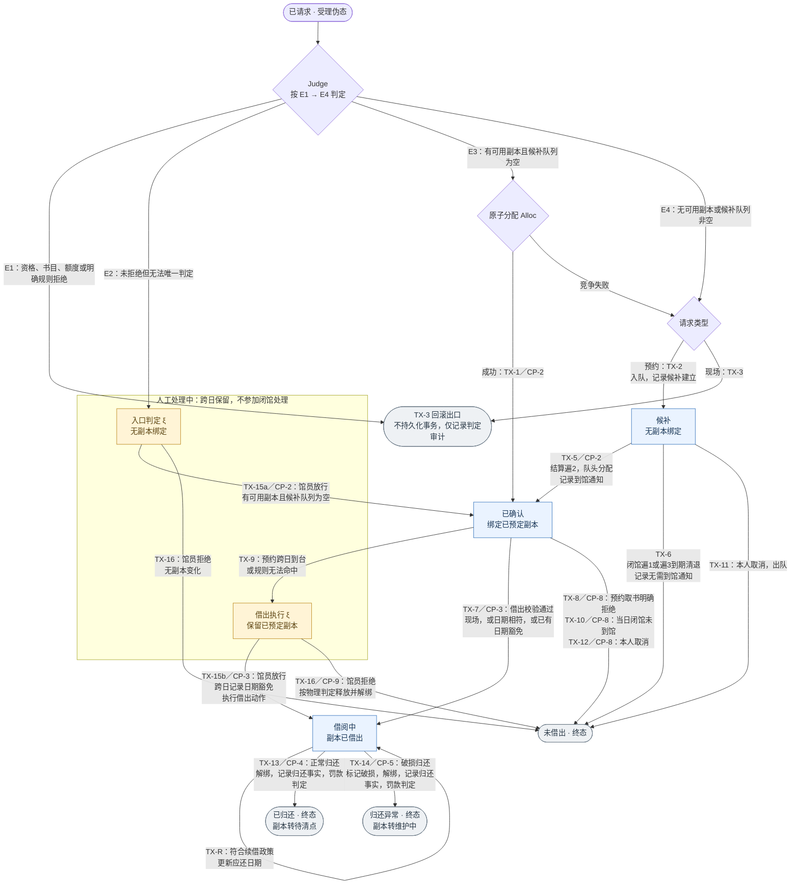
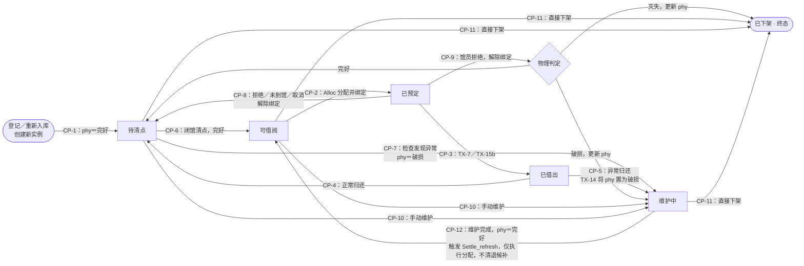
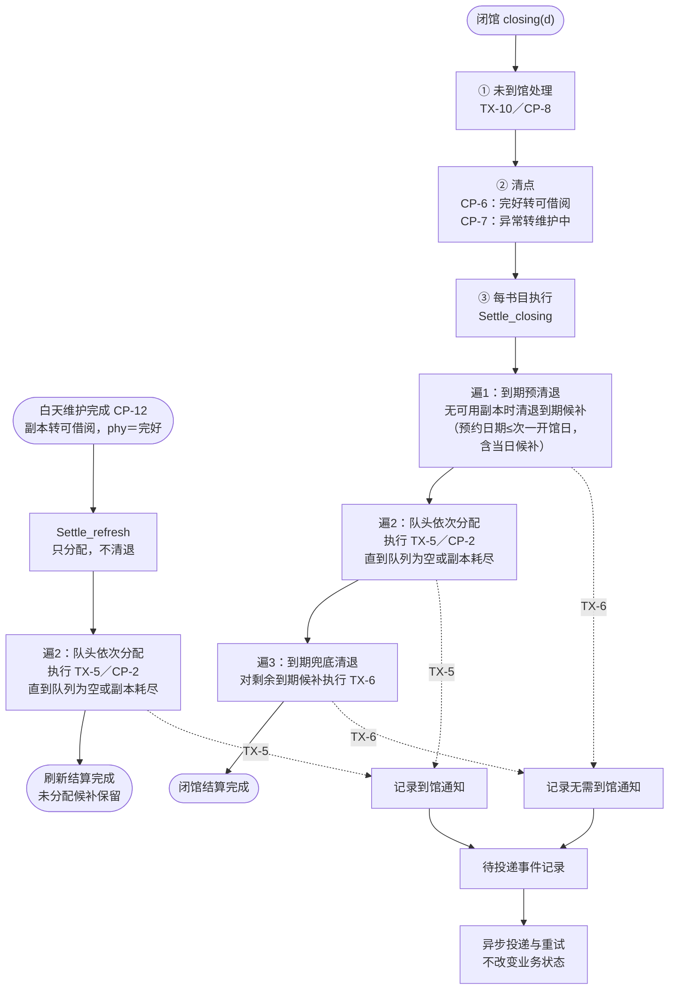

# 业务流程

| 属性     | 值                |
| -------- | ----------------- |
| 文档编号 | `MLS-DOC-RA-0008` |
| 文档状态 | `Approved`           |
| 文档版本 | `v0.17`           |
| 编制日期 | `2026-07-13`      |
| 适用阶段 | `需求分析`        |
| 验证对应 | `系统验收测试`    |
| 权威性质 | `规范性`          |

> 引用文档：
>
> - [系统需求主规格](MLS-DOC-RA-0003.md)
> - [参与者与系统语境](MLS-DOC-RA-0005.md)
> - [Open 问题登记册](MLS-DOC-RA-0007.md)
> - [业务规则](MLS-DOC-RA-0011.md)
> - [工程决策日志](../../00-governance/MLS-DOC-GOV-0005.md)

本文描述参与者可观察的端到端业务流程。所有尚未批准的数值、判定边界、状态转换和权限仅通过 Open 问题引用，不在本文赋值。

## 1. 访客公开检索馆藏

- **触发者：** 访客（`MLS-ACT-0001`）在读者页公共门户发起馆藏检索或浏览。
- **前置业务状态：** 访客无需成为读者；馆藏中存在可公开检索的书目与实体副本信息。
- **正常步骤：** 门户采用顶部导航与搜索优先布局；访客提交检索条件；系统查找匹配书目并支持分类筛选、可借状态筛选、可在线阅读筛选、排序与分页；系统按书目级展示`可借`或`不可借`——书目下至少一个实体副本为`可借阅`时显示`可借`，不展示实体副本数量、编号、位置及不可借的内部原因；访客可打开书目详情，并在详情子页面使用公开在线阅读器（见 §19）。
- **替代步骤：** 没有匹配项时，系统明确展示无结果，访客可调整条件、筛选或翻页再次检索；书目无在线阅读内容时不提供阅读器入口。
- **异常步骤：** 检索无法完成时，系统告知本次请求未完成且不把未确认结果呈现为业务事实。
- **结束状态：** 访客获得可理解的检索结果或明确的无结果／未完成反馈，馆藏业务事实未被修改。
- **关联 Open 问题：** `MLS-OQ-0007`（已关闭，2026-08-14）；门户公开范围依据 `MLS-DEC-0016`。

## 2. 访客自助注册读者

- **触发者：** 访客（`MLS-ACT-0001`）发起自助注册。
- **前置业务状态：** 访客尚未以目标读者身份完成注册。
- **正常步骤：** 访客提供注册所需业务信息；系统依已批准的账户生命周期规则校验（登录名唯一，3~32 字符，字母/数字/下划线；密码 ≥8 位且含字母 + 数字）；校验通过后系统建立读者身份，无需人工审核；系统向新读者确认结果。
- **替代步骤：** 可纠正的信息不满足已批准规则时，系统说明需纠正之处，访客可修正后重新提交。
- **异常步骤：** 同登录名重复注册时系统自动拒绝；其他重复、冲突或防滥用条件触发时，系统依已批准规则拒绝完成本次注册并保留可审计结果。
- **结束状态：** 注册成功者成为读者（`MLS-ACT-0002`），或本次注册未成立且原有身份不变。
- **关联 Open 问题：** `MLS-OQ-0006`（已关闭，2026-08-14）。

## 3. 馆员维护书目与实体副本

- **触发者：** 馆员（`MLS-ACT-0003`）发起馆藏维护。
- **前置业务状态：** 馆员处于获准的馆藏维护语境；待处理对象是书目或归属于书目的具体实体副本。
- **正常步骤：** 馆员识别书目；新增或修正书目描述；在书目下新增或修正可独立识别的实体副本，新登记副本初始为`待清点`，经闭馆清点完好转`可借阅`后方可外借；系统保存业务变化并记录关键操作审计。
- **替代步骤：** 已有书目需要增加另一册实体副本时，馆员复用该书目并只建立新的具体副本；`已下架`副本不可逆，重新入库按新增副本办理。
- **异常步骤：** 维护动作与现有流通事实或已批准状态转换冲突时，系统阻止不一致变化并提示馆员处理冲突；`已借出`或`已预定`中的副本不得直接维护或下架。
- **结束状态：** 书目与实体副本的业务关系保持一致，成功变化可追溯；失败时原业务事实保持不变。
- **关联 Open 问题：** `MLS-OQ-0007`（已关闭，2026-08-14）、`MLS-OQ-0008`（已关闭，2026-08-14）。

## 4. 馆员办理具体副本借阅

- **触发者：** 馆员（`MLS-ACT-0003`）为读者发起借阅办理。
- **前置业务状态：** 读者、具体实体副本和当前流通事实可被识别；借阅政策采用全馆统一配置。
- **正常步骤：** 馆员识别读者并按请求路径办理。预约取书：读者事务在预约成立时已原子绑定`已预定`副本，取书不重新分配副本；系统在办理当日执行借出校验——办理当日＝预约日期或存在日期豁免，并复核借出自动规则（如当日存在未缴罚款或逾期未还等明确拒绝项）；通过时绑定副本转`已借出`、事务转`借阅中`，应还日期为借出当日加 7 天。现场借阅（读者页面或服务台发起）：系统按入口判定执行——读者资格（无未缴罚款且无逾期未还）、书目可借性（存在即用`可借阅`副本且该书目候补队列为空）、额度（`候补`、`已确认`与`人工处理中`合计不超过 5 条且同一读者同一书目至多 1 条）；通过时原子分配绑定副本并连续执行借出。馆员向读者确认结果。
- **替代步骤：** 系统判定为边界项时转入人工处理（`人工处理中`跨开馆日保留、不参与闭馆处理）；馆员放行按路径区分：入口判定转人工的事务无副本绑定，放行须存在即用`可借阅`副本且该书目候补队列为空（无副本不得放行），放行后重新分配绑定并转`已确认`——现场请求随即连续借出，预约请求等待预约日取书；借出执行转人工的事务已绑定`已预定`副本，放行直接执行借出、无需额外可用副本且不受候补队列阻挡，跨预约日期借出时记录日期豁免留痕。普通例外由授权馆员按受控流程处理，并记录原判定、原因、说明、人员和时间；属于高风险范围（罚款减免、强制流通变更等）时，馆员发起后须经系统管理员复核通过方生效。
- **异常步骤：** 提交请求的入口明确拒绝（资格、可预约性、额度、重复请求，或现场请求无即用副本／该书目候补队列非空）不建立持久事务记录，仅记录判定审计；预约取书的借出校验命中明确拒绝规则时保留原事务，以`未借出`结束并释放绑定（副本转`待清点`）；发现重复、冲突、无效对象时不重复建立事实，并向馆员说明可观察结果。
- **结束状态：** 借阅成立并可追溯，或未成立且原流通事实保持一致；人工例外保留完整审计。
- **关联 Open 问题：** `MLS-OQ-0005`、`MLS-OQ-0007`（均已关闭，2026-08-14）。

## 5. 馆员办理具体副本归还并判定逾期

- **触发者：** 馆员（`MLS-ACT-0003`）发起具体副本归还办理。
- **前置业务状态：** 具体实体副本存在可识别的在借流通关系。
- **正常步骤：** 馆员识别具体副本及对应流通关系；系统确认归还事实并结束在借关系；归还后副本转入`待清点`，当日不再外借，经闭馆清点完好转`可借阅`；系统依据已批准罚款政策（`MLS-OQ-0002` 关闭：罚款 = min(书价 × 10% × 逾期天数, 书价 × 300%)，按分进一，无宽限期）判定逾期并形成罚款业务事实；系统记录办理结果。
- **替代步骤：** 判定无法自动确定时转入人工处理；授权馆员完成受控例外并记录原判定、原因、说明、人员和时间；馆员判定破损时事务以`归还异常`结束，副本转`维护中`，同样计逾期罚款，破损赔偿属高风险事务链、与罚款独立。
- **范围勘误（2026-09-11 用户确认，ODV-F01）：** 首版不建设破损赔偿业务链。上句"破损赔偿属高风险事务链、与罚款独立"为历史表述保留，不构成首版范围承诺；首版以[系统需求主规格](MLS-DOC-RA-0003.md) §3 排除行（遗失损坏赔偿）为准——破损归还仍按`归还异常`结束并计逾期罚款，不产生赔偿业务事实。依据 `MLS-DOC-OD-0002` §7 Q1（2026-09-11 用户确认）。
- **异常步骤：** 找不到有效在借关系、发生重复归还或业务事实冲突时，系统不重复结束关系或重复形成罚款，并向馆员说明结果。
- **结束状态：** 有效归还结束原借阅；副本后续可用性及罚款结果遵循已批准规则；异常与例外可追溯。
- **关联 Open 问题：** `MLS-OQ-0005`、`MLS-OQ-0007`（均已关闭，2026-08-14）。

## 6. 读者自助续借并由系统自动判定

- **触发者：** 读者（`MLS-ACT-0002`）对本人借阅发起续借。
- **前置业务状态：** 该读者存在未结束且符合候选识别条件的借阅关系；续借政策采用全馆统一配置。
- **正常步骤：** 读者选择本人借阅；系统按已批准续借政策（`MLS-OQ-0001`/`0003`/`0004` 关闭：续借不限制次数、每次最多延长 7 天、累计持有不超过 30 天、存在有效预约时只允许续借到该书目最小预约日期的前一天、未缴罚款或逾期未还时自动拒绝）自动判定；有效预约为书目级`候补`与`已确认`事务，多笔时取最小预约日期；自动通过时系统延续该借阅关系并向读者展示结果。
- **替代步骤：** 自动判定为边界项时，系统转入人工处理并告知读者当前结果；普通例外由授权馆员处理，高风险例外经系统管理员复核通过后生效；处理结果可被读者获知。
- **异常步骤：** 自动拒绝、重复请求、对象不属于本人或借阅关系已结束时，系统不改变原借阅事实并说明结果。
- **结束状态：** 续借成立并留下判定事实，或未成立且原借阅事实不被错误改变；边界项进入人工处理。
- **关联 Open 问题：** `MLS-OQ-0005`（已关闭，2026-08-14）。

## 7. 自动判定与人工边界处理

- **触发者：** 借阅、归还、续借或其他需要规则判定的业务请求触发系统判定；授权馆员处理转人工事项。
- **前置业务状态：** 存在已批准、全馆统一的适用业务配置；参与判定的业务事实可被识别。
- **正常步骤：** 系统依据已批准配置形成自动通过、转人工或自动拒绝结果；自动通过或拒绝时记录判定及依据；转人工时建立待处理事项；授权馆员查看原判定并处理；系统记录原因、说明、人员和时间。
- **替代步骤：** 若人工结果属于已批准的高风险范围（罚款减免或豁免、强制更改流通事实、账户停用/恢复、角色/权限变更），系统转交系统管理员复核，复核通过前不生效；普通例外由馆员处理。
- **复核生效一致性（2026-09-11 用户确认 SC-Q9/SC-Q4，ODV-F04）：** 复核批准记录、目标业务实际变更与待投递业务事件整体提交或整体回滚；确定失败时只保留失败审计，不留下"已批准但目标未生效"的业务结果。复核时目标相关事实已变化的，原申请不直接生效，按最新事实重新发起新的业务处置并保留与原事务的关联，不修改已完成事务。
- **异常步骤：** 已批准规则不足、相互冲突或所需业务事实不一致时，系统不得猜测结果，必须保持转人工或未完成状态并记录原因。
- **结束状态：** 请求获得可追溯的通过、拒绝或人工处理结果；尚未完成的边界项不会被伪装为已完成。
- **关联 Open 问题：** `MLS-OQ-0005`（已关闭，2026-08-14）、`MLS-OQ-0008`（已关闭，2026-08-14）。

## 8. 形成罚款、查看并模拟支付

- **触发者：** 系统根据有效归还及已批准规则形成罚款；读者（`MLS-ACT-0002`）查看本人罚款并发起模拟支付。
- **前置业务状态：** 存在与读者关联、可结算的罚款业务事实；本地支付模拟器（`MLS-ACT-0005`）处于受控本地环境。
- **正常步骤：** 系统形成罚款并向读者展示金额义务及结算状态；读者选择应结算罚款；系统创建本地模拟支付订单；本地支付模拟器产生可控结果；系统处理结果并更新可观察的模拟结算状态。
- **替代步骤：** 模拟器产生失败、取消或超时结果时，系统保留相应结果，读者可查询；符合已批准条件时可关闭订单、退款或进入对账处理。
- **异常步骤：** 重复结果通知不得重复改变罚款或订单结果；冲突或无法确认的结果进入可追溯的异常处理。
- **结束状态：** 罚款与模拟订单状态一致且可查询，或差异被识别以供后续处理。整个流程不离开受控本地环境，无真实资金交易。
- **关联 Open 问题：** `MLS-OQ-0009`（已关闭，2026-08-14）。

## 9. 模拟支付闭环与日终对账

- **触发者：** 读者创建模拟支付订单；本地支付模拟器提供结果通知；馆员发起关闭或退款；授权角色手动发起日终对账。
- **前置业务状态：** 待处理对象属于本地模拟支付业务；所有交互均限制在受控本地环境且不产生真实资金。
- **正常步骤：** 系统创建订单；读者或授权角色查询结果；模拟器异步通知结果；系统一次性确认有效结果；不再继续的订单被关闭；馆员发起全额或部分模拟退款；授权角色手动触发日终对账，系统核对双方模拟记录并形成对账结果。
- **替代步骤：** 重复通知返回既有处理结果而不重复改变业务事实；对账一致时记录一致结论，出现差异时识别差异并交由授权角色处理。
- **异常步骤：** 无法关联、相互冲突、超时或不符合已批准权限的请求不改变已确认结果，并形成可追溯异常；超时、异步通知、对账差异等异常处理时限值由配置文件加载，不硬编码。
- **结束状态：** 创建、查询、通知、关闭、退款和日终对账均留下可核对的模拟业务事实；未解决差异保持显式可见。
- **关联 Open 问题：** `MLS-OQ-0008`、`MLS-OQ-0009`（均已关闭，2026-08-14）。

## 10. 授权角色查询操作审计

- **触发者：** 系统管理员或其他经批准的授权角色发起审计查询。
- **前置业务状态：** 已存在关键业务、自动判定或人工例外的审计事件；请求者具备已批准的查看权限。
- **正常步骤：** 授权角色提出查询条件；系统展示与权限相符的审计事件；授权角色查看操作、判定、原因、人员和时间的可追溯关系。
- **替代步骤：** 查询范围包含无权查看的内容时，系统仅返回获准范围并明确受限结果。
- **异常步骤：** 请求者未获授权、审计事实无法读取或查询条件无效时，系统不披露受限内容，并记录相应访问结果。
- **结束状态：** 授权角色获得可核对的审计结果，或请求被受控拒绝；审计事实不因查询而改变。
- **关联 Open 问题：** `MLS-OQ-0005`（已关闭，2026-08-14）、`MLS-OQ-0008`、`MLS-OQ-0009`（均已关闭，2026-08-14）。

## 11. 读者预约与预约取书

- **触发者：** 读者（`MLS-ACT-0002`）对书目发起预约；系统在闭馆结算或维护完成触发的即时结算时按队列分配；馆员为预约读者办理取书借阅。
- **前置业务状态：** 预约对象为可识别的书目；书目可预约以该书目下存在状态 ∈ {`可借阅`, `已借出`, `待清点`} 的实体副本为守卫；预约政策按已批准配置（`MLS-OQ-0001`/`0003`/`0004` 关闭）执行。
- **正常步骤：** 读者页按预约日期展示书目保证状态日历——同一书目在同一日期正常情况下只呈现一种保证状态，以颜色区分可直接确认、需要候补与不可预约；日历仅为呈现口径，不改变提交时的入口判定与最新状态校验（书目显示`可借`或日历显示可直接确认，均不代表请求必然获准）。读者选择书目并填写预约日期与取书时段发起预约；在线提交的预约日期最早为次一开馆日（当日提交被明确拒绝），服务台可代读者建立预约且不受该日期守卫约束——当日预约在存在即用副本时直接确认并即时取书，无即用副本落入当日候补并于当日闭馆结算判定（不残留至次一开馆日）；系统按已批准规则自动判定（资格、可预约守卫、额度）；书目存在即用`可借阅`副本且候补队列为空时直接确认并原子分配绑定，否则候补请求提交前系统展示确认步骤及固定说明`当图书收回时会进行通知，但不做其他保证。`，读者确认后落入该书目候补队列队尾；每个开馆日闭馆结算与维护完成触发的即时结算按队头先到先得分配，分配成功产生到馆通知；到期未兑现的候补在次一开馆日＝预约日期的闭馆以`未借出`结束并产生无需到馆通知，此前静默重试不通知；读者在预约日到台取书，使用预约成立时已绑定的副本执行借出校验并自动完成借出（不重新分配副本）；当日未到馆的确认预约在闭馆未到馆处理中以`未借出`结束并释放绑定；取书时段用于备书需求模拟与到馆统计、不作状态守卫，读者于预约当日提前、准时或延后到台取书均不因时段被拒。
- **替代步骤：** 读者可随时取消本人有效预约（候补出队、已确认立刻释放绑定），队列后位递补；预约资格不满足（未缴罚款或逾期未还）时入口自动拒绝创建且不留持久事务记录；取书借出跨日到台或规则无法命中时转人工处理——借出执行转人工已绑定`已预定`副本，放行直接执行借出（跨日记录日期豁免留痕），拒绝以`未借出`结束并释放绑定。
- **异常步骤：** 重复预约、预约数达上限、全部副本`已预定`或业务事实冲突时，系统不重复建立或猜测结果，明确拒绝回滚或转人工并保留判定审计；取书时段缺失或在线提交预约日期为当日时，预约不建立并明确说明原因。
- **结束状态：** 预约成立并可追溯；分配、预约日取书、取消与未到馆处理的终态和副本流转（释放转`待清点`、清点后重新入库）一致；冲突与例外可追溯。
- **关联 Open 问题：** `MLS-OQ-0005`、`MLS-OQ-0007`（均已关闭，2026-08-14）。

## 12. AI 辅助业务问答与受确认操作办理

- **触发者：** 参与者向对话式 AI 助手提交业务问题或操作请求；AI 模型服务端点（`MLS-ACT-0006`）作为受控组件参与处理。
- **前置业务状态：** 参与者处于其获准角色语境；AI 助手可用且经系统管理的模型服务端点可达；账户采用一账户一角色一页面集模型，角色能力配置按已批准矩阵执行；AI 调用受 AI 调用额度池约束（访客为全局共享池，登录用户按账户限额，数值配置化）；访客 AI 受限开放（仅 L1，数据范围同现行访客可见范围）。
- **正常步骤：** AI 助手以当前会话角色的身份与权限运行，AI 对业务行为的参与按四级登记（L1 查询返回、L2 起草确认、L3 页面引导、L4 拒绝）：业务问答按 L1 通过工具调用获取业务事实，问答结果以工具调用结果为依据呈现，需要查看详情或跳转办理时按需附页面入口卡片；操作类请求按 L2 生成操作预填内容并以页面入口卡片呈现（卡片携带预填参数、不含确认按钮），用户点击卡片跳转现行页面后预填参数注入现行页面表单，在现行表单检查、修改并以现行提交控件提交；需要页面引导时按 L3 提供页面入口卡片及占位引导文本，跳转由用户点击触发，不预填业务值、不代提交、不参与复核判断；工具调用以登记的微页面编排动作为对象，微页面内数据加载与提交仍走现行接口与校验，AI 不新增数据通道；用户在现行页面提交后系统按现行流程完整执行前端与后端校验和自动判定，形成业务事实；资金三项（模拟支付、退款、对账）与高风险四类操作的 AI 参与上限一律为 L3；AI 会话日志按事件逐条留存并与操作日志以标识关联。
- **替代步骤：** 用户在现行表单修改预填内容后提交，或取消、不提交——未提交不产生业务事实、不形成业务记录（预填内容仅经会话日志按批准留存口径保存）；L2 跳转后助手会话不中断，AI 不推送提交结果，入口卡片保留可再次点击，用户返回对话后可继续提问；L4 越界请求被明确告知不可用并说明受限方向，不泄露越权数据。
- **异常步骤：** AI 调用超出额度池可用额度时明确告知受限且不产生业务事实；请求超出角色配置矩阵或权限范围时，AI 助手明确告知不可用且不泄露越权数据；AI 请求未登记工具或越权参数时系统拒绝调用并留痕；模型服务端点不可用时明确告知服务暂不可用，不虚构业务事实；校验失败时操作不生效并说明原因。
- **结束状态：** 参与者获得可理解回答或确认执行结果；确认执行的操作与手工办理结果一致并可追溯；业务事实仅由现行自动判定与人工处理形成，AI 自然语言回复不构成业务事实。
- **关联 Open 问题：** `MLS-OQ-0016`、`MLS-OQ-0017`、`MLS-OQ-0018`、`MLS-OQ-0019`（2026-09-05 登记；均已关闭，2026-09-06）。

## 13. 借阅事务状态机

本节以状态机视图描述借阅事务全生命周期的已批准业务口径（`MLS-DEC-0014`、`MLS-DEC-0018`）。图中 `TX-xx`/`CP-xx` 为 2026-09-07 三线状态机评审确认稿的转移编号，仅作边标注使用；规范性内容为图中的状态、条件与伴随结果，及本节文字与 `MLS-DEC-0018` 的口径。

- **受理与拒绝：** 事务由提交请求在入口判定原子步内瞬时创建；入口判定互斥完备（E1 明确拒绝、E2 转人工、E3 分配直确认、E4 预约落候补或现场明确拒绝）。入口明确拒绝回滚不留持久事务记录，仅记录判定审计；自助批次失败项同口径，会话内即时呈现。预约取书阶段的借出校验明确命中拒绝规则时（TX-8）保留原事务，以`未借出`结束并释放绑定（副本转`待清点`），不适用回滚无痕口径。
- **人工处理中：** 正式事务状态，跨开馆日保留、不参与闭馆未到馆处理；入口判定转人工无副本绑定，借出执行转人工保留`已预定`绑定。放行按路径区分：入口判定事务的放行（TX-15a）须存在即用`可借阅`副本且候补队列为空（无副本不得放行），放行后重新分配绑定并转`已确认`——现场请求随即连续借出，预约请求等待预约日取书；借出执行事务的放行（TX-15b）使用已绑定`已预定`副本直接借出、无需额外可用副本且不受候补队列阻挡，跨预约日期借出记录日期豁免留痕；拒绝（TX-16）按副本物理判定释放。
- **放行守卫留存口径（2026-09-11 用户确认 C1-a，ODV-F03）：** 入口判定事务的放行守卫（TX-15a：存在即用`可借阅`副本且候补队列为空）不满足时，放行不执行：事务保持`人工处理中`，保留事务、无副本绑定、计入预约额度（同入口人工留存口径），可待守卫满足后再次放行，或改走拒绝（TX-16）。
- **终态：** `未借出`、`已归还`、`归还异常`三态封闭；经系统受理的事务到达终态后永久保留、逻辑删除（`MLS-BR-0024`）。
- **绑定一致：** `借阅中`事务必绑定一个`已借出`副本，`已确认`事务必绑定一个`已预定`副本，`候补`事务无绑定；任一时刻至多一个活动事务绑定同一副本。
- **范围排除：** 罚款支付与对账（§8/§9）、破损赔偿高风险链、审计事件存储与查询、AI 呈现层不在本状态机建模；闭馆时刻、开馆日历、预约日期范围与时段长度为可配置参数。

## 14. 实体副本状态机

实体副本采用六态状态机（`MLS-DEC-0018`）；创建边唯一——登记或重新入库均建立新副本实例并初始为`待清点`。

- **待清点隔离：** `待清点`副本当日不参与分配与借出，经闭馆清点完好转`可借阅`——当天归还、登记或释放的副本当天不外借。已知例外（`MLS-OQ-0028`，已关闭 2026-09-08：不处理）：副本经`维护中`路径（检查发现异常或手动维护后当日维护完成）当日转`可借阅`并参与分配与借出，不受上述当日隔离约束，系统不补充额外隔离规则。
- **占用保护：** `已借出`或`已预定`副本不得维护或下架；`维护中`、`已下架`副本不可借、不可预约。
- **已下架不可逆：** 唯一终态，无出边；重新入库＝登记新副本实例。
- **可用性刷新：** 维护完成使书目出现`可借阅`副本时，即刻触发该书目结算分配（见 §15）。

## 15. 闭馆结算与通知调度

每个开馆日闭馆按固定次序执行三阶段——未到馆处理、清点、结算（`MLS-DEC-0013`、`MLS-DEC-0018`）；阶段间不插入其他业务事件。

- **未到馆处理：** 预约日期＝当日且`已确认`的事务以`未借出`结束并释放绑定；`人工处理中`事务不参与本阶段。
- **结算三遍制：** 遍1 到期预清退（无可用副本时先清退到期候补——预约日期不晚于次一开馆日的候补，含服务台当日候补）、遍2 队头先到先得分配、遍3 到期兜底清退；闭馆结束后该书目候补队列不残留到期项。
- **失败判定唯一时点：** 到期候补未兑现的失败判定与无需到馆通知发生于其到期闭馆——在线候补为次一开馆日＝预约日期的闭馆，服务台当日候补为预约日期当日闭馆；此前静默重试不通知；闭馆后不反向补发到馆通知。
- **刷新结算：** 白天维护完成使书目出现`可借阅`副本时即刻触发该书目结算分配（仅分配、不清退——到期候补保留至当晚闭馆的最后一次机会），与闭馆结算复用同一结算过程、不另设模块；闭馆清点入池不单独触发结算，由阶段③统一承载。
- **通知语义：** 到馆通知与无需到馆通知各产生一次，写入待投递事件记录后异步投递与重试，投递不阻塞、不改变业务状态。
- **并发口径：** 队列读取与变更、副本分配的检测与写入不可分割；请求不得基于过期状态成功（外部可观察行为口径，实现机制留详细设计，`MLS-OQ-0027`）。
- **提交截止与隔离（2026-09-11 用户确认 SC-Q1/SC-Q3，ODV-F02）：** 相关业务写入必须在本轮闭馆分界 T 前实际提交完成方可纳入闭馆前事实；T 时仍未提交的请求失败回滚，不可在闭馆取数后补交。分界以实际提交完成为准，不是客户端点击、网络到达或服务端准入时间。隔离期间的普通业务写请求明确失败，不隐式排队形成原请求；恢复控制命令、闭馆内部事务与失败审计不受隔离限制，只读查询仍按原权限提供。
- **闭馆失败与恢复（SC-Q5~SC-Q10，ODV-F02）：** 当日三阶段及待投递事件整体提交或整体回滚，失败不留下本轮部分业务结果，诊断与失败审计独立保留。失败后有限自动重试并固定原闭馆业务日期（重试实际时间据实记录）；重试耗尽转人工恢复，不伪造完成状态。跨多个应执行闭馆日期时按业务日期先后逐日补结，后日失败不撤销前日已提交结果；追平后保持隔离，由系统管理员显式重新开放外部事务后才恢复普通写入，正常成功闭馆则在结算成功后即恢复。恢复后的新请求按最新事实判定，不反向改变本轮闭馆结算结果。

## 16. 馆员查看首页到馆统计

- **触发者：** 馆员（`MLS-ACT-0003`）打开首页到馆统计。
- **前置业务状态：** 当日预约与流通业务事实可识别；统计口径按已批准规则（`MLS-BR-0036`）执行。
- **正常步骤：** 系统按口径计算并展示四项计数——计划到馆人数（日初冻结、不含候补）、尚未到馆人数（含临时取消括号）、今日借阅人数（含仅线下借阅括号）与明日预计到馆人数（含未确认候补括号）；各计数按读者去重，到馆以读者到台触发取书借出校验为认定事实，跨日人工放行的借阅计入实际完成借出当日。
- **替代步骤：** 无当日业务事实时各计数显示 0，不虚构数值。
- **异常步骤：** 访客或读者请求统计时受控拒绝且不披露计数；业务事实无法识别时不呈现未经确认的计数。
- **结束状态：** 馆员获得可由固定业务事实复算的四项计数；业务事实未被统计查看修改。
- **关联 Open 问题：** 无（依据 `MLS-DEC-0015`、`MLS-DEC-0019`）。

## 17. 未登录操作登录续行

- **触发者：** 未登录用户（`MLS-ACT-0001`）在读者页触发预约或本人事务操作（如预约、取消、续借、查看我的业务）。
- **前置业务状态：** 用户未登录；目标操作属于预约或本人事务范围。
- **正常步骤：** 系统打开登录模态框并固定展示提示`若无法登录，请线下前往服务台办理借阅。`；用户完成登录后，系统继续执行原操作，续行请求按现行身份、资格与状态规则自动判定，可观察结果与登录后直接发起一致。
- **替代步骤：** 用户取消登录模态框时，原操作不执行、不产生业务事实。
- **异常步骤：** 登录失败（凭据错误、账户锁定等按已批准账户生命周期规则）时模态框保持并展示固定提示，原操作不执行。
- **结束状态：** 原操作以登录后按现行规则形成的结果结束；未登录、放弃或登录失败路径不产生业务事实。
- **关联 Open 问题：** 无（依据 `MLS-DEC-0016`）。

## 18. 读者查看我的业务与站内通知

- **触发者：** 读者（`MLS-ACT-0002`）打开“我的业务”或读者页。
- **前置业务状态：** 读者身份有效；本人事务与业务通知事实可识别。
- **正常步骤：** “我的业务”统一包含当前借阅、预约与候补、历史记录三个分页页签；读者打开任一事务详情，系统展示当前状态、保证类型、预约日期与时段、通知记录及状态时间轴；站内通知 Banner 展示未读业务通知中排序最高者——未读通知按其关联预约日期的时间节点临近程度排序（临近者优先，同日多条不另设先后），到馆通知与无需到馆通知对同一预约事务互斥（同一预约事务仅产生两类之一，不同预约事务含同日不同书目的通知可并存）；存在多条未读时显示`另有 N 条`并以卡片堆叠提示，读者点击 Banner 进入对应事务详情；系统同时保留模拟短信或邮件发送记录（模拟发送，不接入真实短信或邮件通道）。
- **替代步骤：** 无未读通知时 Banner 不展示，页签与详情正常可用；页签无记录时明确展示无记录。
- **异常步骤：** 读者仅能访问本人业务，请求他人事务时受控拒绝且不披露；通知展示与点击不改变业务状态。
- **结束状态：** 读者获得本人事务与通知的完整可观察视图，通知记录与模拟发送记录可查，业务事实不变。
- **关联 Open 问题：** 无（依据 `MLS-DEC-0016`）。

## 19. 公开在线阅读

- **触发者：** 访客或读者从书目详情子页面打开在线阅读器。
- **前置业务状态：** 书目具有在线阅读标记及阅读内容；用户无需登录。
- **正常步骤：** 阅读器在图书详情子页面内提供目录、翻页、页码跳转、缩放、全屏与书内搜索；书内搜索无命中时明确展示无结果。
- **替代步骤：** 书目无在线阅读内容时不提供阅读器入口，检索结果的可在线阅读筛选不含该书目。
- **异常步骤：** 阅读内容不可用时明确告知，不呈现空白或未确认内容。
- **结束状态：** 用户获得可用的阅读交互，馆藏业务事实不变。
- **关联 Open 问题：** 无（依据 `MLS-DEC-0016`）。

## 20. 自助借阅中心会话与服务台代建

- **触发者：** 读者在自助借阅中心扫描读者证建立会话；馆员（`MLS-ACT-0003`）在服务台为读者直接建立借阅请求。
- **前置业务状态：** 读者证可识别；自助中心会话可运行；服务台办理语境可识别。
- **正常步骤：** 自助中心按“扫描读者证—连续扫描多册图书—分别校验—确认结果—清空会话”运行；批次中各册为独立事务逐册校验，混合成功／失败逐册呈现——合规图书在校验通过时即自动完成借出，失败图书在会话内即时呈现未借出原因并提示前往服务台，不建立持久事务记录（仅记录判定审计）；“确认结果”为读者逐册核对校验结果的环节，读者核对后清空会话。服务台借阅由馆员直接建立并填写读者与实体图书信息，读者不预先提交服务台请求；办理走与现场借阅同一套自动校验流程。
- **替代步骤：** 读者可随时结束并清空会话；会话结束不撤销已形成的借阅，也不新增借阅。
- **异常步骤：** 读者证无法识别或读者资格不满足时会话明确告知；批次中部分册次失败不阻断其他册次校验。
- **结束状态：** 合规图书形成可追溯借阅事实；失败册次仅会话内呈现、无持久事务；会话清空后不残留临时办理载体。
- **关联 Open 问题：** 无（依据 `MLS-DEC-0016`；批次失败不留持久事务记录依 `MLS-DEC-0018` 后续口径）。

## 变更记录

| 日期       | 版本 | 变更内容                                                                                                                                                                                                                                                                                                          |
| ---------- | ---- | ----------------------------------------------------------------------------------------------------------------------------------------------------------------------------------------------------------------------------------------------------------------------------------------------------------------- |
| 2026-09-12 | v0.17 | 场景分析结论传导（ODV-F01/F02/F03/F04，依据用户 2026-09-11 场景确认 SC-Q1/Q3~Q10 及 C1-a、OD-0002 §7 Q1 赔偿确认；修补轮阶段 7）：§5 追加范围勘误——首版不建设破损赔偿业务链，历史表述保留（ODV-F01）；§7 追加复核生效一致性——批准记录、目标变更与待投递事件整体提交或回滚、失败只留审计、目标已变化重新发起（ODV-F04）；§13 追加放行守卫留存口径——TX-15a 守卫不满足时放行不执行、事务保持人工处理中、计入预约额度（ODV-F03）；§15 追加提交截止与隔离、闭馆失败与恢复——严格 T 提交截止、失败整体回滚与有限重试固定原业务日、逐日补结追平后管理员显式开放（ODV-F02）。原因：场景分析已确认结论未传导至业务流程工件；提出人：文档维护轮（ZCode，修补执行代理）；影响需求：`MLS-BR-0046`~`0048` 同轮新增（`MLS-DOC-RA-0011` v0.17）；影响验收：`MLS-AC-0050`~`0053`、`MLS-AT-0031`~`0033` 同轮新增（`MLS-DOC-AT-0002` v0.25）、`MLS-DOC-RA-0014` v0.17 追踪行；评审人/批准人：lingzz（用户，2026-09-11 场景逐项确认及 2026-09-12 十项清单执行指令）；结论：追加式传导，既有批准内容未改动 |
| 2026-09-10 | 不变 | 元数据勘误：「文档版本」头部自 `v0.15` 更正为 `v0.16`，对齐本表 v0.16 行（2026-09-09），内容无变化。原因：对应修订轮仅追加修订记录行，头部版本未同步（2026-09-10 C0 输入快照核对发现，全库同型勘误共 9 份）；提出人：B1-C 行动计划 C0 执行代理（ZCode）；影响需求：无；影响验收：无；评审人/批准人：随本轮 C0 提交交用户核阅，未单独批准；结论：元数据与修订记录一致 |
| 2026-09-09 | v0.16 | 审计返修（留存澄清传导补漏，经用户确认）：§12 替代步骤「预填不落库」改为「不形成业务记录（预填内容仅经会话日志按批准留存口径保存）」，与 `MLS-FR-0032` v0.3/`MLS-IR-0013` 一致。原因：执行审计指出 §12 现行正文残留旧表述、留存澄清未传导完整；提出人：文档维护轮（ZCode，审计返修）；影响需求：§12 一句；影响验收：`MLS-DOC-AT-0002` 同轮修订；评审人/批准人：lingzz（用户，2026-09-09 留存边界确认）；结论：现行流程与留存边界一致 |
| 2026-09-09 | v0.15 | AI 呈现形态传导（`MLS-DEC-0021`，2026-09-09 拍板，`MLS-OQ-0021` 关闭）：§12 正常步骤 L1 补按需附页面入口卡片、L2 由「唤起确认界面」改为入口卡片携带预填参数→点击跳转注入现行表单→现行提交控件确认提交，日志句改按事件逐条留存；替代步骤改为表单内修改后提交或取消/不提交（未提交不产生业务事实、预填不落库）、跳转后会话不中断（AI 不推送结果、卡片可复点）并补 L4 呈现。原因：L2 呈现形态经用户决策包拍板；提出人：文档维护轮（ZCode，AI 产品决策与技术验证执行代理）；影响需求：§12；影响验收：`MLS-AC-0031`/`0032`、`MLS-AT-0020` 同轮修订；评审人/批准人：lingzz（用户，2026-09-09 决策包拍板）；结论：业务流程与 `MLS-DEC-0021` 一致 |
| 2026-09-08 | v0.14 | 审阅返修：§18 互斥对象由「同一预约日期」改为「同一预约事务——同一预约事务仅产生两类之一，不同预约事务（含同日不同书目）可并存」（`GOV-0005` v0.14）；§20 撤销「已扫描未确认的图书不形成借阅」——明确合规图书在校验通过时即自动完成借出、「确认结果」为逐册核对环节，会话结束不撤销已形成的借阅、也不新增借阅。原因：用户审阅指出互斥缺适用对象与逐事务结算规则冲突、「确认后才生效」语义与自动借出矛盾且无业务变更批准依据；提出人：文档维护轮（ZCode，`MLS-OQ-0026` 执行代理）；影响需求：§18、§20；影响验收：`MLS-AC-0044`/`MLS-AT-0027`/`MLS-AT-0021` 同轮修订；评审人/批准人：lingzz（用户，2026-09-08 审阅返修指示）；结论：通知互斥与确认语义均与 `MLS-DEC-0018` 自动借出通路一致 |
| 2026-09-08 | v0.13 | 通知排序口径传导（`MLS-DEC-0020`，2026-09-08 拍板）：§18 正常步骤由「展示最高优先级的未读业务通知」改为按关联预约日期临近程度排序（临近者优先）并补同日两类互斥。原因：「最高优先级」经 `MLS-DEC-0020` 落库定义；提出人：文档维护轮（ZCode，`MLS-OQ-0026` 执行代理）；影响需求：§18；影响验收：`MLS-AC-0044`/`MLS-AT-0027` 同轮修订；评审人/批准人：lingzz（用户，2026-09-08 拍板）；结论：流程与排序决策一致 |
| 2026-09-08 | v0.12 | 读者页业务口径传导（`MLS-DEC-0016`，`MLS-OQ-0026` 推进）：§1 重写为门户检索流程（顶部导航与搜索优先布局、分类／可借／可在线阅读筛选、排序、分页、书目级`可借`/`不可借`展示）；§11 正常步骤补预约日历保证状态呈现（颜色区分三类、同日单一保证状态、呈现不替代提交校验）与候补提交前确认及固定说明；新增 §17 未登录操作登录续行（模态框与固定提示、续行按现行规则判定）、§18 读者查看我的业务与站内通知（三页签、详情五要素、Banner 与`另有 N 条`、模拟短信或邮件发送记录）、§19 公开在线阅读（阅读器六能力）、§20 自助借阅中心会话与服务台代建（五步会话、逐册呈现、失败不留持久事务、读者不预先提交）。原因：`MLS-DEC-0016` 已批准读者页业务口径，业务流程层缺对应流程；提出人：文档维护轮（ZCode，`MLS-OQ-0026` 执行代理）；影响需求：§1、§11、§17~§20；影响验收：`MLS-DOC-AT-0001` §2、`MLS-AC-0001` 修订与 `MLS-AC-0040`~`0046` 新增、`MLS-AT-0001`/`0015`/`0021` 修订与 `MLS-AT-0025`~`0028` 新增随轮登记；评审人/批准人：lingzz（用户，`MLS-DEC-0016` 2026-09-07 批准；本轮按用户 `MLS-OQ-0026` 收口指示传导，待用户审阅）；结论：现行流程覆盖 `MLS-DEC-0016` 各条读者页口径，原型默认值未升级为产品约束 |
| 2026-09-08 | v0.11 | 执行审计返修（`MLS-DEC-0019` v0.11 修订条款传导）：§15 结算三遍制遍1/遍3 清退对象扩展为「到期候补（预约日期不晚于次一开馆日，含服务台当日候补）」（流程图节点与正文同步），失败判定唯一时点按候补来源区分（在线候补＝次一开馆日＝预约日期的闭馆；服务台当日候补＝预约日期当日闭馆）。原因：执行审计指出服务台当日候补的当日清退规则未传导至闭馆流程，当日候补无副本时按新规则应清退而现行流程无清退对象；提出人：文档维护轮（ZCode，`MLS-OQ-0025` 执行代理）；影响需求：§15；影响验收：`MLS-AC-0038`/`MLS-AT-0023` 同轮修订；评审人/批准人：lingzz（用户，2026-09-08 执行审计返修指示）；结论：当日候补在闭馆规则、流程图与验收中具有一致清退路径 |
| 2026-09-08 | v0.10 | `MLS-OQ-0025` 剩余口径传导（`MLS-DEC-0019`，2026-09-08 grill 逐项拍板；存量流程内容修订经用户批准授权，属有条件违反文档 OCP 准则的受控修订）：§11 正常步骤补在线预约日期守卫（最早次一开馆日）、服务台当日预约豁免（当日候补于当日闭馆结算判定）与取书时段语义（备书需求模拟与到馆统计、不作状态守卫），异常步骤补时段缺失与在线当日日期的明确拒绝；新增 §16 馆员查看首页到馆统计（四项计数、日初冻结、到馆认定、互斥括号与零数据口径）；引用文档补[业务规则](MLS-DOC-RA-0011.md)。原因：`MLS-DEC-0015` 已批准统计口径，2026-09-08 grill 由项目负责人逐项拍板补充到馆认定、守卫与展示流程；提出人：文档维护轮（ZCode，`MLS-OQ-0025` 执行代理）；影响需求：§11、§16 新增；影响验收：`MLS-AT-0015` 修订与 `MLS-AT-0024` 新增随轮登记；评审人/批准人：lingzz（用户，2026-09-08 grill 逐项拍板）；结论：现行流程与 `MLS-DEC-0019` 一致，历史关闭依据未改写 |
| 2026-09-08 | v0.9 | §14 待清点隔离补记已知例外（`MLS-OQ-0028`，登记即关闭）：副本经`维护中`路径当日维护完成转`可借阅`的，不适用当日隔离、可当日参与分配与借出。原因：项目负责人 lingzz 2026-09-08 拍板该绕过行为「已知但不处理」，需显式留档以免实现或验收擅自补规则；提出人：文档维护轮（ZCode）；影响需求：§14；影响验收：无新增断言（验收不得要求维护路径副本当日不可分配）；评审人/批准人：lingzz（用户，2026-09-08 拍板）；结论：例外口径与 `MLS-OQ-0028` 关闭依据一致 |
| 2026-09-08 | v0.8 | 三线状态机落地（`MLS-DEC-0018` 传导，`MLS-OQ-0025` 推进；存量契约内容修订经用户批准授权，属有条件违反文档 OCP 准则的受控修订）：§3 新副本初始`待清点`、`已下架`不可逆；§4 按请求路径重写——预约取书使用预约成立时已绑定的`已预定`副本执行借出校验（不重新分配；明确拒绝保留事务以`未借出`结束并释放绑定），现场借阅走入口判定（原子分配、明确拒绝不留持久事务），人工放行按路径区分（入口放行有即用副本与队列守卫，借出执行放行使用已绑定副本）；§5 归还转`待清点`、破损归还转`维护中`并同计罚款；§6 有效预约改书目级最小预约日期口径；§11 重写为六态模型流程（可预约守卫、结算与维护完成触发分配、失败判定唯一时点、到馆/无需到馆通知、取书借出校验与人工转办）；新增 §13 借阅事务状态机、§14 实体副本状态机、§15 闭馆结算与通知调度（嵌入 2026-09-07 评审确认的 mermaid 流程图）；引用文档补[工程决策日志](../../00-governance/MLS-DOC-GOV-0005.md)。原因：三线状态机 grill 六轮评审确认稿 v1.2 经 `MLS-DEC-0018` 登记批准，现行流程仍表达五态与旧结算口径；提出人：文档维护轮（ZCode）；影响需求：§3~§6、§11、§13~§15；影响验收：`MLS-AC-0028` 修订与 `MLS-AC-0036`~`0038` 新增、`MLS-AT-0015` 修订与 `MLS-AT-0021`~`0023` 新增；评审人/批准人：lingzz（用户，2026-09-08 落地指示及同轮审计修订）；结论：现行流程与 `MLS-DEC-0018` 一致，历史关闭依据未改写 |
| 2026-09-07 | v0.7 | 三天保留期口径修订（`MLS-DEC-0013` 传导，`MLS-OQ-0025` 部分传导；存量契约内容修订经用户批准授权，属有条件违反文档 OCP 准则的受控修订）：§11 标题去除「与释放」，正常步骤「保留期（3 天）内取书／保留期内未取释放」改为「读者在预约日取书／取消或当日未到馆涉及的副本在当日结束后清点并重新入库」，结束状态同步；§3 异常步骤副本状态「预约保留」改「已预定」。原因：`MLS-DEC-0013` 已批准取消三日保留期，现行流程仍表达旧契约口径；提出人：文档维护轮（ZCode）；影响需求：§3、§11；影响验收：`MLS-AC-0028`、`MLS-AT-0015` 与验收策略（`MLS-DOC-AT-0001`）同轮修订；评审人/批准人：lingzz（用户，修订授权）；结论：现行流程与 `MLS-DEC-0013` 一致，历史关闭依据未改写 |
| 2026-09-07 | v0.6 | `MLS-OQ-0016`~`0020` 关闭结论传导（`MLS-DEC-0012`）：§12 同步 AI 四级参与模型（L1 查询返回、L2 起草确认、L3 页面引导、L4 拒绝）、L3 页面入口卡片与资金三项/高风险四类 L3 上限、微页面编排动作口径、AI 调用额度池与访客受限开放、一账户一角色一页面集；§12 关联 OQ 标注改均已关闭（2026-09-06）。§1~§11 内容无变化 |
| 2026-09-07 | 不变 | 补录说明：初稿至本表最早记录行之间的版本未随变更记录规范建立，早期历史以 git 提交历史为准                                                                                                                                                                                                                         |
| 2026-09-05 | v0.5 | AI 能力传导（`MLS-DEC-0010`/`MLS-DEC-0011`）：新增 §12 AI 辅助业务问答与受确认操作办理；补引用/被引用列表。§1~§11 内容无变化                                                                                                                                                                                      |

---

- 2026-09-11：增加总体设计草图反向引用，仅维护导航；不改变本工件规范内容或批准范围。

- 2026-09-11：增加业务词汇表反向引用，未改变规范内容。

- 2026-09-11（不变）：增加核心流通场景分析反向引用，仅导航维护，无规范内容变化。

> 被引用文档：
>
> - [核心流通场景因果与交互分析](../../02-overall-design/MLS-DOC-OD-0003.md)
>
> - [业务词汇](../../../CONTEXT.md)
>
> - [模块关系与 4+1 视图草图](../../02-overall-design/MLS-DOC-OD-0002.md)
>
> - [工程文档唯一入口](../../README.md)
> - [编号规范](../../00-governance/MLS-DOC-GOV-0001.md)
> - [需求分析阶段工程化设计](MLS-DOC-RA-0001.md)
> - [需求分析文档入口](MLS-DOC-RA-0002.md)
> - [系统需求主规格](MLS-DOC-RA-0003.md)
