# 模块关系与 4+1 视图草图

| 字段 | 值 |
| --- | --- |
| 文档编号 | `MLS-DOC-OD-0002` |
| 文档状态 | `Draft`，供关系讨论，未完成 OD 评审 |
| 文档版本 | `v0.11` |
| 编制日期 | `2026-09-11` |
| 阶段 | M3 总体设计 |

> 引用文档：
>
> - [核心流通场景因果与交互分析](MLS-DOC-OD-0003.md)
>
> - [总体设计入口](MLS-DOC-OD-0001.md)
> - [需求基线记录](../01-requirements/reviews/MLS-DOC-REV-0002.md)
> - [系统需求主规格](../01-requirements/requirements/MLS-DOC-RA-0003.md)
> - [业务流程](../01-requirements/requirements/MLS-DOC-RA-0008.md)
> - [功能需求](../01-requirements/requirements/MLS-DOC-RA-0010.md)
> - [全局开发计划](../00-governance/MLS-DOC-GOV-0006.md)

## 1. 阅读口径

本稿是基于已批准需求形成的设计候选。模块指集中实现一组职责并向调用者提供接口的代码集合；接口同时规定输入、结果、权限、状态约束和失败行为，不仅指 HTTP 路径。框图不表示独立进程、独立数据库或已实现功能。

事实依据以 REV-0002 激活记录为准；RA-0003 §1 仍含 G5 未通过的旧状态声明，本稿不采用其阶段状态，但采用其已纳入基线的业务范围。该来源状态差异保留待受控维护。

实线为调用或明确标注的数据访问；虚线为异步事件流或契约约束，含义在箭头上注明。所有模块划分、调用组织和物理位置均为候选；需求要求的行为不因分组改变。各图刻意区分逻辑职责、代码组织和运行节点。

## 2. 逻辑视图：职责与状态所有权

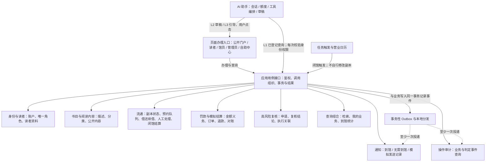

图中的应用用例接口是一组按业务分组的入口，不是承载全部规则的单个大类。它组织跨模块调用与事务；具体状态只有所属模块能够修改。模块间通过接口协作，不从另一个模块旁路写表。查询组合只读，不能用缓存或展示状态决定提交是否成功。

| 候选模块 | 自己维护的事实与接口责任 | 关系依据 |
| --- | --- | --- |
| 身份与读者 | 账户生命周期、唯一角色与读者资料；提供会话身份和访问判断。罚款、逾期资格由当前业务事实计算，不复制成另一个可独立修改的布尔值 | FR-0002～0005；RA-0008 §2、§7 |
| 书目与阅读内容 | 书目、分类及公开阅读内容关联；不拥有副本借出或预定状态。阅读器交互属于前端，内容读取经公开接口 | FR-0006、0040、0045 |
| 流通 | 副本完整六态、预约/候补与借阅事务、绑定关系、续借、普通转人工处理、闭馆与维护后即时分配；对外提供办理动作，不开放任意改状态 | FR-0007～0013、0015～0016、0028、0036～0039、0046；RA-0008 §3～7、§11、§13～16、§20 |
| 罚款与模拟结算 | 罚款金额义务、支付订单与结果、关闭/退款/对账；内部区分罚款账务与支付适配。依据归还结果形成罚款，向流通提供当前未缴事实 | FR-0014、0017～0026；RA-0008 §8～9 |
| 高风险复核 | 保存发起、拒绝/通过和执行关联；不拥有被复核的账户、罚款或流通状态，不能通过通用“改字段”接口生效 | RA-0008 §7；FR-0004、0012 |
| 查询组合 | 组合书目、流通、身份、结算的可见数据，形成门户、我的业务与馆员到馆统计；冻结的日初计划事实仍由流通维护 | FR-0001、0008、0039～0043；RA-0008 §16～19 |
| AI 助手 | 会话事件、模型调用额度、工具编排及预填草稿；会话日志与操作审计分开，使用会话/消息/草稿标识关联 | FR-0029～0035；RA-0008 §12 |
| 通知与审计 | 各自维护投递/查询事实；事件重复不得重复产生业务通知。发送结果不触发再次分配或借出 | FR-0027、0038、0044；RA-0008 §10、§15、§18 |

先合并副本生命周期与流通，是因为预约确认、借出、取消和闭馆都要同时维护事务与副本绑定。书目维护页面仍可发起副本新增/维护，但调用流通接口；页面上的相邻功能不代表由同一个后端模块写入。维护完成与闭馆结算复用同一分配过程，符合现有需求，不拆成两套规则。

### 关键跨模块关系

| 动作 | 候选调用组织 | 一致性要求与尚未冻结部分 |
| --- | --- | --- |
| 注册 | 注册用例组织身份与读者记录建立 | 成功时完整建立读者身份，不暴露半成品 |
| 借阅/预约/续借 | 用例获取身份及当前结算事实，调用流通判定与执行 | 资格与副本/队列状态在提交时复核；具体锁序、冲突返回及重试归 OQ-0027 详细设计 |
| 归还 | 用例组织流通结束/副本迁移、罚款形成、Outbox 记录 | 用户已确认同一事务，失败整体回滚；不能先归还成功再因罚款写入失败永久漏记 |
| 支付结果通知 | 结果处理用例组织订单与罚款结算 | 有效结果只生效一次；重复、冲突结果不重复结算；不让模拟器直接改业务表 |
| 复核通过 | 复核用例组织复核记录和目标模块受控动作 | 执行前重新校验目标最新状态；拒绝不改变目标。SC-Q9 已确认批准记录、目标变更与待投递事件整体提交或回滚，失败仅保留审计日志 |
| 闭馆 | 触发器调用流通闭馆用例 | 未到馆→清点→结算，阶段间不插入其他业务事件；隔离与崩溃恢复机制待 DD |
| 显示检索/日历 | 查询组合读取书目与流通可见结果 | 可借显示不保证预约成功，允许陈旧范围遵循批准质量要求 |

## 3. 开发视图：前后端独立工作的共同输入

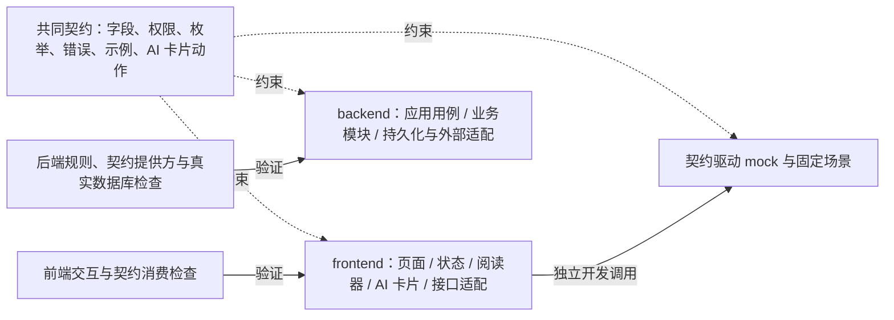

两侧以同一份契约为输入。前端不复制业务决策来模拟权威结果，mock 按预置场景返回；后端不依赖前端启动来验证事务。契约存放目录、生成方式、人员和分支尚未确定。是否拆分身份/读者或罚款/支付内部包可在 DD 细化，不影响本稿对外职责。

## 4. 进程视图：成功事实与异步投递

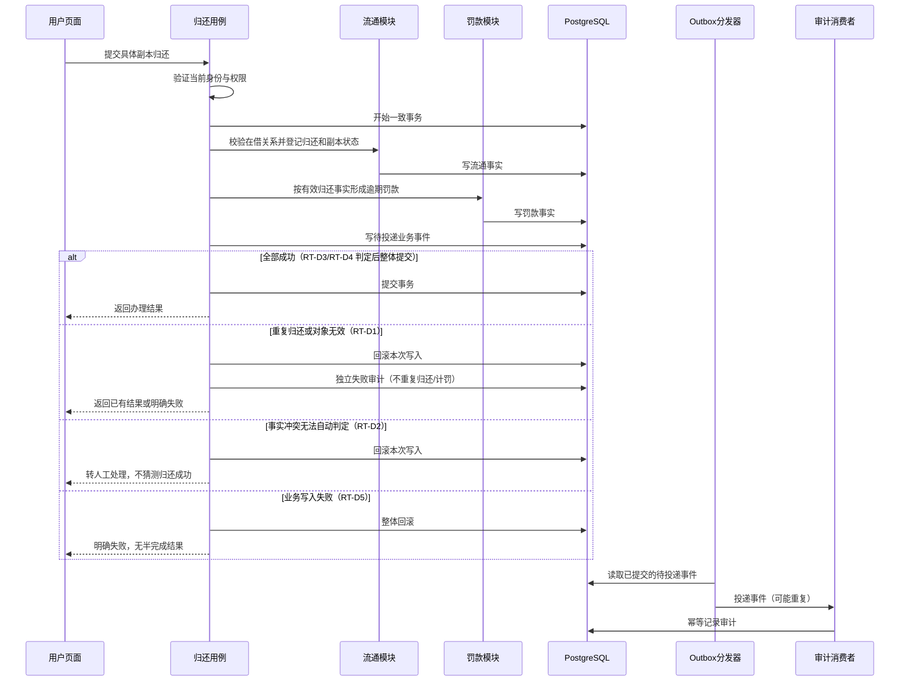

分支标注对应 OD-0003 §4 的 RT-D 分析行（该节沿用本图作为归还模块时序，并以此图为其时序覆盖声明目标）。此图仅示归还链；它不暗示所有动作都有罚款或到馆通知。未产生业务记录的拒绝判定也必须有审计记录，其独立事务记录方式待 DD 明确，不能随业务回滚被丢弃。任务和分发器的并行度、互斥、重试以及多消费者投递记录尚未冻结。

## 5. 物理视图：候选单应用部署

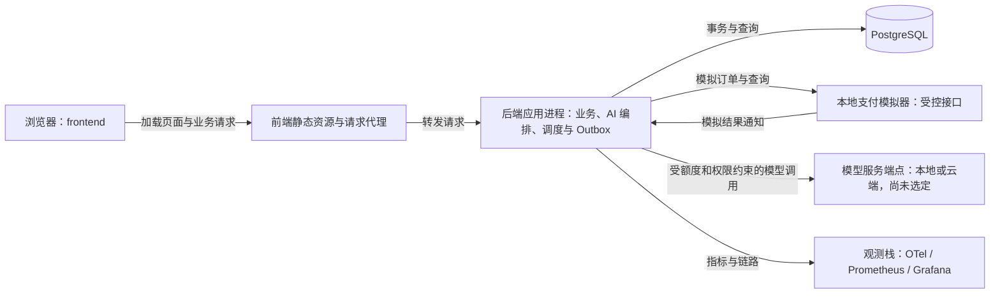

模块化单体是本稿的部署候选，逻辑模块不各自部署成微服务。模拟器框表示受控接口，其是否与应用共进程尚未冻结；模型端点两种形态是备选，图中不表示两者同时启用。阅读内容存储介质未选定。观测系统不作为业务状态来源；不增加外部支付、消息推送平台或其他业务系统。

## 6. 场景视图（+1）：AI 预填仍由用户在页面办理

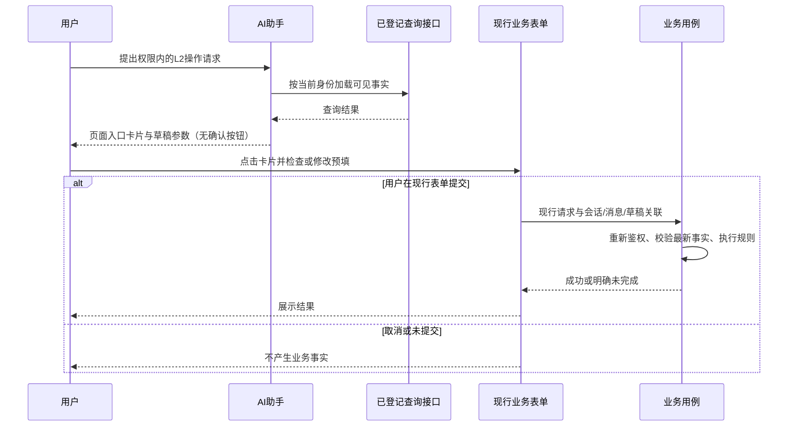

资金与高风险等 L3 行为只给页面引导，不进入上述 L2 预填路径；L4 拒绝。AI 不推送办理结果，用户返回对话可继续查询。

| 检查场景 | 需要贯通的模块 | 用于检查草图的关键问题 |
| --- | --- | --- |
| 登录续行与预约 | 身份、查询、流通 | 目标保留，登录后仍重验最新资格与副本/队列 |
| 自助批量借书 | 前端会话、流通、审计 | 逐册独立成功或失败，清空会话不撤销已借出事实 |
| 归还与罚款 | 流通、罚款、Outbox、审计 | 不重复归还、不漏罚款、不丢关键审计 |
| 闭馆与维护完成 | 日历触发、流通、Outbox、通知 | 共用分配规则，清退时机分开，通知重复不重复改变状态 |
| 支付与复核 | 结算、复核、身份/流通、审计 | 不重复结算，审批不绕过目标规则 |
| AI 预填 | AI、身份、现行页面、业务用例 | 数据同权限、提交同规则，未提交不产生业务事实 |

本表是视图一致性检查样例，不替代全量系统测试设计或需求追踪矩阵。

## 7. 待确认关系与设计留项

- **Q1，已由用户确认（2026-09-11）：** 首版不建赔偿模块，异常归还只处理流通终态、副本状态与既有逾期罚款。RA-0008 §5 的“破损赔偿属高风险事务链”与 RA-0003 §3 范围排除不一致；本稿采用用户本轮确认，来源文档勘误及基线变更记录仍待同步，不把用户答复当作来源文件已经修正。
- **候选模块关系：** 副本状态与预约借还同归流通；账户与读者暂归一组；罚款与支付暂归结算组；复核保存责任链、目标模块执行业务变化。此为供用户审阅的设计建议，尚未冻结。
- **技术留项：** AI 真实端点选择及验证、闭馆隔离/恢复、事务锁序和重试、原子性约束的实现、内容存储、契约细节均未定稿。它们不阻止阅读本草图，但必须按 M3/M4 出口完成。

## 8. 场景分析已确认的设计约束

2026-09-11，用户 lingzz 在场景分析确认第一轮确认：SC-Q1 闭馆全馆隔离，并区分分界时间点前后行为；SC-Q2 逾期归还整体提交或回滚，包含借阅结束、副本状态、罚款与待投递业务事件。场景图与时序细化受此约束，跨界请求提交截止见下方第二轮确认；闭馆恢复结论见第三至第五轮记录。本次确认不等于完整 OD 评审通过。

### 第二轮确认：提交截止与复核对象变化

- SC-Q3：用户明确否决准入时间分界方案，相关业务写入必须在闭馆分界 T 前实际提交完成，T 时未完成提交则失败回滚。闭馆取数不能被此前在途请求的迟到提交污染；t_commit < T 方可归入分界前事实，闭馆隔离期间 t_commit ≥ T 的普通业务写入不得成功；闭馆成功恢复写入后的新请求按 SC-Q6 处理。页面响应到达时间不替代提交事实。实现上必须验证实际提交与闭馆取数的隔离保证，不能以“请求开始时检查过时间”代替。
- SC-Q4：用户确认复核目标相关事实变化时原申请不直接生效，重新发起建立新业务事务，保留原事务关联，不修改已完成事务。此处“新事务”指新业务处置记录，不只是另开数据库事务。

### 第三轮确认：闭馆事务与恢复写入

- SC-Q5：用户确认三阶段整体提交或回滚，涵盖未到馆处理、清点、候补结算及本轮待投递业务事件。失败不产生本轮部分业务结果或通知投递，保持隔离；诊断和失败审计仍需保留。
- SC-Q6：用户确认闭馆成功结算后恢复其他事务写入。T 是本轮闭馆前业务提交截止点；从 T 至闭馆成功恢复之间普通相关写入受隔离，恢复后新请求按最新事实处理，不反向改变本轮闭馆结算结果。

## 9. 闭馆分界与补结分析（SC-Q1～SC-Q10）

T 为本轮闭馆提交截止，R 为真正恢复外部事务写入的时点。正常闭馆按 SC-Q6 在成功后恢复；逐日补结路径按 SC-Q10 在追平后保持隔离，须管理员显式重新开放。此前第9节将所有成功都连到自动恢复，现由本节修正。外部事务指被隔离的普通业务写入，不指恢复控制命令、闭馆内部事务或失败审计；只读查询仍按原权限提供。

### 9.1 因果图

C 为条件，E 为结果，AND/NOT 为逻辑组合，不表示调用次序。C1 与 C2 互斥；C6 表示依据当时营业日历已无到期未完成闭馆批次。C5 只在逐日补结路径成立。

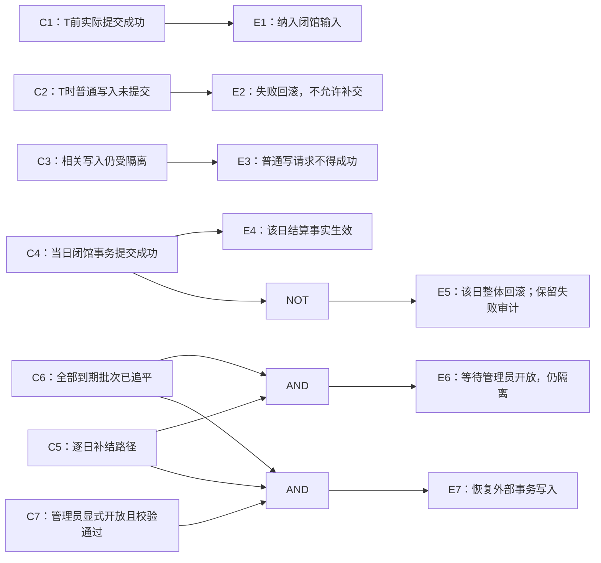

正常路径的恢复条件为 C4 且没有进入逐日补结路径；補结路径中“本日成功”“全部追平”“管理员重新开放”是三件不同的事。管理员命令也必须验证追平仍成立，不能用此前页面显示的“已追平”绕过新到期的批次。提交结果未知时先核对既有结果，不得当作确定失败而重复执行。

### 9.2 判定表

下表按判定主体分为三组（C11-a，2026-09-11 用户确认）：**组间无交互**，各自独立判定，不跨组比较行优先级；**组内按行优先级或阶段先后判定**——普通请求组三行互斥，闭馆批次与恢复组内 D5 是 D6/D7 的前置结果行而非同阶段竞争行，D8/D9 与 D10/D11 是不同时点的判定。

**主体一：普通业务请求（T 截止与隔离）**

| 规则 | 条件 | 业务结果 | 外部写入 |
| --- | --- | --- | --- |
| CL-D1 | 普通请求在 T 前实际提交成功 | 纳入本轮闭馆前事实；响应晚到不改变事实 | 原请求已完成 |
| CL-D2 | 普通请求在 T 时未提交 | 失败回滚，不可在闭馆取数后补交 | 禁止本次写入 |
| CL-D3 | 普通新请求到达且隔离仍有效 | 明确失败，不隐式排队形成原请求 | 保持隔离 |

**主体二：闭馆批次与恢复控制**

| 规则 | 条件 | 业务结果 | 外部写入 |
| --- | --- | --- | --- |
| CL-D4 | 正常闭馆三阶段及事件提交成功 | 本轮统一生效 | 按 SC-Q6 恢复 |
| CL-D5 | 某日闭馆确定失败 | 该日整体回滚，只保留失败审计/诊断 | 保持隔离 |
| CL-D6 | 失败且自动重试未耗尽 | 按该轮原日期重试，实际执行时间据实记录 | 保持隔离 |
| CL-D7 | 自动重试耗尽 | 转人工恢复，不伪造完成状态 | 保持隔离 |
| CL-D8 | 逐日补结，本日成功且还有到期批次 | 继续下一业务日期，前日提交不回滚 | 保持隔离 |
| CL-D9 | 逐日补结已追平、管理员尚未开放 | 等待管理员，不自行继续普通写入 | 保持隔离 |
| CL-D10 | 管理员显式开放，当前仍已追平且有权限 | 记录开放操作并到达 R | 恢复 |
| CL-D11 | 管理员命令无权或当前未追平 | 命令失败，不改变控制状态 | 保持隔离 |

**主体三：已提交事件的投递**

| 规则 | 条件 | 业务结果 | 外部写入 |
| --- | --- | --- | --- |
| CL-D12 | 已提交事件投递失败或重复 | 幂等重试，不撤销已完成的当日结算 | 不以投递失败改变开放状态 |

### 9.3 场景流图

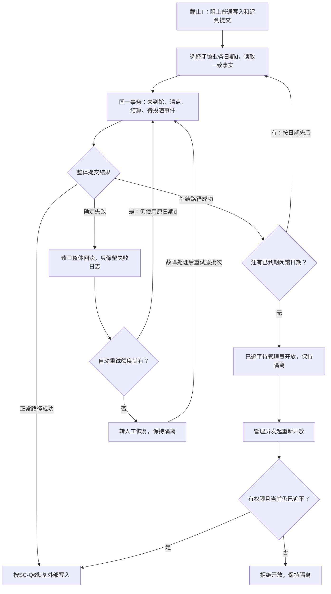

重试仍须重新读取适用于该原日期批次的一致事实，不能使用受回滚影响的临时对象。图中的日期固定不表示所有重试复用已失效的数据库快照。已完成日期不得重复结算；失败日期后面的日期不得越序先结算。

### 9.4 模块时序图

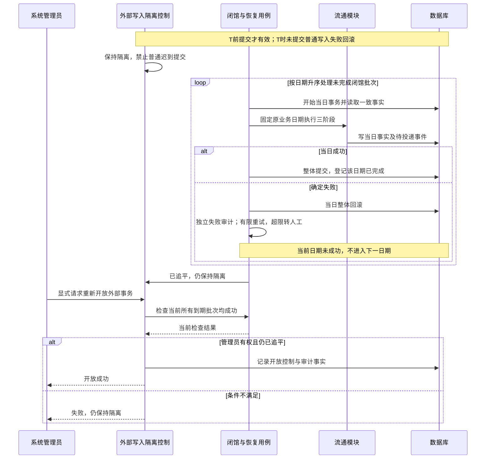

本图为逐日补结路径；正常成功闭馆不据此自动增加管理员确认环节。如何保证管理员开放检查与控制状态变更不被新的闭馆截止打断，是详细设计必须证明的原子性约束，不另产生业务政策。

## 10. 第四轮确认：闭馆恢复

2026-09-11，用户 lingzz 确认：

- SC-Q7：闭馆失败跨日重试固定原闭馆业务日期；本轮到期、未到馆、清点及结算判定不因恢复日期改变而漂移。重试的实际时间仍据实记录，不改写历史时间。
- SC-Q8：有限自动重试，超出转人工恢复；次数与间隔配置化，具体参数未指定。恢复期间维持隔离，闭馆成功是恢复写入的必要条件；逐日补结路径还须满足 SC-Q10 的管理员显式开放条件。人工恢复不等于允许跳过结算或强制宣布成功。

SC-Q1～SC-Q8 的确认仅覆盖闭馆、逾期归还一致性与复核对象变化。完整模块划分、接口及其他场景尚未通过 OD 评审。跨多个应执行闭馆日期的补结及恢复写入方式随后由 SC-Q10 确认。

## 11. 场景分析覆盖索引

以下索引区分已有需求事实与本轮新增设计确认，避免重复询问已定规则。因果图中的条件必须进一步拆成可独立取值的事实；判定表注明互斥或不可达组合，场景流引用同一判定行，时序图注明状态写入及其原子范围。

| 场景族 | 现有确定输入 | 本轮已确定接口/事务约束 | 细化状态 |
| --- | --- | --- | --- |
| 预约提交、候补确认 | FR-0028 C01～C11；在线/服务台日期守卫、资格、可预约性、额度、重复、队列与即用副本 | 竞争后必须按最新状态重新确认候补，不从简图推定自动入队 | OD-0003 §2 已展开四类分析 |
| 预约取书、现场与自助借阅 | FR-0028 C14；FR-0036/0037；入口人工与借出人工分别处理 | T 时未提交的相关写入失败；自助逐册事务不整体撤销 | OD-0003 §3 已展开判定与场景流；馆员人工处置路径（PK-D5～D8）以该节场景流图为准，不另建时序图 |
| 归还与罚款 | BR-0017 罚款公式与封顶、BR-0019 重复拒绝、正常/破损副本迁移 | SC-Q2 业务变化与待投递事件整体提交或回滚 | OD-0003 §4 已补条件与判定；本稿 §4 保留完整时序并标注 RT-D 分支 |
| 闭馆与恢复 | 未到馆、清点、结算顺序；通知与分配既有规则 | SC-Q1/3/5/6/7/8：隔离、截止、整体提交、成功恢复写入、原日期、有限重试 | 第9节四类分析已形成；SC-Q10 已确定逐日补结和管理员开放 |
| 高风险复核 | 馆员发起、管理员复核；复核前不生效 | SC-Q4 目标已变化时新建后续业务事务，不修改已完成事务 | OD-0003 §5 已展开；SC-Q9 批准、执行及事件同一事务，失败仅留审计；拒绝/守卫失败路径以该节场景流为准（C7-b 图注） |
| 模拟支付 | 创建/查询/通知/关闭/退款/对账、重复通知幂等、无真实资金 | 闭馆隔离范围内写入不得污染取数 | §14～§16 已展开四类分析及订单释放状态图 |
| AI 辅助 | L1～L4、资金/高风险 L3 上限、页面预填与用户现行提交、会话日志和操作关联 | 用户未提交不产生业务事实，复用同一提交约束 | 场景时序已有，条件与拒绝分支待补齐 |

本索引不宣称场景分析已全量完成，也不替代原需求追踪矩阵。

编号映射说明（C8-b/C9-a）：本稿闭馆与支付各图维持 C/E 条件/结果编号——§9.1 因果图 C1～C7/E1～E7、§14.2 因果图 C1～C6′/E1～E5，与判定行的映射以两表『条件』列为锚点：§9.1 条件组合对应 §9.2 三个主体组（普通请求 CL-D1～D3、闭馆批次与恢复 CL-D4～D11、事件投递 CL-D12）各行条件；§14.2 条件对应 §14.3 生命周期行（PAY-D1～D6、PAY-D15）与 §15.1 建单守卫行（PAY-D7～D14）条件。图内不逐字复制行号；OD-0003 各图则直接携带 RS/PK/RT/RV-D 编号。馆员人工处置路径（入口/借出人工事务的放行、守卫不满足保持、拒绝）统一以 OD-0003 §3.2 场景流为准，不在各时序图重复展开；该节时序图后附『覆盖声明』行登记此归属。

## 12. 第五轮确认：复核一致性与补结后的管理员开放

2026-09-11，用户 lingzz 确认：

- SC-Q9：复核批准记录、目标实际变更及待投递业务事件整体提交或回滚；确定失败只保留失败日志供审计，不留下“已批准但目标未生效”的业务结果。目标事实发生变化时按 SC-Q4 新建后续处置，不改写已完成事务。
- SC-Q10：闭馆按业务日期先后逐日补结，每日三阶段整体事务；后日失败不撤销前日已提交结果。追平后保持外部事务隔离，由管理员显式重新启动，不自动恢复。

SC-Q10 细化逐日补结分支的恢复条件；正常成功闭馆仍按 SC-Q6。此处外部事务不包括用于重试、查询恢复进度和管理员开放的受控恢复命令，否则系统无法在隔离期间恢复。

## 13. 支付订单来源与第六轮确认

### 13.1 用户确认的边界

2026-09-11，用户 lingzz 原文确认 SC-Q11：“支付超时不产生事务，只产生日志。维持数据状态一致性。”因此不把超时建立为新的支付业务事务，不因超时创建补偿订单或改成付款成功/失败。该轮未明的建单与支付边界已由下方 SC-Q13 用户解释明确。

SC-Q12 用户采纳：读者可关闭本人符合条件的订单、馆员可受控关闭、系统可按配置自动关闭；已成功支付走退款，支付尝试超时不直接关闭订单；订单自身到期按 SC-Q13 建立订单关闭事务。该权限不是创建订单的授权，不据此新增馆员任意建单或管理员收费功能。

### 13.2 合法订单来源

下表依据已引用的 RA-0008 §5/§8/§9 与 RA-0010 FR-0014/0018/0024/0025/0031，区分产生收费依据、创建支付订单和后续记录。新增场景必须有业务来源，不能仅因技术上存在超时、重试或事件就创建订单。

| 事件/入口 | 产生的事实 | 是否创建新支付订单 |
| --- | --- | --- |
| 馆员办理逾期归还 | 归还事实与逾期罚款，遵循 SC-Q2 原子提交 | 不自动创建；罚款是支付依据 |
| 读者对本人应结算罚款明确发起模拟支付 | 基于有效罚款建立本地模拟支付订单 | 现有需求明确的建单入口 |
| 超时、查询、重复通知、重试通知 | 日志或既有订单结果核对 | 不因这些事件另建订单 |
| 关闭订单 | 已有订单受控终止 | 不另建支付订单 |
| 馆员对已完成支付申请退款 | 与原支付关联的退款业务记录 | 退款不是新的正向支付订单 |
| 授权角色手动对账 | 对账记录及差异 | 不因差异自动新增收费订单 |
| 罚款减免/豁免 | 高风险复核与获批后的罚款处置 | 不因减免创建支付订单 |
| AI 提供支付页面入口 | L3 引导，用户到现行页面办理 | AI 不代建订单、不代提交 |
| 遗失/损坏赔偿、借阅押金、预约费用 | 没有当前首版收费来源 | 不设计此类订单来源 |

现有规范未明确合并多笔罚款支付，本稿不增加该能力。同一罚款同时多个订单已由 SC-Q14 明确禁止。建单与支付结果的持久化边界已按 SC-Q13 分开：建单失败不留订单，支付超时保留既有订单。

## 14. 支付尝试超时、订单到期与建单失败（SC-Q13）

2026-09-11，用户 lingzz 明确：“不产生业务是不产生提交事实，但保留订单供再次支付。除非订单本身也超时，此时建立订单关闭事务。同理，建立订单失败不产生订单事务。”

### 14.1 业务概念与结果

- 支付尝试超时：本次尝试没有可提交的支付结果，不提交支付/罚款结算事实；保留已存在的订单供再次支付，只记录超时日志。不因尝试超时创建另一张支付订单。
- 订单到期：订单自身有效期届满，与单次支付尝试超时不同；触发订单关闭事务。关闭本身须成功提交才形成关闭事实，不能只因计时到期便把关闭操作宣称成功。
- 建单失败：没有订单提交事实，不遗留订单业务记录；失败日志独立保存。
- 支付成功、关闭及退款仍各自遵循授权、当前状态校验和幂等要求。已有成功支付不因迟到的超时计时事件被关闭，也不因重试重复结算。

### 14.2 因果图

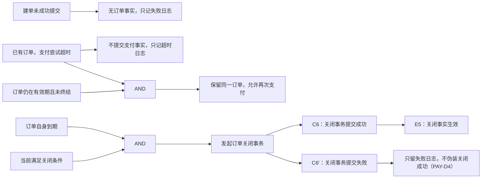

这些箭头表达条件与结果，不表示订单到期必然可以覆盖任何当前状态。已成功支付、已关闭和冲突结果必须沿用现有状态与幂等规则。C6′ 为 2026-09-11 用户确认 C4-a 后补入的关闭失败出口，与 §14.3 PAY-D4 行、§14.4 场景流『关闭提交成功？否』分支一致。

### 14.3 判定表

本表按行优先级判定（C2-a，2026-09-11 用户确认）：**PAY-D5 > PAY-D6 > PAY-D3 > PAY-D2 > PAY-D15**——幂等返回最优先，已支付不可被关闭撤销（SC-Q15），未支付到期发起关闭，超时仅日志，终态吸收兜底；只有前行未命中才进入下一行。

| 分析行 | 条件 | 订单事实 | 支付/罚款事实 | 日志与后续 |
| --- | --- | --- | --- | --- |
| PAY-D1 | 建单提交失败 | 不产生订单 | 不结算 | 失败日志 |
| PAY-D5 | 重复成功通知或重复处理 | 不重复更新 | 不重复结算 | 返回或展示既有结果，保留必要日志 |
| PAY-D6 | 已完成支付又收到到期关闭请求 | 不破坏已完成订单 | 不撤销已确认结算 | 不执行不符合条件的关闭，反向处理走退款 |
| PAY-D3 | 订单自身到期且符合关闭条件（符合关闭条件不含已终结订单） | 发起关闭事务 | 不因到期结算罚款 | 关闭提交后方生效 |
| PAY-D2 | 支付尝试超时，订单仍有效且未终结 | 保留原订单 | 不提交本次支付事实 | 超时日志，允许原订单再次支付 |
| PAY-D15 | 超时或关闭请求到达已终结订单（已支付或已关闭） | 不改变既有订单事实 | 不改变既有结算 | 仅记录日志（终态吸收，与 §16 状态机终态语义和 PAY-D5 幂等口径一致） |
| PAY-D4 | 关闭事务失败 | 不产生本次关闭提交事实 | 保持原结算事实 | 失败日志，不伪装关闭成功 |

PAY 为本稿新分析编号，不是历史判定表行号。PAY-D15 为 2026-09-11 用户确认 C3-a 后补入的正式分析行（原表未定义迟到事件到达已终结订单的判定，占位编号 PAY-D2b 同步废止）；表中按上述行优先级排列，PAY-D4 为 PAY-D3 发起后的关闭结果行。到期与成功通知同时竞争时的提交顺序仍须由详细设计证明不会产生冲突事实。

### 14.4 场景流图

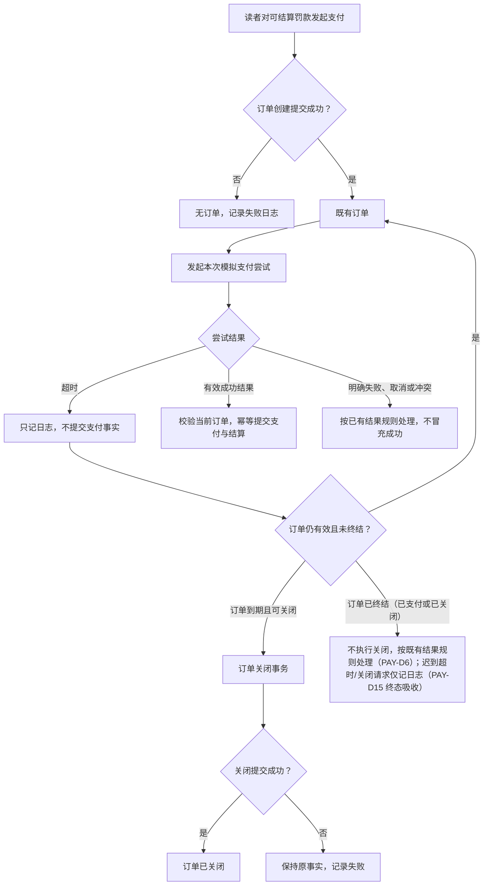

再次支付是对仍符合条件的原订单执行新的尝试，不是自动重建订单。图中回到订单不表示服务端无限自动重试，也未规定订单关闭后能否为同一罚款再建单。『订单已终结』分支为 2026-09-11 用户确认 C5-a 后补入：已终结订单收到到期关闭请求时不执行关闭——已支付订单按既有结果规则反向处理（退款，与 PAY-D6 一致），已关闭订单的迟到超时/关闭请求仅记录日志（PAY-D15 终态吸收），两者均不改变既有事实。

### 14.5 模块时序图

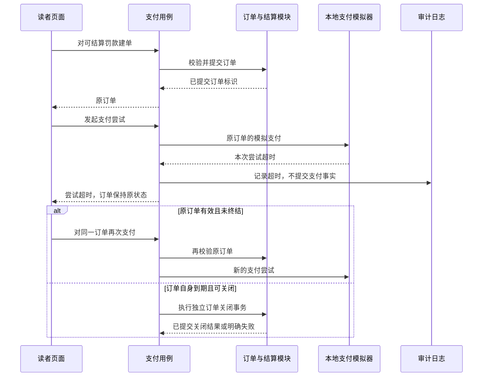

该图省略已在前表说明的建单失败出口，不改变失败不留订单的约束。订单到期触发器与单次支付调用计时器职责分开；闭馆隔离仍约束相应写入，计时事件不能绕过已确认提交截止。

## 15. 同一罚款的订单独占（SC-Q14）

2026-09-11，用户 lingzz 确认：“同一罚款在一个时间点只能有一个罚款订单，不得同时建立多个订单。直到原订单被释放，才能建立新订单。”

同一罚款至多被一个未释放订单占用；历史订单保留，不通过删除历史满足唯一性。支付尝试超时按 SC-Q13 保留原订单，因此不释放占用、不允许另建订单。SC-Q15 已确认：未支付订单只有在关闭事务成功提交后释放占用；页面关闭、支付尝试超时或失败、关闭命令已发出及关闭执行失败均不释放。读者取消支付同样通过关闭事务。

### 15.1 建单判定表补充

| 分析行 | 条件 | 允许结果 |
| --- | --- | --- |
| PAY-D7 | 同一罚款已有未释放订单 | 不建立第二订单；此前订单仍可按其有效条件办理 |
| PAY-D8 | 同一罚款没有未释放订单且仍符合可结算条件 | 可尝试新建订单，成功后占用该罚款 |
| PAY-D9 | 两个不同请求同时为同一罚款建单 | 最多一个订单提交成功，不依赖前端按钮防重 |
| PAY-D10 | 建单失败并回滚 | 不留下订单，不留下本次占用 |
| PAY-D11 | 原订单尚未完成释放 | 新建请求不得因“释放处理中”绕过占用 |
| PAY-D12 | 未支付订单关闭事务成功提交 | 关闭与释放占用同时生效；罚款仍应结算时才可重新建单 |
| PAY-D13 | 支付超时/失败或关闭失败 | 原订单仍占用罚款，不得新建第二单 |
| PAY-D14 | 订单支付成功且罚款已结清 | 不得为已结清罚款建立新单；反向处理走既有退款流程 |

PAY-D8 不表示释放后罚款必然仍可支付；创建时仍核对最新结算事实。SC-Q14 不自动授权修改旧订单、删除旧订单或合并多笔罚款。

### 15.2 建单竞争的模块时序

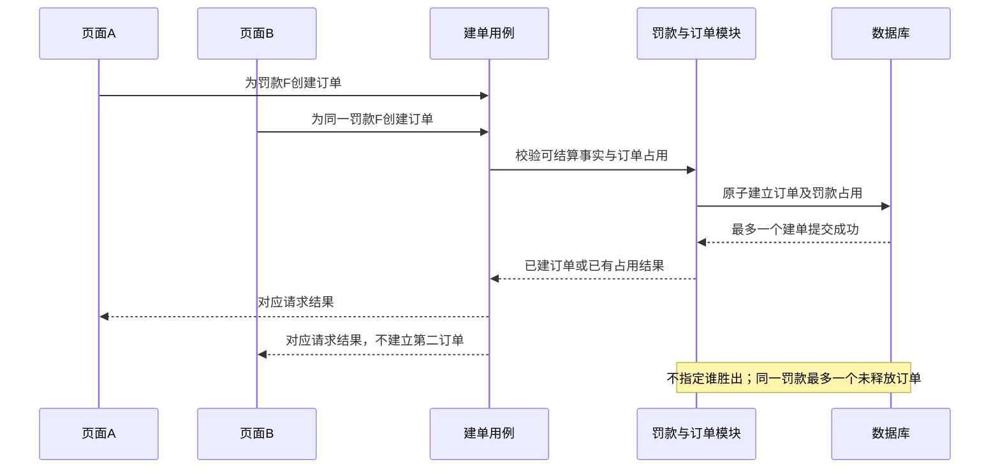

该图表达必须满足的不变量，不冻结锁、索引或返回码实现。释放与新建之间也必须遵守同一原子性约束，不能分别检查后各自写入而造成重叠。

## 16. 第九轮确认：订单释放（SC-Q15）

2026-09-11，用户 lingzz 确认建议：未支付订单只有关闭事务成功提交后才释放占用；支付尝试超时、失败或关闭失败都不释放。读者取消支付通过关闭事务处理，订单自身到期同样须提交关闭。支付成功完成罚款结算，不能再为已结清罚款建单。

关闭事实与占用释放必须共同生效，否则会出现已关闭仍占用或未关闭已放开两种矛盾；此为 SC-Q14/15 的实现不变量，不表示已选择具体数据库结构。

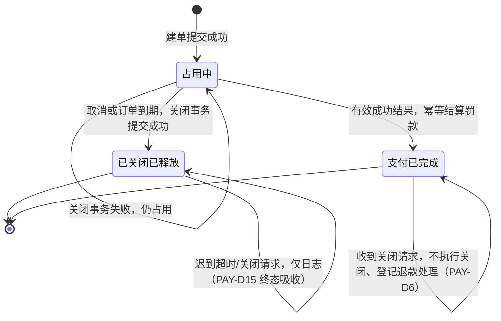

已关闭已释放与支付已完成均为吸收态：迟到超时/关闭请求类事件只记日志，不改变既有事实（C3-a 终态吸收，PAY-D15）；已支付订单收到关闭请求不执行关闭、登记按既有结果规则反向处理（PAY-D6，退款流程不在本图展开）。这些是业务分析状态，不是数据库枚举定稿。新订单是独立对象，不把已关闭订单改回占用中；是否仍可收费依据罚款最新事实判断。退款记录关联原已完成支付，不能将本图反向转移当作退款设计。本图四态与验证模型 `verification/models/OrderOccupancy.tla` 的 `NONE/OCCUPIED/CLOSED/PAID` 一一对应（未建单＝建单失败或尚未建单，无业务记录），释放是已关闭的派生事实，不设独立『已释放』状态。

## 修订记录

- 2026-09-12，v0.11：原因：形式化验证差距 F2/F3/F4/F5/F8/F11 经用户确认（C2-a、C3-a、C4-a、C5-a、C8-b、C11-a）后逐条落实；提出人/批准人 lingzz（2026-09-11 确认），记录人 Zcode；影响 §4 时序（分支按 OD-0003 §4 RT-D 行标注）、§9.2（CL 表按三主体分组并注明组间/组内判定关系）、§11（覆盖索引修正两行过时状态，登记 C/E 编号与 CL-D/PAY-D 映射及人工处置以场景流为准）、§14.2（因果图补 C6′ 关闭失败出口）、§14.3（补行优先级声明 D5>D6>D3>D2>PAY-D15、PAY-D3 条件收紧、新增正式行 PAY-D15 终态吸收，占位 PAY-D2b 废止）、§14.4（V 节点补『订单已终结』分支）、§16（状态图补终态吸收与 PAY-D6 自环、登记验证模型四态映射）；未改变任何已确认业务结论。

- 2026-09-11，v0.10：原因：用户确认释放定义；提出人/批准人 lingzz，记录人 Codex；影响订单状态、独占和建单条件；SC-Q15 已确定，补 PAY-D12～14 及状态图，原“释放待明确”记录为历史。

- 2026-09-11，v0.9：原因：用户确认同一罚款订单独占；提出人/批准人 lingzz，记录人 Codex；影响建单因果条件、判定表及并发时序；SC-Q14 已确认，释放的具体提交结果仍待明确。

- 2026-09-11，v0.8：原因：用户解释业务提交事实及两类超时；提出人/批准人 lingzz，记录人 Codex；SC-Q13 已明确建单失败无订单、支付尝试超时保留原订单、订单自身到期触发关闭事务；补充支付分析四类工件，完整支付状态矩阵尚未冻结。

- 2026-09-11，v0.7：原因：用户明确支付超时日志边界、采纳关闭权限并要求核对来源；提出人/批准人 lingzz，记录人 Codex；影响支付因果条件与订单入口，记录 SC-Q11 原文及未明持久化边界，禁止扩张收费来源。

- 2026-09-11，v0.6：原因：第五轮用户确认；提出人/批准人 lingzz，记录人 Codex；影响复核提交结果与逐日补结开放条件；SC-Q9/SC-Q10 已确定，修正原第9节“补结成功自动恢复”的关系，未登记完整 OD 批准。

- 2026-09-11，v0.5：原因：第四轮用户确认；提出人/批准人 lingzz，记录人 Codex；影响恢复日期与重试场景；SC-Q7 固定原日期，SC-Q8 有限重试后转人工，补充场景流恢复边。

- 2026-09-11，v0.4 补充：将已确认 SC-Q1～SC-Q6 展开为闭馆因果图、判定表、场景流图与模块时序图；仅为该分支分析样板，当时恢复策略及其他业务场景尚未完整展开。

- 2026-09-11，v0.4：原因：第三轮用户确认；提出人/批准人 lingzz，记录人 Codex；影响闭馆失败出口及恢复后场景；SC-Q5/SC-Q6 已确认，完整 OD 仍为 Draft。

- 2026-09-11，v0.3：原因：第二轮用户确认；提出人/批准人 lingzz，记录人 Codex；影响闭馆边界条件与高风险复核场景；结论 SC-Q3 严格截止、SC-Q4 新建后续业务事务，未冻结恢复机制或实现。

- 2026-09-11，v0.2：原因：用户确认闭馆隔离与逾期归还原子提交；提出人/批准人：lingzz，记录人：Codex；影响：闭馆和归还场景及模块时序；场景分析评审尚未完成，SC-Q1/SC-Q2 已确认，其余保留草案。

- 2026-09-11，v0.1：按用户“先确定草图、不明确关系再确认”要求编制；记录人 Codex。已完成五类粗粒度视图与职责说明；需求批准沿用已有基线，模块划分未批准，Q1 已获用户确认、来源勘误待同步，无代码实现或测试执行结论。

> 被引用文档：
>
> - [核心流通场景因果与交互分析](MLS-DOC-OD-0003.md)
>
> - [业务词汇](../../CONTEXT.md)
>
> - [总体设计入口](MLS-DOC-OD-0001.md)
> - [工程文档目录](../README.md)
> - [开发任务规划](../../TODO.md)
> - [当前交接记录](../../HANDOFF.md)
