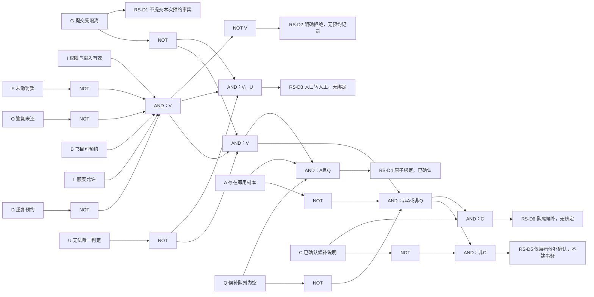
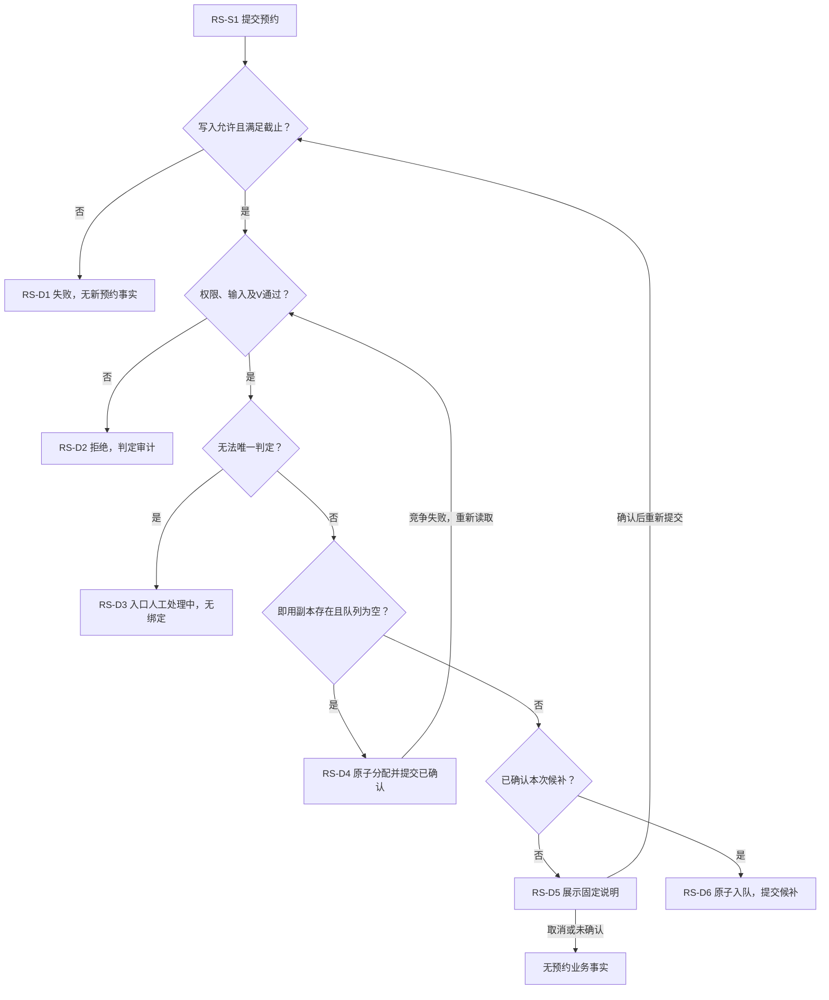
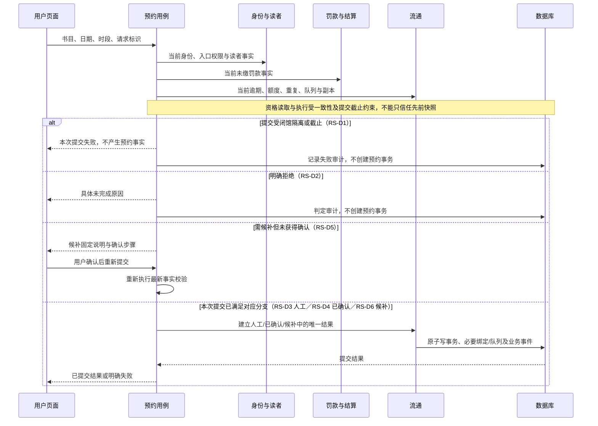
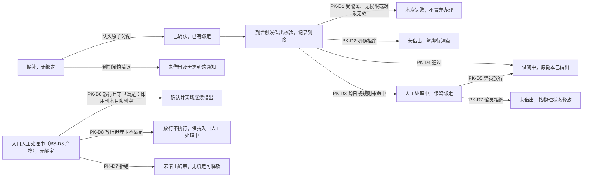
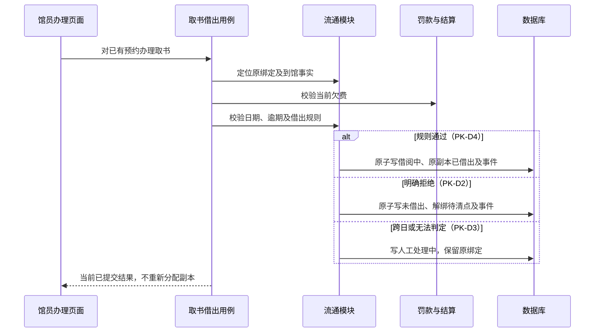
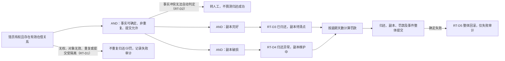
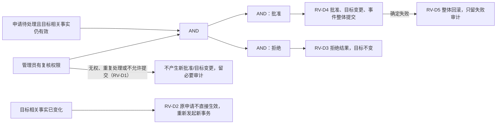
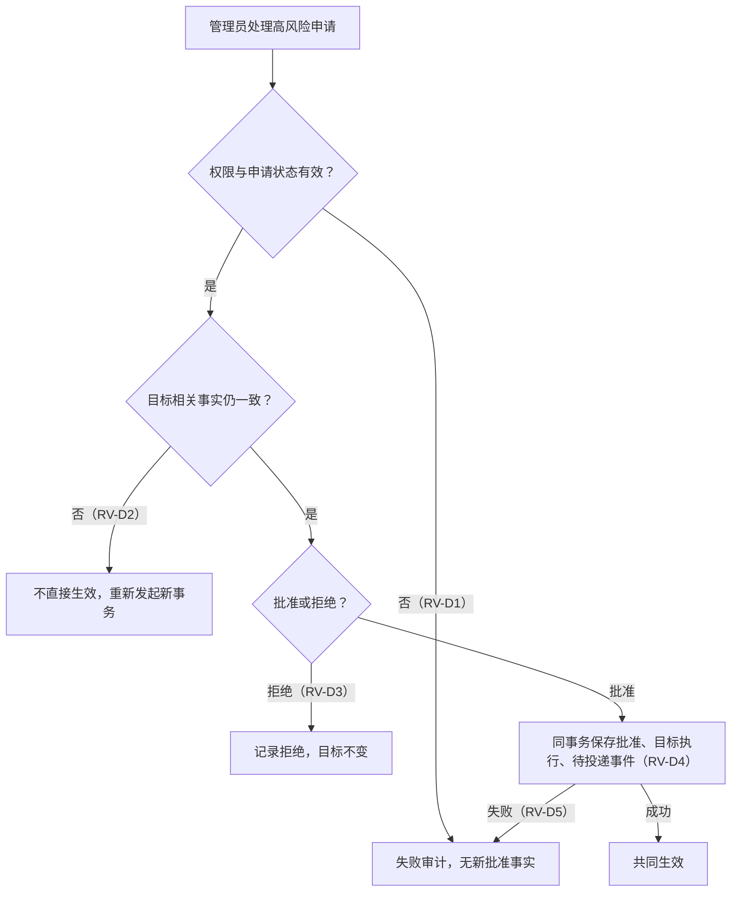
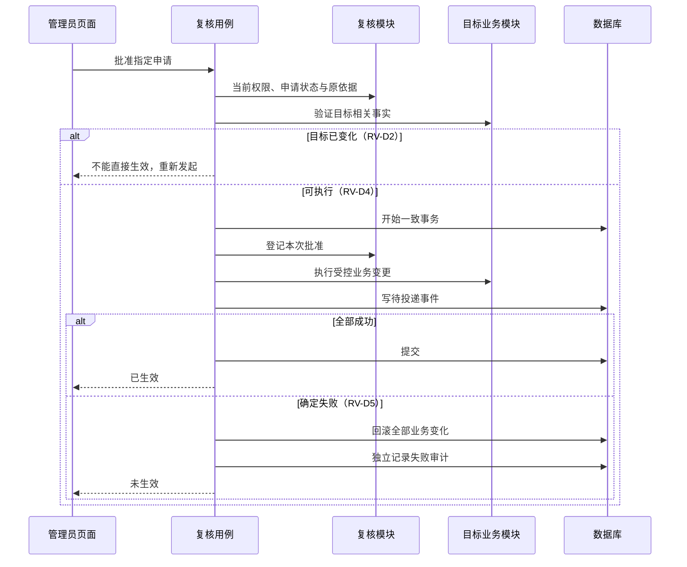

# 核心流通场景因果与交互分析

| 字段     | 值                                                |
| -------- | ------------------------------------------------- |
| 文档编号 | `MLS-DOC-OD-0003`                                 |
| 文档状态 | `Approved`                                        |
| 文档版本 | `v0.4`                                            |
| 编制日期 | `2026-09-11`                                      |
| 范围     | 预约提交、候补分配、到馆借出及归还/复核的事务交互 |

> 引用文档：
>
> - [限定范围交付与 DevOps 阶段规则](../00-governance/MLS-DOC-GOV-0008.md)
>
> - [模块关系、4+1 草图与用户确认记录](MLS-DOC-OD-0002.md)
> - [业务流程](../01-requirements/requirements/MLS-DOC-RA-0008.md)
> - [功能需求](../01-requirements/requirements/MLS-DOC-RA-0010.md)
> - [业务规则](../01-requirements/requirements/MLS-DOC-RA-0011.md)

## 2026-10-01 当前适用范围与批准修订

lingzz 于 2026-10-01 明确批准 A–E，并追加新增功能 TLA 形式化回归、CI 验证及完整 PR 流程要求。本节与[限定范围交付与 DevOps 阶段规则](../00-governance/MLS-DOC-GOV-0008.md)共同限定当前适用内容；下文相冲突的范围、角色、状态和准入表述保留为原基线历史，其余约束继续有效。批准修订与执行验证分别登记。

当前判定场景保留预约、馆员取书与现场借出、正常/异常归还及账户变更复核；退款和高风险流通例外的设计分支属于移出历史。当天上架与实际 LENT 分别判断，管理员关闭权限与日结恢复按 GOV-0008 修订。

本次改变模型来源文档，原结构、判定表和 TLC 报告仅为历史结论；当前模型映射和重跑在 TODO 登记为未完成，不继承旧 GAP=0 或 No error 结论。

## 1. 分析方法与完成边界

本文把同一业务条件在因果图、判定表、场景流、模块时序中对应起来。条件表示可观察事实或已批准判断，结果表示明确业务出口；模块调用不能代替业务原因。表内 `—` 表示该行结果不取决于该条件，不表示条件为假。

RS、PK、RT、RV 为本稿分析编号，不是需求 ID，也不是历史“借阅8/续借8/归还4”判定表的原行号；原逐行表尚未定位，不以本稿冒充恢复。当前事实采用现行 FR/BR 和后续业务流程，不沿用已被替代的“保留3天”。条件分析不选择数据库表、锁实现或错误码。

本文各图统一携带本稿分析行编号（RS/PK/RT/RV-D）。凡某图未展开而由同文档其他图或 OD-0002 对应图覆盖的分析行，以紧随该图的『覆盖声明：〈分析行〉 → 〈目标章节〉』行登记指向；声明目标必须实际携带所引分析行编号，不允许空引。

闭馆因果/判定/场景/时序见 OD-0002 §9，支付尝试与订单释放见 §14～§16；与本文共同支撑当前 4+1 细化。完整系统测试规格、全量用例展开及需求基线变更传导尚未完成。

## 2. 预约提交：条件字典

输入是读者在线预约或馆员代读者预约；现场立即借阅在分支说明中对照，不能将预约日期限制照搬到现场借阅。提交阶段按最新事实检查，日历只提供展示。来源：FR-0028 C01～C11、BR-0020/0035/0037/0038、RA-0008 §11/§13。

| 条件 | 含义                                                                                    | 取值约束                                         |
| ---- | --------------------------------------------------------------------------------------- | ------------------------------------------------ |
| G    | 本次请求未取得开放 epoch 的写许可，或控制状态处于隔离；已持许可事务先结束后才提交逻辑 T | G 成立时不得产生本次预约事实                     |
| I    | 发起者具备该入口权限，目标是合法读者，日期/时段输入有效                                 | 在线预约不得选择当日；服务台不受在线日期守卫约束 |
| F    | 目标读者有未缴罚款                                                                      | 与 O 分别检查，不混成无法解释的“资格不符”        |
| O    | 目标读者有逾期未还副本                                                                  | 与 F 可以同时成立                                |
| B    | 书目下存在可借阅、已借出或待清点副本                                                    | 全部副本已预定不满足 B                           |
| L    | 候补、已确认、人工处理中合计尚有预约额度                                                | 创建后不能超过 5 条                              |
| D    | 同读者同书目已存在禁止重复的预约事务                                                    | D 成立直接拒绝                                   |
| U    | 无明确拒绝项，但批准规则无法唯一判定                                                    | 仅在未命中明确拒绝后判定                         |
| A    | 存在即用可借阅副本                                                                      | 不等同 B，不把待清点当即用副本                   |
| Q    | 该书目候补队列为空                                                                      | 新请求不得绕过队首                               |
| C    | 读者已收到规定候补说明并确认本次候补提交                                                | 候补写入前必须成立，不由日历颜色代替             |

派生条件 `V = I AND NOT F AND NOT O AND B AND L AND NOT D`。V 是多个原因的合取，前端错误展示仍能定位具体失败原因；多个拒绝原因的展示次序未在此虚构。

### 2.1 因果图

条件节点（含 A、Q、C）均为独立节点；"非G"、"非U"、"非A或非Q"、"非C" 经显式 NOT 边参与组合，复合节点标签同时给出全部约束，两者一致。图为同一有效提交时点的条件关系；分配竞争导致条件变化时需重新判定，不能从失败边直接创建候补而漏掉 C。

### 2.2 判定表

按行优先级判定；只有前行未命中才进入下一行。所有成功写入还须通过原子提交与截止约束。

| 分析行 | G   | V   | U   | A且Q | C   | 结果              | 持久化与副作用                 |
| ------ | --- | --- | --- | ---- | --- | ----------------- | ------------------------------ |
| RS-D1  | 是  | —   | —   | —    | —   | 闭馆隔离/截止失败 | 不建预约，记录必要失败审计     |
| RS-D2  | 否  | 否  | —   | —    | —   | 明确规则拒绝      | 无持久预约事务，记录判定审计   |
| RS-D3  | 否  | 是  | 是  | —    | —   | 入口人工处理中    | 保留事务、无绑定、计入预约额度 |
| RS-D4  | 否  | 是  | 否  | 是   | —   | 已确认            | 原子建立事务并绑定已预定副本   |
| RS-D5  | 否  | 是  | 否  | 否   | 否  | 等待用户候补确认  | 不预建候补事务                 |
| RS-D6  | 否  | 是  | 否  | 否   | 是  | 候补              | 原子入队、无副本绑定、计入额度 |

不可达/无关组合：V 为否时 U/A/Q/C 不改变明确拒绝；B 为否而 A 为真不符合副本定义；C 不免除任何资格或提交时校验。原子分配竞争失败后，按最新状态重新计算 V/U/A/Q：若还符合预约但需候补，进入 RS-D5/6；若条件已经不允许预约则 RS-D2。

现场请求在无即用副本或队列非空时明确拒绝，不套用 RS-D5/6。既有事务因同一幂等请求重复到达时，不能通过再次执行该表产生第二个事务；不同重复业务请求仍按 D 拒绝。

### 2.3 场景流图

成功出口仅在最终提交后成立，前置检查与状态写入之间不得插入破坏结果的并发变更。图中重读不是无界自动重试政策；重试次数与失败返回由 DD 明确。

### 2.4 模块时序图

读者确认后的再次提交重新进入同一用例，而不是直接调用入队接口。身份、罚款和流通是职责关系；此图不承诺三次独立读取天然构成一致快照。

## 3. 候补分配与到馆借出

候补分配复用 RA-0008 §15 的既定流程：闭馆模式含到期预清退、队头分配、到期兜底清退；白天维护完成仅触发分配，不清退。分配成功原子绑定副本并产生一次到馆通知，投递异步；到期未兑现才产生无需到馆通知，不以预测值清退。

### 3.1 到馆判定表

以下以已有已确认预约为前提，发起者仍须满足当前权限；到台触发借出校验即形成到馆事实，不以借出成功为前提。来源：RA-0008 §4/§13/§16。

| 分析行 | 条件                                                               | 事务结果                                       | 副本及其他事实                                                                               |
| ------ | ------------------------------------------------------------------ | ---------------------------------------------- | -------------------------------------------------------------------------------------------- |
| PK-D1  | 提交受隔离、无权限、无效对象                                       | 本次操作失败，不冒充办理                       | 不执行新借出                                                                                 |
| PK-D2  | 自动借出明确拒绝，如当日未缴罚款或逾期未还                         | 既有预约以未借出结束                           | 释放绑定，副本待清点；保留判定与到馆事实                                                     |
| PK-D3  | 未明确拒绝，但跨预约日且无已记录豁免，或规则无法命中               | 借出执行人工处理中                             | 保留已预定绑定，跨日保留，不参加闭馆未到馆处理                                               |
| PK-D4  | 日期符合或已有豁免，借出规则通过                                   | 借阅中                                         | 使用原绑定副本转已借出，不重新分配，按批准借期计算应还日                                     |
| PK-D5  | 馆员放行借出执行人工事务                                           | 执行借出；跨日记录日期豁免                     | 使用已有绑定，不额外要求可用副本或队列为空                                                   |
| PK-D6  | 馆员放行入口人工事务                                               | 有即用副本且队列为空方可确认；现场请求继续借出 | 无副本不得放行，不能套用 PK-D5                                                               |
| PK-D7  | 馆员拒绝人工事务                                                   | 未借出                                         | 有绑定时按物理判定释放：完好待清点、破损维护中、灭失下架                                     |
| PK-D8  | 馆员放行入口人工事务，但放行守卫不满足（无即用副本或候补队列非空） | 放行不执行，事务保持入口人工处理中             | 保留事务、无绑定、计入预约额度（同 RS-D3 留存口径）；可待守卫满足后再放行，或改走 PK-D7 拒绝 |

PK-D8 为 2026-09-11 用户确认 C1-a 后补入的正式分析行（原表未定义"入口人工＋放行＋无即用副本"组合的出口）；守卫语义依据 RA-0008 §13（借阅事务状态机）TX-15a 守卫句，占位编号 PK-D6b 同步废止。

时段用于备书与统计，不因提前或迟于该时段拒绝当日取书。PK-D2 与入口 RS-D2 不同：前者结束已有预约，后者没有预约业务记录。

### 3.2 场景与模块时序

覆盖声明：PK-D1、PK-D5、PK-D6、PK-D7、PK-D8 → §3.2 场景流。时序图覆盖自动借出三分支（PK-D2/D3/D4）；提交失败与馆员人工处置路径（放行、守卫不满足、拒绝）以本节场景流图为准，不在时序图重复展开。

## 4. 归还与逾期罚款

原因条件为有效在借关系、是否重复归还、能否确定业务事实、物理完好/破损、逾期天数。归还由馆员发起；正常/破损归还都按批准政策计算逾期罚款，首版不增加赔偿模块。来源：RA-0008 §5、BR-0017/0019/0023、SC-Q2。

覆盖声明：RT-D1、RT-D2、RT-D3、RT-D4、RT-D5 → OD-0002 §4。本节不另建模块时序：归还完整时序沿用 OD-0002 §4 进程视图时序图，其分支已按本节 RT-D 分析行标注（成功＝RT-D3/D4 判定后整体提交；重复或对象无效＝RT-D1；事实冲突＝RT-D2 转人工；写入失败＝RT-D5 整体回滚），同一事务范围已由 SC-Q2 确认。

| 分析行 | 条件                                   | 结果与原子范围                               |
| ------ | -------------------------------------- | -------------------------------------------- |
| RT-D1  | 无权、对象无效、重复归还或提交受隔离   | 不重复归还/计罚，记录失败审计                |
| RT-D2  | 非明确拒绝，但业务事实冲突无法自动判定 | 转人工，不猜测正常归还成功                   |
| RT-D3  | 有效归还、副本完好                     | 结束在借、副本待清点、罚款判定与事件整体提交 |
| RT-D4  | 有效归还、副本破损                     | 归还异常、副本维护中、罚款判定与事件整体提交 |
| RT-D5  | RT-D3/4 的任一业务写入失败             | 整体回滚，无半完成结果；独立失败审计         |

无逾期时不产生逾期金额义务；逾期时按 BR-0017 的书价、天数、按分进一及封顶规则计算，不重复发明数值。归还不是支付建单入口。

## 5. 高风险复核

来源：RA-0008 §7、BR-0021、SC-Q4/9。普通流通人工处理不一概送高风险复核；资金/权限/强制状态等已批准高风险范围才适用本节。

| 分析行 | 条件                       | 结果                                                         |
| ------ | -------------------------- | ------------------------------------------------------------ |
| RV-D1  | 无权、重复处理或不允许提交 | 不产生新批准/目标变更，留必要审计                            |
| RV-D2  | 原申请相关目标事实已变化   | 原申请不生效，按最新事实重新发起新业务事务，不修改已完成事务 |
| RV-D3  | 合法复核拒绝               | 保存拒绝处理，目标不改变                                     |
| RV-D4  | 合法复核批准且业务执行成功 | 批准、目标变化、事件共同提交                                 |
| RV-D5  | 批准执行中任一业务写入失败 | 整体回滚，只有失败审计；不留下已批准未生效                   |

覆盖声明：RV-D1、RV-D3 → §5 场景流。

图注（C7-b）：本图自『批准指定申请』开始，覆盖目标变化（RV-D2）、批准执行（RV-D4）与执行失败（RV-D5）路径；拒绝决定（RV-D3）与无权、重复处理、守卫失败（RV-D1）的分支见本节场景流图，不在本图重复展开。

“执行前校验”与执行之间同样不能放任目标并发改变；上图顺序是职责表达，真实一致性保护贯穿相关事实读取到提交。具体冲突检测机制留 DD。

## 6. 与 4+1 的对应及测试输入

| 视图       | 本次明确内容                                                       | 验证对象                                                   |
| ---------- | ------------------------------------------------------------------ | ---------------------------------------------------------- |
| 逻辑       | 流通拥有副本绑定/队列，结算拥有罚款与订单，复核不旁路改目标        | RS/PK/RT/RV 各结果由唯一责任模块产生                       |
| 开发       | 前端提交与确认、后端权威判定、共同场景数据                         | 前端 mock 按表返回，不自行裁定业务结果；后端按真实数据验证 |
| 进程       | 归还/复核整体事务、闭馆截止与隔离、异步事件                        | 失败无半完成，重复不重复产生事实，T 后无迟到提交           |
| 物理       | 同一 PostgreSQL 事务能力承担已确认一致性；受控模拟器和模型端点独立 | 不因逻辑分模块拆成无法满足原子性的独立提交                 |
| 场景（+1） | 确认取消、竞争、跨日、异常归还、目标变化、超时、关闭与人工开放     | 每条路径引用对应分析行，不只跑成功页面                     |

测试向量至少包含：资格各条件分别失败；额度临界前后；同书目重复；全部副本已预定；队列非空且有副本；候补确认前后状态变化；逻辑T前提交、隔离等待旧许可结束、隔离新请求；入口/借出两种人工态；正常/破损且逾期/未逾期归还；事务写入中断；复核对象先被其他事务改变；支付尝试超时与订单到期分别触发；同一罚款并发建单；关闭失败不释放；多日补结追平后未获管理员开放。

本清单是测试设计输入，不是已执行证据或完整测试规格。管理员重新开放、订单关闭/释放等控制事务须和普通写入隔离规则形成明确例外接口，不能依靠前端绕开。

## 2026-10-07 日结自动恢复批准修订

lingzz 于 2026-10-07 明确要求修复：管理员重开作为后备处置手段，系统自行处理恢复，启动时自检并补齐漏结。本节替代此前日结成功后必须等待管理员重开的适用规则。日期顺序、事务原子性、重试预算及权限守卫继续适用。

- 启用日结的部署在应用完成启动前检查图书馆时区上一业务日及此前的漏结。按原业务日期先后逐日补结，成功批次不重复执行；不提前结算当前业务日。
- 启动检查与每日定时任务共用恢复流程。全部应结日期成功后，系统自动恢复普通写入。
- 补结失败、批次未成功或自动开放被拒绝时，保留隔离与失败记录。管理员重开保留原权限及追平守卫，用于后备处置。
- 普通写入在恢复成功后继续按当前事实和权限判定。AI 会话创建沿用普通写入准入，不绕过闭馆隔离。

## 修订记录

- 2026-10-01：v0.4，追加当前适用说明并传导 A–E 与新增功能 TLA/CI/完整 PR 要求。原因：限定交付与原完整基线存在范围及状态差异；提出人：lingzz/Codex；影响需求：当前范围和相邻角色、日期规则；影响验收：获批批次边界及迭代验证；内容评审/批准人：lingzz；结论：本轮局部修订 Approved，独立审计及未执行验证另行登记。
- 2026-09-14，不变：8 张修订图在 Windows 原生 Chrome 复核全部通过，当前内容完成受影响复审。影响需求与验收：无新增；批准人：lingzz；结论：批准。

- 2026-09-12，v0.3（WIN-T/WIN-UI）：原因：Windows 实测及用户逐图反馈；提出人/选择批准人 lingzz，记录/核对 Codex；影响需求：BR-0046、FR-0031/0032 的边界与呈现；影响验收：AC-0050/0031、AT-0031/0020 及对应设计追踪；评审人：Codex（本轮核对）；整包批准人：未新增代签；结论：用户选择已传导，图与机制为修订候选，H4/H5 保持待确认。

- 2026-09-12，v0.2：原因：形式化验证差距 F1/F6/F7/F8/F9/F10 经用户确认（C1-a、C6-a、C7-b、C8-b、C9-a、C10-a）后逐条落实；提出人/批准人 lingzz（2026-09-11 确认），记录人 Zcode；影响 §2.1 因果图（A/Q/C 升独立节点、M/OK 补非G 输入边）、§2.4 时序（补 RS-D1 分支）、§3.1 判定表（新增正式行 PK-D8，占位 PK-D6b 废止）、§3.2 场景流与时序（补 PK-D1/PK-D6/PK-D7/PK-D8 路径及覆盖声明）、§4 因果图（补 RT-D1/RT-D2）、§5 三图（补 RV-D1、统一 D-编号、C7-b 图注）；本文各图现统一携带 D-编号，未展开路径以覆盖声明指向实际携带编号的目标图。

- 2026-09-11，v0.1：原因：用户要求用因果图、判定表、场景流和模块时序支撑 4+1；提出人 lingzz，编制/检查人 Codex；逐项设计确认来源为 OD-0002 SC-Q1～15，本文整体仍待评审；新增 RS/PK/RT/RV 分析行，未冒充历史判定表或测试通过。

修订补记（2026-09-12，不变）：仅登记本轮审计反向引用；不扩大原批准范围。

- 2026-10-07：依据 lingzz 本轮明确指令追加日结启动补结、成功后自动开放及管理员后备规则；原强制人工重开表述作为历史基线保留。

> 被引用文档：
>
> - 后续实证审计与人工清单（历史：`git show 7eedf0b:HANDOFF-AUDIT-20260912.md`）
> - [总体设计入口](MLS-DOC-OD-0001.md)
> - [模块关系与 4+1 草图](MLS-DOC-OD-0002.md)
> - [工程文档目录](../README.md)
> - [当前交接记录](../../HANDOFF.md)
> - [开发任务规划](../../TODO.md)
>
> - [本轮文档维护与独立审计入口](../../artifacts/doc-maintenance-20261001/REPORT.md)。
