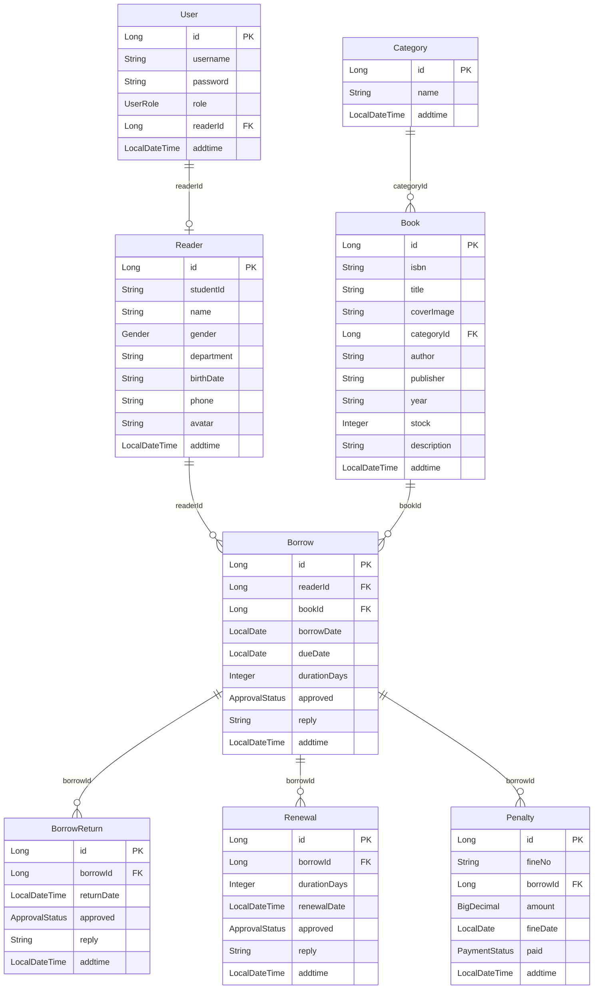

> **Archive Status:** Historical Reference
> **Original Path:** `docs/DATA-MODEL.md`
> **Archived On:** `2026-07-13`
> **Historical Purpose:** 返工前契约或实现记录
> **Superseded By:** `docs/README.md`
> **Authority:** 非规范性；不得作为当前需求、接口、数据或验收契约

# DATA-MODEL - Current Entity Model

This file is the current data-model baseline for MyLibrarySystem.

## Current Actual State

CodeGraph verified on 2026-07-04.

The current backend model contains 8 JPA entities:

- `User`
- `Reader`
- `Book`
- `Category`
- `Borrow`
- `BorrowReturn`
- `Renewal`
- `Penalty`

P4 normalization rule: `BorrowReturn`, `Renewal`, and `Penalty` store `borrowId`. They do not store snapshot fields such as `bookId`, `bookIsbn`, `bookTitle`, `studentId`, or `readerName`. Display fields are assembled in response DTOs through the chain `Borrow -> Reader/Book`.

`News`, `Message`, and `LibraryCard` are planned or legacy reference models only. They are not current `com.library` backend entities.

## Current ER Model

## Entity Definitions

### User

| Field | Type | Notes |
| --- | --- | --- |
| `id` | Long | primary key |
| `username` | String | admin username or reader student ID |
| `password` | String | backend BCrypt hash |
| `role` | `UserRole` | `ADMIN` or `READER` |
| `readerId` | Long | nullable link to `Reader` |
| `addtime` | LocalDateTime | creation time |

### Reader

| Field | Type | Legacy name |
| --- | --- | --- |
| `id` | Long | `id` |
| `studentId` | String | `xueshengxuehao` |
| `name` | String | `xingming` |
| `gender` | `Gender` | `xingbie` |
| `department` | String | `yuanxi` |
| `birthDate` | String | `chushengnianyue` |
| `phone` | String | `shouji` |
| `avatar` | String | `touxiang` |
| `addtime` | LocalDateTime | `addtime` |

### Category

| Field | Type | Legacy name |
| --- | --- | --- |
| `id` | Long | `id` |
| `name` | String | `tushuleibie` |
| `addtime` | LocalDateTime | `addtime` |

### Book

| Field | Type | Legacy name |
| --- | --- | --- |
| `id` | Long | `id` |
| `isbn` | String | `tushubianhao` |
| `title` | String | `tushumingcheng` |
| `coverImage` | String | `tushufengmian` |
| `categoryId` | Long | `tushuleixing` legacy value was a name |
| `author` | String | `zuozhe` |
| `publisher` | String | `chubanshe` |
| `year` | String | `nianfen` |
| `stock` | Integer | `shuliang` |
| `description` | String | `tushuxiangqing` |
| `addtime` | LocalDateTime | `addtime` |

### Borrow

| Field | Type | Notes |
| --- | --- | --- |
| `id` | Long | primary key |
| `readerId` | Long | FK to `Reader` |
| `bookId` | Long | FK to `Book` |
| `borrowDate` | LocalDate | set when borrow is approved/applied by service logic |
| `dueDate` | LocalDate | used for overdue calculation |
| `durationDays` | Integer | requested/approved duration |
| `approved` | `ApprovalStatus` | approval state |
| `reply` | String | approval reply |
| `addtime` | LocalDateTime | creation time |

### BorrowReturn

| Field | Type | Notes |
| --- | --- | --- |
| `id` | Long | primary key |
| `borrowId` | Long | FK to `Borrow` |
| `returnDate` | LocalDateTime | return application/approval date |
| `approved` | `ApprovalStatus` | approval state |
| `reply` | String | approval reply |
| `addtime` | LocalDateTime | creation time |

### Renewal

| Field | Type | Notes |
| --- | --- | --- |
| `id` | Long | primary key |
| `borrowId` | Long | FK to `Borrow` |
| `durationDays` | Integer | renewal duration |
| `renewalDate` | LocalDateTime | renewal application/approval date |
| `approved` | `ApprovalStatus` | approval state |
| `reply` | String | approval reply |
| `addtime` | LocalDateTime | creation time |

### Penalty

| Field | Type | Notes |
| --- | --- | --- |
| `id` | Long | primary key |
| `fineNo` | String | fine number |
| `borrowId` | Long | FK to `Borrow` |
| `amount` | BigDecimal | penalty amount |
| `fineDate` | LocalDate | penalty date |
| `paid` | `PaymentStatus` | payment state |
| `addtime` | LocalDateTime | creation time |

## Response DTO Display Fields

Response DTOs may include joined display fields such as:

- `readerName`
- `studentId`
- `bookTitle`
- `bookIsbn`
- `categoryName`

These fields are not P4 entity snapshot columns. They are derived through repository/service joins or lookups.

## Planned / Legacy Models

| Model | Status |
| --- | --- |
| `News` | Planned P5 / legacy reference only |
| `Message` | Planned P5 / legacy reference only |
| `LibraryCard` | Legacy or future scope; not current backend entity |

Do not use planned/legacy models as current database schema unless the backend implementation is added and this baseline is updated.
