# DATA-MODEL — Entity Definitions & ER Diagram

> Bilingual: EN field names + CN descriptions for business meaning.
> Entity classes use English names (JPA `@Entity`). Field names follow Java camelCase convention.
> Old pinyin names documented in §4 Field Dictionary for cross-reference.

## 1. ER Diagram

```mermaid
erDiagram
    User ||--o{ News : creates
    User ||--o{ Message : replies
    Reader ||--o{ Borrow : submits
    Reader ||--o{ BorrowReturn : submits
    Reader ||--o{ Renewal : submits
    Reader ||--o{ Penalty : receives
    Reader ||--o{ Message : writes
    Reader ||--o| LibraryCard : owns
    Book ||--o{ Borrow : referenced
    Book ||--o{ BorrowReturn : referenced
    Book ||--o{ Renewal : referenced
    Book ||--o{ Penalty : referenced
    Book }o--|| Category : belongs_to

    User {
        Long id PK
        String username "admin login name"
        String password "BCrypt hashed"
        String role "admin"
    }

    Reader {
        Long id PK
        String studentId "学号, unique login"
        String name "姓名"
        String password "BCrypt hashed"
        String gender "性别: 男/女"
        String department "院系"
        String birthDate "出生年月"
        String phone "手机 11-digit"
        String avatar "头像 filename"
    }

    Book {
        Long id PK
        String isbn "图书编号"
        String title "图书名称"
        String author "作者"
        String publisher "出版社"
        String year "年份"
        String coverImage "封面 filename"
        Integer stock "库存数量"
        String description "图书详情 TEXT"
        Long categoryId FK
    }

    Category {
        Long id PK
        String name "类别名"
    }

    Borrow {
        Long id PK
        Long readerId FK
        String readerName "借阅人"
        String studentId "学号"
        Long bookId FK
        String bookIsbn "图书编号"
        String bookTitle "图书名称"
        Date borrowDate "借阅时间"
        String approved "是否审核 sfsh: 是/否"
        String reply "审核回复 shhf"
    }

    BorrowReturn {
        Long id PK
        Long bookId FK
        String bookIsbn
        String bookTitle
        Date returnDate "归还时间"
        String studentId
        String readerName
        String approved "是否审核"
        String reply "审核回复"
    }

    Renewal {
        Long id PK
        Long bookId FK
        String bookIsbn
        String bookTitle
        Date renewalDate "续借时间"
        String studentId
        String readerName
        String approved "是否审核"
        String reply "审核回复"
    }

    Penalty {
        Long id PK
        String fineNo "罚款编号"
        Long bookId FK
        String bookIsbn
        String bookTitle
        BigDecimal amount "罚款金额"
        Date fineDate "罚款时间"
        String studentId
        String readerName
        String paid "是否支付 sfzf: 是/否"
    }

    LibraryCard {
        Long id PK
        String cardNo "卡号"
        String studentId
        String readerName
        Date issueDate "办理时间"
    }

    News {
        Long id PK
        String title "标题"
        String introduction "简介"
        String picture "图片"
        String content "内容 TEXT"
        Date addtime
    }

    Message {
        Long id PK
        Long userId "留言人ID"
        String username "用户名"
        String avatarUrl "头像"
        String content "留言内容"
        String picture "留言图片"
        String reply "回复内容"
        String replyPicture "回复图片"
        Date addtime
    }
```



## 2. Entity Definitions

### 2.1 User (管理员)

> Old class: `UsersEntity` · Old table: `users` · New table: `users`

| Field | Type | Constraint | Description |
|-------|------|-----------|-------------|
| `id` | Long | PK, auto | Primary key |
| `username` | String | unique, not-null | Login account name |
| `password` | String | not-null | BCrypt-encoded |
| `role` | String | — | `admin` |

### 2.2 Reader (读者)

> Old class: `DuzheEntity` · Old table: `duzhe` · New table: `readers`

| Field | Type | Constraint | Old Name | Description |
|-------|------|-----------|----------|-------------|
| `id` | Long | PK, auto | `id` | Primary key |
| `studentId` | String | unique, not-null | `xueshengxuehao` | Student ID for login (学号, 7-digit) |
| `name` | String | not-null | `xingming` | Name (姓名) |
| `password` | String | not-null | `mima` | BCrypt-encoded |
| `gender` | String | — | `xingbie` | Gender (男/女) |
| `department` | String | — | `yuanxi` | Department (院系) |
| `birthDate` | String | — | `chushengnianyue` | Birth date (出生年月) |
| `phone` | String | 11-digit | `shouji` | Phone number (手机) |
| `avatar` | String | — | `touxiang` | Avatar image filename |
| `addtime` | Date | auto | `addtime` | Record creation time |

### 2.3 Book (图书)

> Old class: `TushuxinxiEntity` · Old table: `tushuxinxi` · New table: `books`

| Field | Type | Constraint | Old Name | Description |
|-------|------|-----------|----------|-------------|
| `id` | Long | PK, auto | `id` | Primary key |
| `isbn` | String | — | `tushubianhao` | Book ISBN/code (图书编号) |
| `title` | String | — | `tushumingcheng` | Title (图书名称) |
| `coverImage` | String | — | `tushufengmian` | Cover image filename |
| `categoryId` | Long | FK → categories | `tushuleixing` (stored as name) | Category reference |
| `author` | String | — | `zuozhe` | Author (作者) |
| `publisher` | String | — | `chubanshe` | Publisher (出版社) |
| `year` | String | — | `nianfen` | Publication year (年份) |
| `stock` | Integer | default: 1 | `shuliang` | Available copies (数量) |
| `description` | String | TEXT | `tushuxiangqing` | Book description (图书详情) |
| `addtime` | Date | auto | `addtime` | Record creation time |

> **Design note:** Old system stored category as a string (`tushuleixing`) directly on Book.
> New design uses `categoryId` FK → `categories.id` for normalization.

### 2.4 Category (图书类别)

> Old class: `TushuleibieEntity` · Old table: `tushuleibie` · New table: `categories`

| Field | Type | Constraint | Old Name | Description |
|-------|------|-----------|----------|-------------|
| `id` | Long | PK, auto | `id` | Primary key |
| `name` | String | — | `tushuleibie` | Category name |
| `addtime` | Date | auto | `addtime` | Record creation time |

### 2.5 Borrow (图书借阅)

> Old class: `TushujieyueEntity` · Old table: `tushujieyue` · New table: `borrows`

| Field | Type | Constraint | Old Name | Description |
|-------|------|-----------|----------|-------------|
| `id` | Long | PK, auto | `id` | Primary key |
| `readerId` | Long | FK → readers | — | Reader reference |
| `readerName` | String | — | `jieyueren` | Reader name (借阅人) |
| `studentId` | String | — | `xueshengxuehao` | Student ID |
| `bookId` | Long | FK → books | — | Book reference |
| `bookIsbn` | String | — | `tushubianhao` | Book ISBN |
| `bookTitle` | String | — | `tushumingcheng` | Book title |
| `borrowDate` | Date | — | `jieyueshijian` | Borrow date (借阅时间) |
| `approved` | String | — | `sfsh` | Approved? (是否审核: 是/否) |
| `reply` | String | — | `shhf` | Approval reply (审核回复) |
| `addtime` | Date | auto | `addtime` | Record creation time |

### 2.6 BorrowReturn (图书归还)

> Old class: `TushuguihaiEntity` · Old table: `tushuguihai` · New table: `returns`

| Field | Type | Old Name | Description |
|-------|------|----------|-------------|
| `id` | Long PK | `id` | Primary key |
| `bookId` | Long FK | — | Book reference |
| `bookIsbn` | String | `tushubianhao` | Book ISBN |
| `bookTitle` | String | `tushumingcheng` | Book title |
| `returnDate` | Date | `guihaishijian` | Return date (归还时间) |
| `studentId` | String | `xueshengxuehao` | Student ID |
| `readerName` | String | `xingming` | Reader name |
| `approved` | String | `sfsh` | Approved? (是否审核) |
| `reply` | String | `shhf` | Approval reply |
| `addtime` | Date | `addtime` | Record creation time |

### 2.7 Renewal (图书续借)

> Old class: `TushuxujieEntity` · Old table: `tushuxujie` · New table: `renewals`

| Field | Type | Old Name | Description |
|-------|------|----------|-------------|
| `id` | Long PK | `id` | Primary key |
| `bookId` | Long FK | — | Book reference |
| `bookIsbn` | String | `tushubianhao` | Book ISBN |
| `bookTitle` | String | `tushumingcheng` | Book title |
| `renewalDate` | Date | `xujieshijian` | Renewal date (续借时间) |
| `studentId` | String | `xueshengxuehao` | Student ID |
| `readerName` | String | `xingming` | Reader name |
| `approved` | String | `sfsh` | Approved? (是否审核) |
| `reply` | String | `shhf` | Approval reply |
| `addtime` | Date | `addtime` | Record creation time |

### 2.8 Penalty (超期罚款)

> Old class: `ChaoqifakuanEntity` · Old table: `chaoqifakuan` · New table: `penalties`

| Field | Type | Old Name | Description |
|-------|------|----------|-------------|
| `id` | Long PK | `id` | Primary key |
| `fineNo` | String | `fakuanbianhao` | Fine number (罚款编号) |
| `bookId` | Long FK | — | Book reference |
| `bookIsbn` | String | `tushubianhao` | Book ISBN |
| `bookTitle` | String | `tushumingcheng` | Book title |
| `amount` | BigDecimal | `fakuanjine` | Fine amount (罚款金额) |
| `fineDate` | Date | `fakuanshijian` | Fine date (罚款时间) |
| `studentId` | String | `xueshengxuehao` | Student ID |
| `readerName` | String | `xingming` | Reader name |
| `paid` | String | `sfzf` | Paid? (是否支付: 是/否) |
| `addtime` | Date | `addtime` | Record creation time |

### 2.9 News / Announcement (公告)

> Old class: `NewsEntity` · Old table: `news` · New table: `news`

| Field | Type | Description |
|-------|------|-------------|
| `id` | Long PK | Primary key |
| `title` | String | Title (标题) |
| `introduction` | String | Short intro (简介) |
| `picture` | String | Image filename (图片) |
| `content` | String (TEXT) | Full content (内容) |
| `addtime` | Date | Record creation time |

### 2.10 Message (在线留言)

> Old class: `MessagesEntity` · Old table: `messages` · New table: `messages`

| Field | Type | Description |
|-------|------|-------------|
| `id` | Long PK | Primary key |
| `userId` | Long | Sender user ID (留言人ID) |
| `username` | String | Sender username |
| `avatarUrl` | String | Avatar URL (头像) |
| `content` | String | Message body (留言内容) |
| `picture` | String | Attached image (留言图片) |
| `reply` | String | Admin reply (回复内容) |
| `replyPicture` | String | Reply image (回复图片) |
| `addtime` | Date | Record creation time |

### 2.11 LibraryCard (借阅卡)

> Old class: `JieyuekaEntity` · Old table: `jieyueka` · New table: `library_cards`

| Field | Type | Old Name | Description |
|-------|------|----------|-------------|
| `id` | Long PK | `id` | Primary key |
| `cardNo` | String | `kahao` | Card number (卡号) |
| `studentId` | String | `xueshengxuehao` | Student ID |
| `readerName` | String | `xingming` | Reader name |
| `issueDate` | Date | `banlishijian` | Issue date (办理时间) |
| `addtime` | Date | `addtime` | Record creation time |

## 3. Table Relationships

```
users    1 ── *  news          (admin creates announcement)
users    1 ── *  messages      (admin replies to message)

readers  1 ── *  borrows       (reader submits borrow application)
readers  1 ── *  returns       (reader submits return application)
readers  1 ── *  renewals      (reader submits renewal application)
readers  1 ── *  penalties     (reader receives fine)
readers  1 ── *  messages      (reader writes message)
readers  1 ── 0..1 library_cards  (reader has one library card)

books    1 ── *  borrows       (book is borrowed)
books    1 ── *  returns       (book is returned)
books    1 ── *  renewals      (book is renewed)
books    1 ── *  penalties     (book triggers fine)
books    * ── 1  categories    (book belongs to category)
```

## 4. Field Dictionary (Old → New Quick Reference)

| Old Field (pinyin) | New Field (English) | Type | Meaning |
|-------------------|---------------------|------|---------|
| `xueshengxuehao` | `studentId` | String | 学号 |
| `xingming` | `name` / `readerName` | String | 姓名 |
| `mima` | `password` | String | 密码 |
| `xingbie` | `gender` | String | 性别 |
| `yuanxi` | `department` | String | 院系 |
| `shouji` | `phone` | String | 手机 |
| `touxiang` | `avatar` / `avatarUrl` | String | 头像 |
| `tushubianhao` | `isbn` / `bookIsbn` | String | 图书编号 |
| `tushumingcheng` | `title` / `bookTitle` | String | 图书名称 |
| `tushuleixing` / `tushuleibie` | `categoryId` / `name` | FK/String | 图书类别 |
| `tushufengmian` | `coverImage` | String | 封面 |
| `zuozhe` | `author` | String | 作者 |
| `chubanshe` | `publisher` | String | 出版社 |
| `shuliang` | `stock` | Integer | 数量 |
| `tushuxiangqing` | `description` | Text | 详情 |
| `sfsh` | `approved` | String | 是否审核 (是/否) |
| `shhf` | `reply` | String | 审核回复 |
| `sfzf` | `paid` | String | 是否支付 (是/否) |
| `fakuanjine` | `amount` | BigDecimal | 罚款金额 |
| `kahao` | `cardNo` | String | 卡号 |
| `jieyueren` | `readerName` | String | 借阅人 |

## 5. Enum-Like String Values

The old system uses Chinese strings as boolean/status markers. New system preserves these for frontend compatibility:

| Field | Values | Description |
|-------|--------|-------------|
| `approved` (sfsh) | `是` / `否` | Approval status |
| `paid` (sfzf) | `是` / `否` | Payment status |
| `gender` (xingbie) | `男` / `女` | Gender |
| `role` | `admin` / `reader` | User role |

> **Phase 2 design note:** Consider replacing these with enums/enum-ordinals after frontend migration.

## 6. Database Profiles

### Dev (H2 In-Memory)

```yaml
spring:
  datasource:
    url: jdbc:h2:mem:library;DB_CLOSE_DELAY=-1;MODE=MySQL
  jpa:
    hibernate.ddl-auto: update   # auto-create tables from @Entity
    show-sql: true
```

Zero setup. Tables auto-created from JPA annotations on first run.

### Prod (MySQL 8.0)

```yaml
spring:
  datasource:
    url: jdbc:mysql://localhost:3306/library
    username: root
    password: 123456
  jpa:
    hibernate.ddl-auto: validate  # don't auto-modify prod schema
    show-sql: false
```

Requires pre-created database: `CREATE DATABASE library CHARACTER SET utf8mb4;`
